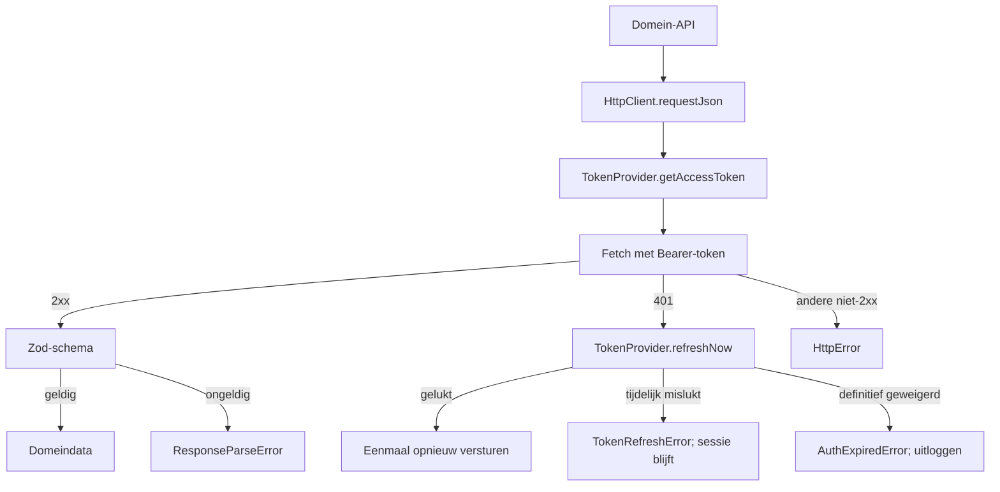

# API en fouten

> Gecontroleerd op: `c0687077` (2026-10-07)
> Bronnen: `src/shared/api/`, `src/shared/query/create-query-client.ts`, `src/domeinen/auth/`, `src/domeinen/allocations/api/`, `src/bootstrap/container.ts`, `src/bootstrap/postal-address-lookup.ts`
> Zie ook: [ADR 0004](../decisions/0004-api-laag.md), [API-contract](../functioneel/api-contract.md), [architectuur](../architecture.md#een-verzoek-met-token)

## Waarvoor

De gedeelde HTTP-laag geeft alle domeinen dezelfde regels voor authenticatie, time-outs,
responsevalidatie en fouten. De foutsoort bepaalt of opnieuw proberen zin heeft en of de sessie kan
blijven bestaan.

## Hoe het werkt

Query's mogen een tijdelijke fout opnieuw proberen. Mutaties doen dat niet automatisch; hun service
beslist of de bevestigde actie in een wachtrij hoort.

## Beweringen

| ID     | Bewering                                                                                                                               | Code                                                                                                                                                                                                                                                                                                                                                                                                                  | Test                                                                                                                                                                                                                                                                                                                                                                                                                                                                 |
| ------ | -------------------------------------------------------------------------------------------------------------------------------------- | --------------------------------------------------------------------------------------------------------------------------------------------------------------------------------------------------------------------------------------------------------------------------------------------------------------------------------------------------------------------------------------------------------------------- | -------------------------------------------------------------------------------------------------------------------------------------------------------------------------------------------------------------------------------------------------------------------------------------------------------------------------------------------------------------------------------------------------------------------------------------------------------------------- |
| API-01 | Een verzoek gebruikt standaard een Bearer-token; een aanroep met `auth: false` verstuurt geen token.                                   | `src/shared/api/http-client.ts`                                                                                                                                                                                                                                                                                                                                                                                       | `src/shared/api/http-client.test.ts`                                                                                                                                                                                                                                                                                                                                                                                                                                 |
| API-02 | Een beveiligd verzoek zonder beschikbare sessie stopt met `AuthExpiredError` voordat het netwerk wordt aangeroepen.                    | `src/shared/api/http-client.ts`                                                                                                                                                                                                                                                                                                                                                                                       | `src/shared/api/http-client.test.ts`                                                                                                                                                                                                                                                                                                                                                                                                                                 |
| API-03 | Na een 401 ververst de client het token eenmaal en verstuurt hetzelfde verzoek eenmaal opnieuw met het nieuwe token.                   | `src/shared/api/http-client.ts`                                                                                                                                                                                                                                                                                                                                                                                       | `src/shared/api/http-client.test.ts`, `src/bootstrap/container.test.ts`                                                                                                                                                                                                                                                                                                                                                                                              |
| API-04 | Een tweede 401 wordt een `HttpError`; hetzelfde verzoek start geen tweede tokenverversing.                                             | `src/shared/api/http-client.ts`                                                                                                                                                                                                                                                                                                                                                                                       | `src/shared/api/http-client.test.ts`                                                                                                                                                                                                                                                                                                                                                                                                                                 |
| API-05 | De standaardtime-out is 30 seconden en geldt voor zowel verbinding als het lezen van de responsebody.                                  | `src/shared/api/http-client.ts`                                                                                                                                                                                                                                                                                                                                                                                       | `src/shared/api/http-client.test.ts`                                                                                                                                                                                                                                                                                                                                                                                                                                 |
| API-06 | Een verzoek zonder antwoord wordt `NetworkError` en een verstreken time-out wordt `TimeoutError`.                                      | `src/shared/api/http-client.ts`                                                                                                                                                                                                                                                                                                                                                                                       | `src/shared/api/http-client.test.ts`                                                                                                                                                                                                                                                                                                                                                                                                                                 |
| API-07 | Een niet-succesvolle HTTP-response wordt `HttpError` met status en, indien aanwezig, bekende `ProblemDetails`-velden.                  | `src/shared/api/http-client.ts`, `src/shared/api/problem-details.ts`, `src/shared/api/errors.ts`                                                                                                                                                                                                                                                                                                                      | `src/shared/api/http-client.test.ts`, `src/shared/api/problem-details.test.ts`, `src/shared/api/errors.test.ts`                                                                                                                                                                                                                                                                                                                                                      |
| API-08 | Een JSON-response die niet aan het opgegeven zod-schema voldoet, wordt `ResponseParseError` met de gevonden schemafouten.              | `src/shared/api/http-client.ts`                                                                                                                                                                                                                                                                                                                                                                                       | `src/shared/api/http-client.test.ts`                                                                                                                                                                                                                                                                                                                                                                                                                                 |
| API-09 | Domeinendpoints die JSON-data lezen valideren die data met `requestJson`; aanroepen zonder bruikbare responsebody gebruiken `request`. | `src/domeinen/allocation-unit/api/allocation-unit-api.ts`, `src/domeinen/allocations/api/allocations-api.ts`, `src/domeinen/auth/api/external-auth-api.ts`, `src/domeinen/notifications/api/push-registration-api.ts`, `src/domeinen/photos/api/photos-api.ts`, `src/domeinen/reference-data/api/reference-data-api.ts`, `src/domeinen/service-form/api/service-form-api.ts`, `src/domeinen/worker/api/worker-api.ts` | `src/domeinen/allocation-unit/api/allocation-unit-api.test.ts`, `src/domeinen/allocations/api/allocations-api.test.ts`, `src/domeinen/auth/api/external-auth-api.test.ts`, `src/domeinen/notifications/api/push-registration-api.test.ts`, `src/domeinen/photos/service/photo-service.test.ts`, `src/domeinen/reference-data/api/reference-data-api.test.ts`, `src/domeinen/service-form/api/service-form-api.test.ts`, `src/domeinen/worker/api/worker-api.test.ts` |
| API-10 | Alleen netwerkfouten, time-outs, tijdelijke tokenrefreshfouten en HTTP 408, 429 of 5xx gelden als retrybaar.                           | `src/shared/api/errors.ts`                                                                                                                                                                                                                                                                                                                                                                                            | `src/shared/api/errors.test.ts`                                                                                                                                                                                                                                                                                                                                                                                                                                      |
| API-11 | Query's proberen een retrybare fout maximaal twee keer opnieuw met oplopende wachttijd; mutaties worden niet automatisch herhaald.     | `src/shared/query/create-query-client.ts`                                                                                                                                                                                                                                                                                                                                                                             | `src/shared/query/create-query-client.test.ts`                                                                                                                                                                                                                                                                                                                                                                                                                       |
| API-12 | Een tijdelijke fout tijdens tokenverversing houdt de sessie in stand en wordt na maximaal drie pogingen een `TokenRefreshError`.       | `src/domeinen/auth/service/token-provider.ts`, `src/domeinen/auth/domain/refresh-policy.ts`                                                                                                                                                                                                                                                                                                                           | `src/domeinen/auth/service/token-provider.test.ts`, `src/bootstrap/container.test.ts`                                                                                                                                                                                                                                                                                                                                                                                |
| API-13 | Alleen een definitief geweigerde refresh, waaronder 401, 403 of `invalid_grant`, beëindigt de sessie.                                  | `src/domeinen/auth/domain/refresh-policy.ts`, `src/domeinen/auth/service/token-provider.ts`                                                                                                                                                                                                                                                                                                                           | `src/domeinen/auth/domain/refresh-policy.test.ts`, `src/domeinen/auth/service/token-provider.test.ts`                                                                                                                                                                                                                                                                                                                                                                |
| API-14 | HTTP-logging bevat methode, pad, status en eventueel trace-id, maar geen request- of responsebody.                                     | `src/shared/api/http-client.ts`                                                                                                                                                                                                                                                                                                                                                                                       | `src/shared/api/http-client.test.ts`, `src/bootstrap/container.test.ts` (privacy)                                                                                                                                                                                                                                                                                                                                                                                    |

| API-15 | Postcode-lookup verstuurt een genormaliseerde postcode zonder spatie en een numeriek huisnummer naar `POST /api/check/zipcode`; een onbruikbare invoer bereikt de API niet. | `src/domeinen/allocations/api/allocations-api.ts`, `src/bootstrap/postal-address-lookup.ts` | `src/domeinen/allocations/api/allocations-api.test.ts`, `src/bootstrap/postal-address-lookup.test.ts` |

## Randgevallen en bewuste keuzes

- Een afgebroken verzoek door de aanroeper blijft een `AbortError`; alleen de eigen time-out wordt
  vertaald naar `TimeoutError`.
- Een lege 2xx-body levert `undefined`. Een domein-API bepaalt vervolgens of dat voor zijn endpoint
  geldig is.
- Tijdelijke refreshfouten loggen de berger niet uit. Dit herstelt regressies 5 en 6 uit
  [bekende fouten](../functioneel/bekende-fouten-oude-app.md).
- De app gebruikt handgeschreven domeinschema's zolang niet vaststaat dat alle omgevingen een
  actuele OpenAPI-specificatie publiceren. Zie [ADR 0004](../decisions/0004-api-laag.md).

## Open vragen

- [Open vraag 9](../functioneel/open-vragen.md): zijn de verschillende OAuth-scopes bij SMS-login
  en verversen bewust?
- [Open vraag 11](../functioneel/open-vragen.md): publiceren alle backendomgevingen een actuele
  OpenAPI-specificatie?
- [Open vragen 20, 21 en 23](../functioneel/open-vragen.md): het gedrag rond een ontbrekende
  eenheid, het soort pushtoken en het id voor afmelden vraagt nog backendbevestiging.
- [Open vragen 24 en 26](../functioneel/open-vragen.md): de vorm van beschikbaarheidsreferentiedata
  en de HTTP-methode voor het serviceformulier zijn nog aannames.
