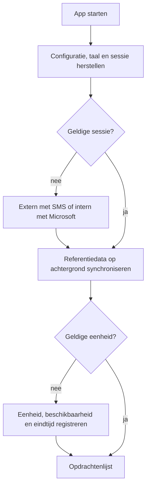
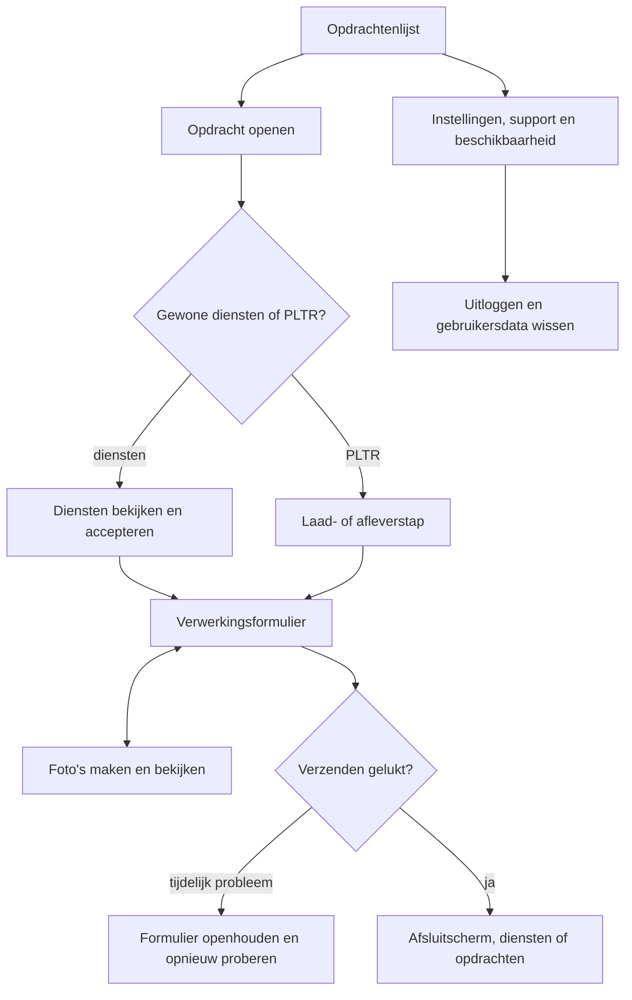

# Applicatieflow

> Gecontroleerd op: `c1506088` (2026-10-07)
> Terugnavigatie (FLOW-21 t/m FLOW-23) gecontroleerd op: `c1506088` (2026-10-09), inclusief lokale wijzigingen. Overige beweringen niet opnieuw gecontroleerd.
> Bronnen: `src/app/`, `src/bootstrap/`, `src/domeinen/`, `src/shared/query/`, `src/shared/ui/navigation.ts`, `docs/functioneel/flows.md`, `docs/roadmap.md`
> Zie ook: [overzicht](overzicht.md), [componenten](componenten.md), [ontwikkelstatus](ontwikkelstatus.md)

## Waarvoor

Deze pagina volgt één berger van appstart tot uitloggen. Hij verbindt de losse onderwerpwiki's tot
één begrijpelijke gebruikersreis en laat zien waar toestel-, opslag- en backendgedrag in die reis
meedoen.

## Hoe het werkt

| Stap | Wat de berger doet                                                                           | Onderwerpwiki                                                                                                                |
| ---- | -------------------------------------------------------------------------------------------- | ---------------------------------------------------------------------------------------------------------------------------- |
| 1    | Start de app en wacht tot de sessie is hersteld.                                             | [Overzicht](overzicht.md), [stores](stores.md)                                                                               |
| 2    | Logt extern met telefoon en SMS-code of intern met Microsoft in.                             | [Inloggen](inloggen.md), [API en fouten](api-en-fouten.md)                                                                   |
| 2b   | Ziet zo nodig de toestemmingswizard (meldingen, locatie, camera).                            | [Toestemmingen](toestemmingen.md)                                                                                            |
| 3    | Registreert zo nodig een eenheid, beschikbaarheid en eindtijd.                               | [Onboarding](onboarding.md), [referentiedata](referentiedata.md)                                                             |
| 4    | Bekijkt, ververst, accepteert, wijst af of draagt opdrachten over.                           | [Opdrachten](opdrachten.md), [beschikbaarheid](beschikbaarheid.md)                                                           |
| 5    | Opent gewone diensten of volgt de laad- en afleverstappen van PLTR.                          | [Diensten](diensten.md), [PLTR](pltr.md), [locatie](locatie.md)                                                              |
| 6    | Vult het formulier in, bewaart een concept en voegt foto's toe.                              | [Verwerkingsformulier](verwerkingsformulier.md), [foto's](fotos.md)                                                          |
| 7    | Laat tijdelijke mutatiefouten later opnieuw versturen en gebruikt de bewaarde lijst offline. | [Offline](offline.md), [outbox](outbox.md)                                                                                   |
| 8    | Wijzigt taal of toestemming, bekijkt meldingen, deelt supportinformatie en logt uit.         | [Instellingen](instellingen.md), [toestemmingen](toestemmingen.md), [pushmeldingen](pushmeldingen.md), [support](support.md) |

## Beweringen

| ID       | Bewering                                                                                                                                                                               | Code                                                                                                                                                                                      | Test                                                                                                                                                                                                                  |
| -------- | -------------------------------------------------------------------------------------------------------------------------------------------------------------------------------------- | ----------------------------------------------------------------------------------------------------------------------------------------------------------------------------------------- | --------------------------------------------------------------------------------------------------------------------------------------------------------------------------------------------------------------------- |
| FLOW-01  | Bij appstart herstelt de container eerst de opgeslagen taal en daarna de sessie; tijdens de onbekende sessiestatus blijft de splash zichtbaar.                                         | `src/bootstrap/container.ts`, `src/app/_layout.tsx`                                                                                                                                       | `src/bootstrap/container.test.ts`                                                                                                                                                                                     |
| FLOW-02  | Een ingelogde sessie geeft toegang tot de app-routes en een uitgelogde sessie tot de loginroutes.                                                                                      | `src/app/_layout.tsx`                                                                                                                                                                     | —                                                                                                                                                                                                                     |
| FLOW-03  | Externe login vraagt een SMS-code aan en wisselt die via de authservice in; interne login gebruikt de native Microsoft-adapter.                                                        | `src/domeinen/auth/screens/login-screen.tsx`, `src/domeinen/auth/service/auth-service.ts`, `src/domeinen/auth/api/external-auth-api.ts`, `src/domeinen/auth/platform/rn/internal-auth.ts` | `src/domeinen/auth/service/auth-service.test.ts`, `src/domeinen/auth/api/external-auth-api.test.ts`, `src/domeinen/auth/platform/rn/internal-auth.test.ts`, `src/bootstrap/container.test.ts`                         |
| FLOW-04  | Zodra een sessie start, synchroniseert de container referentiedata op de achtergrond en hervat een eerder onderbroken batch.                                                           | `src/bootstrap/container.ts`, `src/domeinen/reference-data/service/reference-data-service.ts`                                                                                             | `src/bootstrap/container.test.ts`, `src/domeinen/reference-data/service/reference-data-service.test.ts`                                                                                                               |
| FLOW-05  | De onboardinggate controleert bij iedere start of de eenheid nog bruikbaar is en toont bij benodigde registratie het externe of interne registratiescherm.                             | `src/domeinen/onboarding/hooks/use-onboarding-gate.ts`, `src/domeinen/onboarding/screens/onboarding-gate-screen.tsx`, `src/domeinen/allocation-unit/service/allocation-unit-service.ts`   | `src/domeinen/onboarding/domain/next-step.test.ts`, `src/domeinen/allocation-unit/service/allocation-unit-service.test.ts`                                                                                            |
| FLOW-05b | Zolang de permission-disclosure niet klaar is, stuurt de onboardinggate door naar `/permission-disclosure` vóór eenheidregistratie of de opdrachtenlijst.                              | `src/domeinen/onboarding/screens/onboarding-gate-screen.tsx`, `src/domeinen/settings/hooks/use-permission-disclosure-gate.ts`, `src/domeinen/settings/domain/permission-disclosure.ts`    | `src/domeinen/settings/domain/permission-disclosure.test.ts`                                                                                                                                                          |
| FLOW-06  | De opdrachtenlijst haalt opdrachten en voertuigafgiftes op, groepeert ze en kan beide lijsten tegelijk verversen.                                                                      | `src/domeinen/allocations/screens/allocations-screen.tsx`, `src/domeinen/allocations/hooks/use-allocations.ts`, `src/domeinen/allocations/domain/sections.ts`                             | `src/domeinen/allocations/api/allocations-api.test.ts`, `src/domeinen/allocations/domain/sections.test.ts`                                                                                                            |
| FLOW-07  | Accepteren, afwijzen en afronden van een opdracht lopen via de actionservice; een tijdelijke fout kan de bevestigde mutatie in de outbox zetten.                                       | `src/domeinen/allocations/service/allocation-actions-service.ts`, `src/domeinen/outbox/domain/delivery.ts`                                                                                | `src/domeinen/allocations/service/allocation-actions-service.test.ts`, `src/domeinen/outbox/domain/delivery.test.ts`, `src/bootstrap/container.test.ts`                                                               |
| FLOW-08  | Bij openen van een opdracht haalt de app de volledige diensten op en vult ontbrekende diensttypen zo mogelijk aan.                                                                     | `src/domeinen/allocations/hooks/use-services.ts`, `src/domeinen/allocations/service/hydrate-services.ts`                                                                                  | `src/domeinen/allocations/service/hydrate-services.test.ts`                                                                                                                                                           |
| FLOW-09  | Bij dienst accepteren vraagt de app bevestiging als de actuele positie of het doel onbekend is, of als de afstand minstens 500 meter is.                                               | `src/domeinen/allocations/hooks/use-accept-service.ts`, `src/domeinen/allocations/service/service-actions-service.ts`, `src/domeinen/location/domain/proximity.ts`                        | `src/domeinen/allocations/service/service-actions-service.test.ts`, `src/domeinen/location/domain/proximity.test.ts`                                                                                                  |
| FLOW-10  | Een PLTR-opdracht gebruikt de eerste dienst om de laad- of afleverfase en de eerstvolgende actie te bepalen.                                                                           | `src/domeinen/allocations/screens/pltr-screen.tsx`, `src/domeinen/services/domain/pltr.ts`                                                                                                | `src/domeinen/services/domain/pltr.test.ts`                                                                                                                                                                           |
| FLOW-11  | Het formulier zoekt de definitie op diensttype in alle gesynchroniseerde entiteiten en bouwt daaruit de zichtbare fase en selectopties.                                                | `src/domeinen/service-form/service/service-form-service.ts`, `src/domeinen/service-form/domain/schema.ts`, `src/domeinen/service-form/domain/select-options.ts`                           | `src/domeinen/service-form/service/service-form-service.test.ts`, `src/domeinen/service-form/domain/schema.test.ts`, `src/domeinen/service-form/domain/select-options.test.ts`, `src/bootstrap/container.test.ts`     |
| FLOW-12  | Een gewijzigd formulier wordt bij verlaten als concept bewaard, bij heropenen hersteld en na reset of geslaagde verzending gewist.                                                     | `src/domeinen/service-form/screens/service-form-screen.tsx`, `src/domeinen/service-form/service/draft-storage.ts`                                                                         | `src/domeinen/service-form/service/draft-storage.test.ts`                                                                                                                                                             |
| FLOW-13  | Een formulierverzending controleert eerst of de dienst nog verzendbaar is, verstuurt daarna het formulier en kiest bij succes de volgende route met de gedeelde verwerkingsuitgang.    | `src/domeinen/service-form/service/service-form-service.ts`, `src/domeinen/service-form/api/service-form-api.ts`, `src/domeinen/allocations/hooks/use-processing-exit.ts`                 | `src/domeinen/service-form/service/service-form-service.test.ts`, `src/domeinen/service-form/api/service-form-api.test.ts`, `src/domeinen/services/domain/processing-exit.test.ts`, `src/bootstrap/container.test.ts` |
| FLOW-14  | Een foto wordt eerst lokaal opgeslagen; een tijdelijke uploadfout behoudt bestand en wachtrij-item voor een volgende poging.                                                           | `src/domeinen/photos/service/photo-service.ts`, `src/domeinen/photos/service/photo-repository.ts`                                                                                         | `src/domeinen/photos/service/photo-service.test.ts`, `src/bootstrap/container.test.ts`                                                                                                                                |
| FLOW-15  | De app bewaart geslaagde queryresultaten en uitgaande mutaties lokaal, zodat data na herstel terugkomt en tijdelijke mutatiefouten later opnieuw worden verstuurd.                     | `src/shared/query/query-cache-store.ts`, `src/domeinen/outbox/service/outbox-service.ts`, `src/bootstrap/container.ts`                                                                    | `src/shared/query/query-cache-store.test.ts`, `src/domeinen/outbox/service/outbox-service.test.ts`, `src/bootstrap/container.test.ts`                                                                                 |
| FLOW-16  | Een taalwijziging werkt direct, blijft op het apparaat bewaard en blijft ook na uitloggen gekozen.                                                                                     | `src/domeinen/settings/service/language-settings.ts`, `src/bootstrap/container.ts`                                                                                                        | `src/domeinen/settings/service/language-settings.test.ts`, `src/bootstrap/container.test.ts`                                                                                                                          |
| FLOW-17  | Het toestemmingenscherm leest locatie-, meldingen- en cameratoestemming opnieuw bij focus en kiest per status tussen niets doen, vragen of systeeminstellingen openen.                 | `src/domeinen/settings/screens/permissions-screen.tsx`, `src/domeinen/settings/domain/permission-step.ts`, `src/domeinen/settings/platform/rn/expo-device-permissions.ts`                 | `src/domeinen/settings/domain/permission-step.test.ts`                                                                                                                                                                |
| FLOW-18  | Een beschikbaarheidskeuze loopt via de workerservice en worker-API en ververst daarna het medewerkerrecord.                                                                            | `src/domeinen/worker/hooks/use-set-availability.ts`, `src/domeinen/worker/service/worker-availability-service.ts`, `src/domeinen/worker/api/worker-api.ts`                                | `src/domeinen/worker/service/worker-availability-service.test.ts`, `src/domeinen/worker/api/worker-api.test.ts`                                                                                                       |
| FLOW-19  | Een ontvangen pushbericht wordt gepland als cacheactie en, als het niet is uitgeschakeld, in de lokale historie gezet; uitloggen wist die historie.                                    | `src/domeinen/notifications/service/notification-handler.ts`, `src/domeinen/notifications/service/notification-history.ts`, `src/bootstrap/container.ts`                                  | `src/domeinen/notifications/service/notification-handler.test.ts`, `src/domeinen/notifications/service/notification-history.test.ts`, `src/bootstrap/container.test.ts`                                               |
| FLOW-20  | Uitloggen wist sessie, querycache, outbox, formulierconcepten, foto's, meldingshistorie, permission-disclosure, eenheidsvoorkeuren en alle referentiedata; alleen de taalkeuze blijft. | `src/bootstrap/container.ts`                                                                                                                                                              | `src/bootstrap/container.test.ts`                                                                                                                                                                                     |

### Terugnavigatie vanuit de eenheid

De terugknop van het eenheidoverzicht gaat terug naar het vorige scherm als er
navigatiegeschiedenis is. Vanuit de opdrachtenlijst keert de berger daardoor terug naar het
bestaande dashboard, in plaats van een nieuw dashboard te openen. Alleen zonder geschiedenis
gebruikt de app een vaste terugvalroute.

| ID      | Bewering                                                                                                                                                                 | Code                                                          | Test                                                                   |
| ------- | ------------------------------------------------------------------------------------------------------------------------------------------------------------------------ | ------------------------------------------------------------- | ---------------------------------------------------------------------- |
| FLOW-21 | Als er navigatiegeschiedenis is, gaat de terugknop van het eenheidoverzicht terug naar het vorige scherm zonder een dashboard of instellingenscherm te openen.           | `src/app/(app)/unit/index.tsx`, `src/shared/ui/navigation.ts` | `src/shared/ui/navigation.test.ts` (navigatiehelper)                   |
| FLOW-22 | Zonder navigatiegeschiedenis vervangt de terugknop van het eenheidoverzicht de huidige route door het dashboard als het overzicht niet vanuit eenheidsbeheer is geopend. | `src/app/(app)/unit/index.tsx`, `src/shared/ui/navigation.ts` | `src/shared/ui/navigation.test.ts` (dashboardfallback in de helper)    |
| FLOW-23 | Zonder navigatiegeschiedenis vervangt de terugknop van het eenheidoverzicht de huidige route door instellingen als `returnTo=allocation-unit-management` is meegegeven.  | `src/app/(app)/unit/index.tsx`, `src/shared/ui/navigation.ts` | `src/shared/ui/navigation.test.ts` (instellingenfallback in de helper) |

De tests controleren de navigatiekeuze met een nep-navigator. De routekoppeling is in de code
gecontroleerd; de native stack en animatie zijn niet automatisch getest. Controleer op een
toestel of simulator de route opdrachtenlijst → eenheidoverzicht → terug: een achterwaartse
overgang naar het bestaande dashboard, zonder extra terugknop op het dashboard. Deze regels
gaan alleen over de terugknop van het eenheidoverzicht, niet over opslaan of afronden van de
registratie.

## Randgevallen en bewuste keuzes

- Een tijdelijke fout bij een bevestigde opdracht- of dienstmutatie kan naar de outbox; een
  tijdelijke fout bij het formulier houdt het formulier open met opnieuw proberen.
- Ontbrekende verplichte foto's blokkeren formulierverzending; eerst moeten de ontbrekende posities
  worden gevuld met lokale of al aanwezige CRM-foto's.
- Een onbekende dienststatus blijft zichtbaar als open werk, maar mag niet worden verzonden. Zie
  [statuscodes](statuscodes.md).
- Toestemming weigeren blokkeert de rest van de app niet. Zie
  [toestemmingen](toestemmingen.md).
- De regressies die bewust anders zijn opgelost staan in
  [bekende fouten](../functioneel/bekende-fouten-oude-app.md).

## Open vragen

- De betekenis van enkele opdracht- en dienststatussen staat in open vragen
  [1, 2, 5 en 7](../functioneel/open-vragen.md).
- Backendtaalcodes en formulierverzending staan in open vragen
  [6 en 26](../functioneel/open-vragen.md).
- Live locatie is niet gebouwd zolang open vraag
  [14](../functioneel/open-vragen.md) niet is opgelost. Eenheid afmelden zit in vrijwillig
  uitloggen (open vraag 23 gesloten).
- Een echt pushbericht vereist bevestiging van de Expo-pushketen uit open vraag
  [21](../functioneel/open-vragen.md).
- Formuliervelden met datum, decimalen en landen volgen de aannames uit open vragen
  [27, 28 en 29](../functioneel/open-vragen.md).
