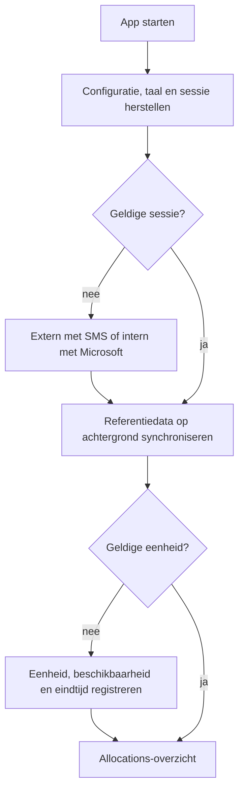
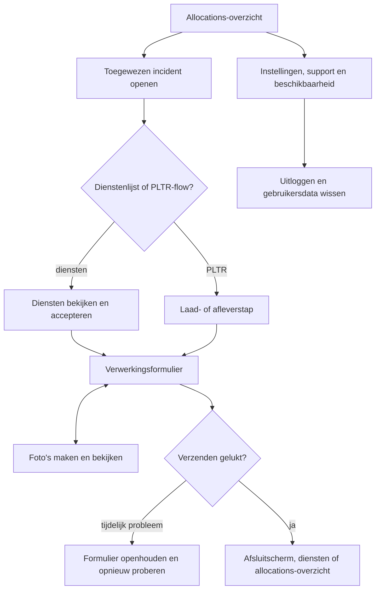
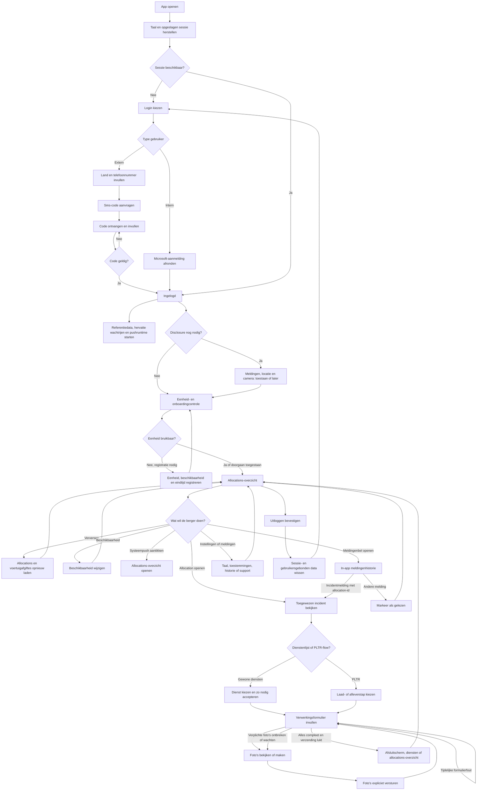
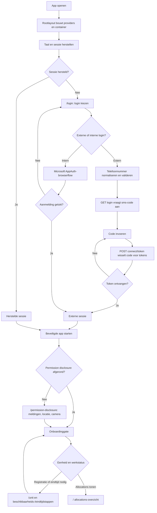
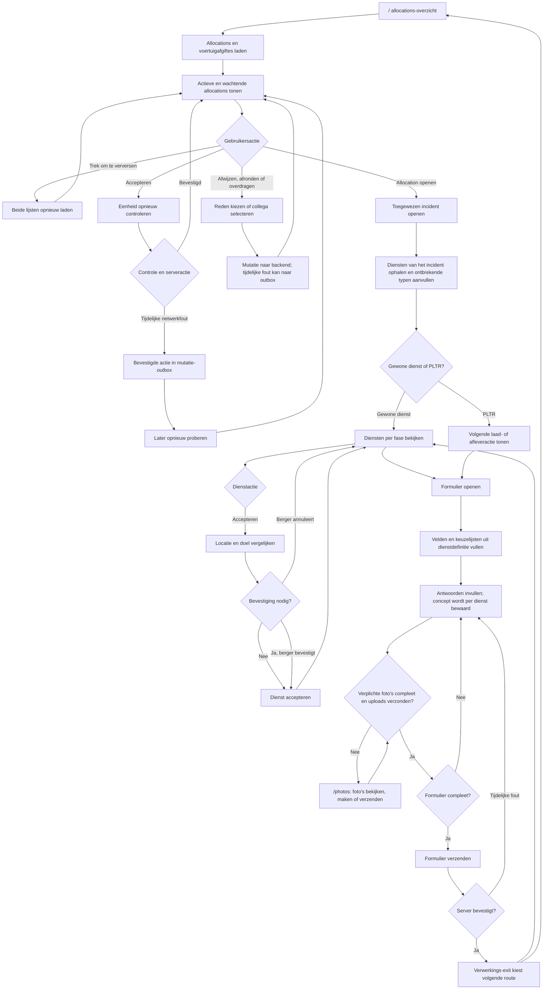
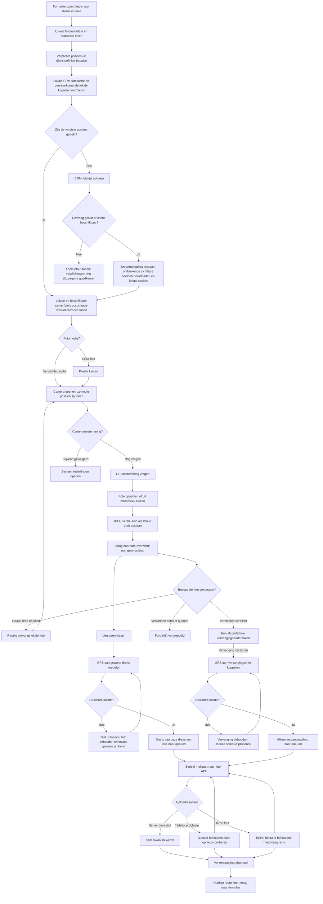
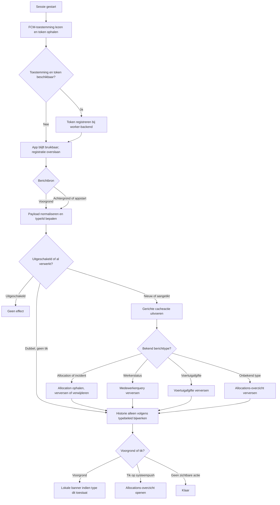
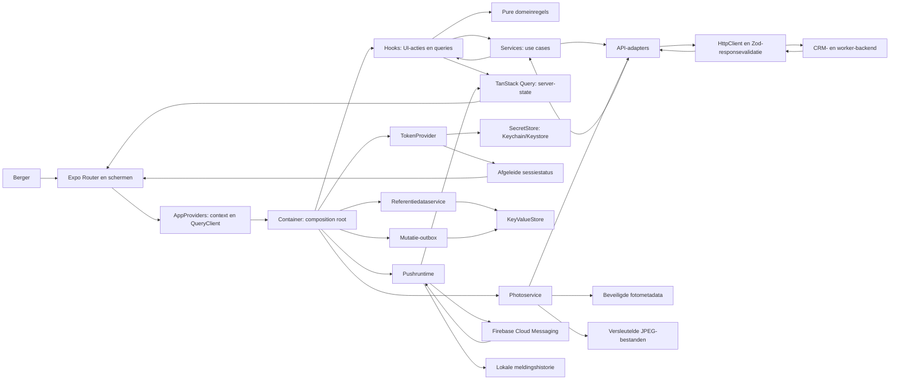
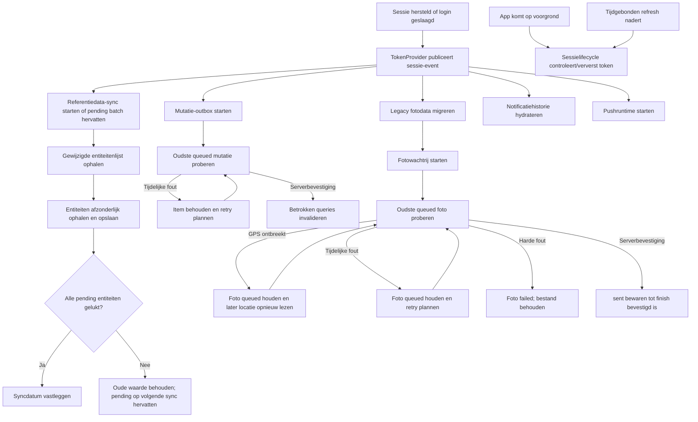

# Applicatieflow

> Gecontroleerd op: `c0127855` (2026-10-17; nieuwe flows en routekoppelingen)
> De bestaande beweringen FLOW-01 t/m FLOW-23 zijn behouden en niet allemaal opnieuw per regel geaudit. Terugnavigatie FLOW-21 t/m FLOW-23 was eerder gecontroleerd op `c1506088` (2026-10-09), inclusief lokale wijzigingen.
> Bronnen: `src/app/`, `src/bootstrap/`, `src/domeinen/`, `src/shared/query/`, `src/shared/ui/navigation.ts`, `docs/functioneel/flows.md`, `docs/roadmap.md`, onderwerpwiki's waarnaar hieronder wordt gelinkt
> Zie ook: [overzicht](overzicht.md), [componenten](componenten.md), [ontwikkelstatus](ontwikkelstatus.md)

## Waarvoor

Deze pagina volgt één berger van appstart tot uitloggen. Hij verbindt de losse onderwerpwiki's tot
één begrijpelijke gebruikersreis en laat zien waar toestel-, opslag- en backendgedrag in die reis
meedoen.

**Terminologie:** een `worker` heeft één of meer `allocations`. Elke allocation is een incident dat
aan die worker is toegewezen. De allocation bevat de incidentgegevens en de diensten van dat
incident. Het type van de allocation volgt uit de eerste dienst en bepaalt welke route opent: de
PLTR-flow of de gewone dienstenlijst. Een allocation is dus niet zelf een dienst of PLTR.

## Hoe het werkt





| Stap | Wat de berger doet                                                                           | Onderwerpwiki                                                                                                                |
| ---- | -------------------------------------------------------------------------------------------- | ---------------------------------------------------------------------------------------------------------------------------- |
| 1    | Start de app en wacht tot de sessie is hersteld.                                             | [Overzicht](overzicht.md), [stores](stores.md)                                                                               |
| 2    | Logt extern met telefoon en SMS-code of intern met Microsoft in.                             | [Inloggen](inloggen.md), [API en fouten](api-en-fouten.md)                                                                   |
| 2b   | Ziet zo nodig de toestemmingswizard (meldingen, locatie, camera).                            | [Toestemmingen](toestemmingen.md)                                                                                            |
| 3    | Registreert zo nodig een eenheid, beschikbaarheid en eindtijd.                               | [Onboarding](onboarding.md), [referentiedata](referentiedata.md)                                                             |
| 4    | Bekijkt, ververst, accepteert, wijst af of draagt allocations (toegewezen incidenten) over.  | [Allocations en acties](opdrachten.md), [beschikbaarheid](beschikbaarheid.md)                                                |
| 5    | Opent gewone diensten of volgt de laad- en afleverstappen van PLTR.                          | [Diensten](diensten.md), [PLTR](pltr.md), [locatie](locatie.md)                                                              |
| 6    | Vult het formulier in, bewaart een concept en voegt foto's toe.                              | [Verwerkingsformulier](verwerkingsformulier.md), [foto's](fotos.md)                                                          |
| 7    | Laat tijdelijke mutatiefouten later opnieuw versturen en gebruikt de bewaarde lijst offline. | [Offline](offline.md), [outbox](outbox.md)                                                                                   |
| 8    | Wijzigt taal of toestemming, bekijkt meldingen, deelt supportinformatie en logt uit.         | [Instellingen](instellingen.md), [toestemmingen](toestemmingen.md), [pushmeldingen](pushmeldingen.md), [support](support.md) |

## Uitgebreide flows

De schema's hieronder geven twee gezichtspunten op dezelfde applicatie: eerst wat de berger
doorloopt, daarna welke routes, services, opslag en backendverzoeken daarbij betrokken zijn. De
details per onderwerp blijven leidend; links staan bij de stappen. Een pijl naar een achtergrondtaak
betekent dat de app die taak start of hervat bij een sessie- of app-event, niet dat het besturingssysteem
een continue synchronisatie garandeert.

### 1. De volledige gebruikersreis



De loginroutes, permission disclosure, onboardinggate, allocations-overzicht en formulier hebben elk een
eigen onderwerpwiki: [inloggen](inloggen.md), [toestemmingen](toestemmingen.md),
[onboarding en eenheid](onboarding.md), [allocation-acties](opdrachten.md),
[diensten](diensten.md), [PLTR](pltr.md) en
[verwerkingsformulier](verwerkingsformulier.md).

### 2. Login, sessie en startscherm



De externe gebruiker vraagt een sms-code aan en voert die in; een onjuiste of verlopen code geeft
herstelbare feedback. De interne gebruiker meldt zich aan via de native Microsoft/AppAuth-flow. Een
herstelbare fout bij sessieverversing logt de gebruiker niet uit; een definitief geweigerde refresh
beëindigt de sessie. De permission-wizard kan per stap worden uitgesteld; geweigerde toestemming
blokkeert de rest van de app niet. Camera- en locatiefunctionaliteit kunnen later alsnog om hun
benodigde toestemming vragen. Zie [openstaande validaties](ontwikkelstatus.md) en
[inloggen](inloggen.md).

### 3. Allocations, incidenten, diensten en formulier



Bij openen van een allocation haalt de app de volledige dienstenlijst van het toegewezen incident op; alleen diensten zonder
diensttype worden zo nodig aanvullend per id opgehaald. Bij dienstacceptatie vraagt de app om
bevestiging als de actuele positie, het doel of de afstand onbekend is, of als de afstand ten minste
500 meter is. Het formulier gebruikt referentiedata voor zijn definitie, bewaart wijzigingen als
concept en controleert bij verzenden de actuele dienststatus, verplichte velden en foto's. De
bestemming na verwerken hangt af van de dienst- en allocationstatus; het is niet altijd hetzelfde
scherm. Zie [diensten](diensten.md), [PLTR](pltr.md),
[formulier](verwerkingsformulier.md), [locatie](locatie.md) en
[offline werken](offline.md).

### 4. Foto's: ophalen, bekijken, maken en versturen



**Welke foto wordt gebruikt?** De app leest eerst de lokale lijst en de eerder gecachete CRM-foto's.
Een lokale foto kan een overeenkomstige serverfoto representeren; zo telt dezelfde opname niet twee
keer. Als verplichte posities daarmee niet zijn gevuld, vraagt de app de CRM-fotolijst op. De
servermetadata wordt gecachet; voor een serverfoto zonder lokale kopie kan de app het beeld
downloaden en versleuteld bewaren. Bij een netwerkfout gebruikt de app een aanwezige cache. Zonder
bruikbare serverrespons of cache blijft de lookup onbetrouwbaar en mag die niet als complete
verplichting worden behandeld. Een bestaande verplichte lokale foto kan een serveropvraag overbodig
maken als zij de vereiste posities al dekt. Zie [Foto's, lokaal en server](fotos.md).

**Wat kan opnieuw worden gemaakt?**

| Foto in het overzicht     | Actie                                                                                           |
| ------------------------- | ----------------------------------------------------------------------------------------------- |
| Lokale `draft`            | Opnieuw maken of verwijderen.                                                                   |
| Lokale `failed`           | Opnieuw proberen; de lokale opname blijft beschikbaar om te vervangen.                          |
| `queued`                  | Niet verwijderen of opnieuw maken zolang de upload loopt.                                       |
| Verzonden verplichte foto | Afzonderlijk vervangen; de bestaande serverfoto blijft staan totdat de vervanging is bevestigd. |
| Verzonden extra foto      | Vergrendeld; geen vervangactie vanuit het overzicht.                                            |
| Fase-1-history in fase 2  | Alleen bekijken; de strip is referentie voor de afleverfoto's.                                  |

In een tweefasen-dienst wordt iedere werkelijk gemaakte fase-1-foto een afzonderlijke verplichte
tegenfoto in fase 2, ook als het een extra of herhaalde positie was. Een eenfasige dienst toont geen
fasehistory. Foto's die al `sent` zijn blijven lokaal bewaard totdat de server de allocation heeft afgerond
heeft bevestigd of de gebruiker uitlogt. De expliciete **Versturen**-actie vraagt eerst de GPS-fix
op en biedt daarna de foto's van de huidige dienst/fase aan. GPS wordt dus niet bij de cameraknop
vastgelegd. Alleen in de development-simulator bestaat een vaste foto-GPS-fallback; die geldt niet
voor GPS-status of nabijheidscontrole en niet voor een fysiek toestel/releasebuild. Zie
[foto's](fotos.md), [toestemmingen](toestemmingen.md) en [offline werken](offline.md).

**Belangrijk meetpunt:** `submitBatch` en `submitOverride` kunnen afronden terwijl een foto
`queued` blijft voor een latere poging of `failed` is geworden. Het huidige overzicht behandelt een
resolve van de submit-promise als succes en navigeert terug; dat bewijst dus niet dat alle foto's
`sent` zijn. Controleer bij klantacceptatie de foto's daarna opnieuw in het overzicht en vergelijk
de status met wat de UI meldde. Dit is een concrete flow die apart op toestel moet worden bevestigd.

### 5. Pushmeldingen en in-app historie



De pushmelding is een verversingssignaal; de backend blijft de bron van waarheid. Een tik op een
systeempush opent het allocations-overzicht, niet automatisch een specifiek incidentdetail. Dat is
anders dan een tik op een incidentmelding in de in-app historie: die opent het toegewezen incident
als een allocation-id bekend is; andere meldingen worden alleen als gelezen gemarkeerd. De in-app meldingenlijst is een lokale
historie met filters en gelezen-status. Of echte FCM-berichten in een klantomgeving aankomen
hangt ook af van native Firebase-configuratie, toestemming en backendverzending. Zie
[pushmeldingen](pushmeldingen.md), [toestemmingen](toestemmingen.md) en
[ontwikkelstatus](ontwikkelstatus.md).

### 6. Instellingen, beschikbaarheid, support en uitloggen

Vanaf de app-header opent de berger [Instellingen](instellingen.md). Daar zijn onder meer taal,
toestemmingen, referentiedata-/syncstatus, support en uitloggen beschikbaar. De werkerstatus opent
via [Beschikbaarheid](beschikbaarheid.md); die wijziging gaat via de worker-service naar de API en
ververst de workerquery. De syncstatus toont resultaten van referentiedata en kan een mislukte
entiteit opnieuw proberen; er is geen apart voortgangsscherm tijdens de automatische sync. Support
kan een geredigeerd log via de systeemdeelactie delen.

Bij uitloggen beëindigt de app de sessie en wist zij gebruikersgebonden cache, outbox, fotodata,
formulierconcepten, meldingshistorie, disclosurevoortgang en referentiedata volgens de huidige
implementatie. De taalkeuze blijft als apparaatvoorkeur behouden. Zie
[instellingen](instellingen.md), [support](support.md), [stores](stores.md) en
[opslagsleutels](opslagsleutels.md).

### 7. Technische flow: scherm naar backend en opslag



De routebestanden kiezen schermen; zij bouwen geen domeinservices. `container.ts` verbindt de
services met API's, opslag, klok, scheduler, locatielezer en pushgateway. Servergegevens lopen via
TanStack Query. De Query-cache bewaart alleen geslaagde queryresultaten. Bevestigde mutaties en
foto's hebben elk een eigen duurzame wachtrij; zij zijn niet dezelfde soort offline data. Tokens
worden alleen door de `TokenProvider` beheerd en staan in beveiligde opslag. Zie
[componenten en routes](componenten.md), [architectuur](../architecture.md),
[stores](stores.md), [API en fouten](api-en-fouten.md) en
[offline werken](offline.md).

### 8. Technische flow: sessie-events en achtergrondwerk



Referentiedata-sync wordt bij een nieuwe of herstelde sessie gestart en hervat een opgeslagen
pending batch. De nieuwe syncdatum wordt pas vastgelegd als alle entiteiten van die batch gelukt
zijn; er is geen voortgangsbalk. De sessielifecycle ververst tokens vóór verlopen en bij terugkeer
naar de voorgrond. De mutatie-outbox bevat alleen al door de berger bevestigde acties; formulier-
inhoud en gewone queryfouten worden niet automatisch ingepland. De fotowachtrij verwerkt pas
opnames die expliciet verstuurd zijn. Een tijdelijke fout aan het hoofd houdt latere items tegen.
Dit beschrijft eventgestuurd werk van de app; het belooft geen periodieke OS-background-fetch als de
app door iOS of Android is beëindigd. Zie [referentiedata](referentiedata.md),
[offline werken](offline.md) en [sessies](inloggen.md).

### 9. Technische flow: foto-GPS en upload

```mermaid
sequenceDiagram
  actor Berger
  participant Overview as Foto-overzicht
  participant PhotoService as Photoservice
  participant Local as Beveiligde lokale opslag
  participant Location as LocationReader
  participant API as Foto-API
  Berger->>Overview: Versturen
  Overview->>PhotoService: attachLocation(service, phase)
  PhotoService->>Local: Drafts zonder coordinate lezen
  PhotoService->>Location: Eenmalige actuele fix opvragen
  Location-->>PhotoService: Coordinate of geen bruikbare fix
  alt Geen bruikbare fix
    PhotoService-->>Overview: false
    Overview-->>Berger: Locatie ontbreekt; foto's blijven lokaal
  else Fix beschikbaar
    PhotoService->>Local: Coordinate aan passende drafts koppelen
    Overview->>PhotoService: submitBatch(service, phase)
    PhotoService->>Local: Drafts van alleen deze dienst/fase queued maken
    loop Seriële wachtrij
      PhotoService->>Local: JPEG-bytes en metadata lezen
      PhotoService->>API: Multipart upload met GPS, positie, fasegegevens en JPEG
      alt Server bevestigt
        API-->>PhotoService: Succes
        PhotoService->>Local: Status sent bewaren
      else Tijdelijk probleem
        API-->>PhotoService: Retrybaar probleem
        PhotoService->>Local: queued behouden; later opnieuw proberen
      else Harde fout
        API-->>PhotoService: Niet-herhaalbare fout
        PhotoService->>Local: failed bewaren; bestand behouden
      end
    end
    PhotoService-->>Overview: Wachtrijresultaat
    Overview-->>Berger: Huidige UI toont succes en navigeert terug als de submit-promise resolveert
  end
```

Een vervanging van een reeds verzonden verplichte foto gebruikt `submitOverride(photoId)` en biedt
alleen die ene foto aan; zij gaat niet mee in de gewone fasebatch. Het bestaande serverrecord blijft
intact totdat de nieuwe upload door de server is bevestigd. Bij een hard afgewezen foto kan de
berger vanuit het overzicht handmatig opnieuw proberen. De exacte uploadvelden en mapping staan in
[Foto's](fotos.md) en het [API-contract](../functioneel/api-contract.md).

### 10. Routes in de gebruikersreis

| Moment                | Route of scherm                                 | Wat de berger hier doet                                                                          |
| --------------------- | ----------------------------------------------- | ------------------------------------------------------------------------------------------------ |
| Niet aangemeld        | `/login`                                        | Externe SMS-aanmelding of interne Microsoft-aanmelding kiezen.                                   |
| Beveiligde start      | `/`                                             | Permission disclosure en onboardinggate; daarna allocations-overzicht of benodigde eenheidsstap. |
| Toestemmingen         | `/permission-disclosure`, `/permissions`        | Wizard na aanmelden of later toestemmingen beheren.                                              |
| Eenheid en diensttijd | `/unit` en onderliggende eenheidsroutes         | Voertuig/eindtijd registreren of wijzigen.                                                       |
| Dagelijks werk        | `/` en `/availability`                          | Allocations/voertuigafgiftes bekijken en beschikbaarheid wijzigen.                               |
| Allocation/incident   | `/allocations/[id]`                             | Een toegewezen incident openen; daarin de dienstenlijst of PLTR-flow bekijken.                   |
| Dienstformulier       | `/allocations/[id]/services/[serviceId]/form`   | Formulier invullen, concept hervatten en verzenden.                                              |
| Foto's                | `/allocations/[id]/services/[serviceId]/photos` | Foto's beoordelen, maken, vervangen, verwijderen waar toegestaan en versturen.                   |
| Foto-positie/camera   | `.../photos/position`, `.../photos/camera`      | Extra positie kiezen of een foto opnemen; na opslag terug naar het foto-overzicht.               |
| Meldingen             | `/notifications`                                | Lokale pushhistorie lezen en incidentmeldingen openen.                                           |
| Instellingen en hulp  | `/settings`, `/language`, `/support`            | Taal, toestemming, synchronisatiestatus, support en uitloggen beheren.                           |

De routecatalogus met de volledige route- en schermlijst staat in
[Componenten en routes](componenten.md). Routegroepen tussen haakjes zijn geen zichtbaar URL-deel.

### 11. Klantcontrole: stappen en verwacht bewijs

| Controle                | Actie                                                                                                            | Verwacht zichtbaar resultaat                                                                                                                                                                                    | Wat technisch mee moet kloppen                                                                                        |
| ----------------------- | ---------------------------------------------------------------------------------------------------------------- | --------------------------------------------------------------------------------------------------------------------------------------------------------------------------------------------------------------- | --------------------------------------------------------------------------------------------------------------------- |
| Sessieherstel           | Sluit en open de app met een geldige sessie.                                                                     | Splash tijdens herstel, daarna de beveiligde start zonder opnieuw in te loggen.                                                                                                                                 | Sessie uit beveiligde opslag; token gebruikt voor API-verzoeken.                                                      |
| Externe login           | Vraag een code aan en meld aan met geldige en ongeldige codes.                                                   | Geldige code gaat door; ongeldige/verlopen code geeft herstelbare feedback.                                                                                                                                     | SMS-aanvraag, tokenuitwisseling en geen tokens/codes in logs.                                                         |
| Interne login           | Meld aan met een intern Microsoft-account.                                                                       | Terugkeer naar de beveiligde start.                                                                                                                                                                             | Native AppAuth-flow en interne sessie.                                                                                |
| Eerste beveiligde start | Doorloop de disclosure en onboarding met benodigde testgegevens.                                                 | Toestemmingen kunnen worden toegestaan of uitgesteld; eenheidstappen verschijnen alleen als de gate ze nodig heeft.                                                                                             | Permissionstatus, worker-/eenheidscontrole en eventuele referentiedata.                                               |
| Allocations-overzicht   | Open de lijst en trek om te verversen.                                                                           | Allocations en voertuigafgiftes worden bijgewerkt.                                                                                                                                                              | Beide queries verversen; alleen succesvolle serverresultaten worden cachebaar.                                        |
| Incident/dienst         | Open een allocation en accepteer een dienst op korte, verre en onbekende locatie.                                | Diensten van het toegewezen incident verschijnen; waar de nabijheidsregel dat vereist wordt om bevestiging gevraagd.                                                                                            | Volledige diensten ophalen, locatiebeslissing en juiste serviceactie.                                                 |
| Formulier en foto's     | Vul velden in, verlaat/heropen het formulier, maak foto's en verstuur.                                           | Concept wordt hersteld; lokale foto's verschijnen vóór verzending; ontbrekende verplichte beelden blokkeren formulierverzending. Een succesmelding moet worden vergeleken met de werkelijke foto-`sent`-status. | Concept per dienst, fotofase/posities, GPS bij verzending en bevestiging dat alle uploads `sent` zijn.                |
| Offline mutatie         | Bevestig een ondersteunde actie tijdelijk zonder netwerk.                                                        | De actie krijgt een wachtstatus en wordt na herstel opnieuw aangeboden.                                                                                                                                         | Alleen bevestigde mutaties in de outbox; query's verversen na serverbevestiging.                                      |
| Push                    | Geef toestemming, registreer toestel en stuur een backendtestbericht naar voorgrond, achtergrond en koude start. | Voorgrondbanner/historie en bij aantikken het allocations-overzicht.                                                                                                                                            | FCM-tokenregistratie, payload parsing, deduplicatie en cacheactie. Dit vereist toestel-, Firebase- en backendtoegang. |
| Uitloggen               | Log uit en meld opnieuw aan.                                                                                     | Login verschijnt; gebruikersdata van de vorige sessie is niet meer zichtbaar.                                                                                                                                   | Querycache, outbox, fotodata, concepten en meldingshistorie worden gewist; taalvoorkeur blijft.                       |

Gebruik [Klantacceptatie](klantacceptatie.md) voor afzonderlijke scenario's en
[Ontwikkelstatus](ontwikkelstatus.md) om gebouwde functionaliteit te onderscheiden van flows die
nog niet op toestel of backend zijn bevestigd. Noteer bij een mislukte stap route, tijdstip,
zichtbare melding en of het toestel online was; deel geen sms-code, token of persoonsgegevens.

## Beweringen

| ID       | Bewering                                                                                                                                                                               | Code                                                                                                                                                                                      | Test                                                                                                                                                                                                                  |
| -------- | -------------------------------------------------------------------------------------------------------------------------------------------------------------------------------------- | ----------------------------------------------------------------------------------------------------------------------------------------------------------------------------------------- | --------------------------------------------------------------------------------------------------------------------------------------------------------------------------------------------------------------------- |
| FLOW-01  | Bij appstart herstelt de container eerst de opgeslagen taal en daarna de sessie; tijdens de onbekende sessiestatus blijft de splash zichtbaar.                                         | `src/bootstrap/container.ts`, `src/app/_layout.tsx`                                                                                                                                       | `src/bootstrap/container.test.ts`                                                                                                                                                                                     |
| FLOW-02  | Een ingelogde sessie geeft toegang tot de app-routes en een uitgelogde sessie tot de loginroutes.                                                                                      | `src/app/_layout.tsx`                                                                                                                                                                     | —                                                                                                                                                                                                                     |
| FLOW-03  | Externe login vraagt een SMS-code aan en wisselt die via de authservice in; interne login gebruikt de native Microsoft-adapter.                                                        | `src/domeinen/auth/screens/login-screen.tsx`, `src/domeinen/auth/service/auth-service.ts`, `src/domeinen/auth/api/external-auth-api.ts`, `src/domeinen/auth/platform/rn/internal-auth.ts` | `src/domeinen/auth/service/auth-service.test.ts`, `src/domeinen/auth/api/external-auth-api.test.ts`, `src/domeinen/auth/platform/rn/internal-auth.test.ts`, `src/bootstrap/container.test.ts`                         |
| FLOW-04  | Zodra een sessie start, synchroniseert de container referentiedata op de achtergrond en hervat een eerder onderbroken batch.                                                           | `src/bootstrap/container.ts`, `src/domeinen/reference-data/service/reference-data-service.ts`                                                                                             | `src/bootstrap/container.test.ts`, `src/domeinen/reference-data/service/reference-data-service.test.ts`                                                                                                               |
| FLOW-05  | De onboardinggate controleert bij iedere start of de eenheid nog bruikbaar is en toont bij benodigde registratie het externe of interne registratiescherm.                             | `src/domeinen/onboarding/hooks/use-onboarding-gate.ts`, `src/domeinen/onboarding/screens/onboarding-gate-screen.tsx`, `src/domeinen/allocation-unit/service/allocation-unit-service.ts`   | `src/domeinen/onboarding/domain/next-step.test.ts`, `src/domeinen/allocation-unit/service/allocation-unit-service.test.ts`                                                                                            |
| FLOW-05b | Zolang de permission-disclosure niet klaar is, stuurt de onboardinggate door naar `/permission-disclosure` vóór eenheidsregistratie of het allocations-overzicht.                      | `src/domeinen/onboarding/screens/onboarding-gate-screen.tsx`, `src/domeinen/settings/hooks/use-permission-disclosure-gate.ts`, `src/domeinen/settings/domain/permission-disclosure.ts`    | `src/domeinen/settings/domain/permission-disclosure.test.ts`                                                                                                                                                          |
| FLOW-06  | Het allocations-overzicht haalt allocations en voertuigafgiftes op, groepeert ze en kan beide lijsten tegelijk verversen.                                                              | `src/domeinen/allocations/screens/allocations-screen.tsx`, `src/domeinen/allocations/hooks/use-allocations.ts`, `src/domeinen/allocations/domain/sections.ts`                             | `src/domeinen/allocations/api/allocations-api.test.ts`, `src/domeinen/allocations/domain/sections.test.ts`                                                                                                            |
| FLOW-07  | Accepteren, afwijzen en afronden van een allocation lopen via de actionservice; een tijdelijke fout kan de bevestigde mutatie in de outbox zetten.                                     | `src/domeinen/allocations/service/allocation-actions-service.ts`, `src/domeinen/outbox/domain/delivery.ts`                                                                                | `src/domeinen/allocations/service/allocation-actions-service.test.ts`, `src/domeinen/outbox/domain/delivery.test.ts`, `src/bootstrap/container.test.ts`                                                               |
| FLOW-08  | Bij openen van een allocation haalt de app de diensten van het toegewezen incident op en vult ontbrekende diensttypen zo mogelijk aan.                                                 | `src/domeinen/allocations/hooks/use-services.ts`, `src/domeinen/allocations/service/hydrate-services.ts`                                                                                  | `src/domeinen/allocations/service/hydrate-services.test.ts`                                                                                                                                                           |
| FLOW-09  | Bij dienst accepteren vraagt de app bevestiging als de actuele positie of het doel onbekend is, of als de afstand minstens 500 meter is.                                               | `src/domeinen/allocations/hooks/use-accept-service.ts`, `src/domeinen/allocations/service/service-actions-service.ts`, `src/domeinen/location/domain/proximity.ts`                        | `src/domeinen/allocations/service/service-actions-service.test.ts`, `src/domeinen/location/domain/proximity.test.ts`                                                                                                  |
| FLOW-10  | De PLTR-flow binnen een allocation gebruikt de eerste dienst om de laad- of afleverfase en de eerstvolgende actie te bepalen.                                                          | `src/domeinen/allocations/screens/pltr-screen.tsx`, `src/domeinen/services/domain/pltr.ts`                                                                                                | `src/domeinen/services/domain/pltr.test.ts`                                                                                                                                                                           |
| FLOW-11  | Het formulier zoekt de definitie op diensttype in alle gesynchroniseerde entiteiten en bouwt daaruit de zichtbare fase en selectopties.                                                | `src/domeinen/service-form/service/service-form-service.ts`, `src/domeinen/service-form/domain/schema.ts`, `src/domeinen/service-form/domain/select-options.ts`                           | `src/domeinen/service-form/service/service-form-service.test.ts`, `src/domeinen/service-form/domain/schema.test.ts`, `src/domeinen/service-form/domain/select-options.test.ts`, `src/bootstrap/container.test.ts`     |
| FLOW-12  | Een gewijzigd formulier wordt bij verlaten als concept bewaard, bij heropenen hersteld en na reset of geslaagde verzending gewist.                                                     | `src/domeinen/service-form/screens/service-form-screen.tsx`, `src/domeinen/service-form/service/draft-storage.ts`                                                                         | `src/domeinen/service-form/service/draft-storage.test.ts`                                                                                                                                                             |
| FLOW-13  | Een formulierverzending controleert eerst of de dienst nog verzendbaar is, verstuurt daarna het formulier en kiest bij succes de volgende route met de gedeelde verwerkingsuitgang.    | `src/domeinen/service-form/service/service-form-service.ts`, `src/domeinen/service-form/api/service-form-api.ts`, `src/domeinen/allocations/hooks/use-processing-exit.ts`                 | `src/domeinen/service-form/service/service-form-service.test.ts`, `src/domeinen/service-form/api/service-form-api.test.ts`, `src/domeinen/services/domain/processing-exit.test.ts`, `src/bootstrap/container.test.ts` |
| FLOW-14  | Een foto wordt eerst lokaal opgeslagen; een tijdelijke uploadfout behoudt bestand en wachtrij-item voor een volgende poging.                                                           | `src/domeinen/photos/service/photo-service.ts`, `src/domeinen/photos/service/photo-repository.ts`                                                                                         | `src/domeinen/photos/service/photo-service.test.ts`, `src/bootstrap/container.test.ts`                                                                                                                                |
| FLOW-15  | De app bewaart geslaagde queryresultaten en uitgaande mutaties lokaal, zodat data na herstel terugkomt en tijdelijke mutatiefouten later opnieuw worden verstuurd.                     | `src/shared/query/query-cache-store.ts`, `src/domeinen/outbox/service/outbox-service.ts`, `src/bootstrap/container.ts`                                                                    | `src/shared/query/query-cache-store.test.ts`, `src/domeinen/outbox/service/outbox-service.test.ts`, `src/bootstrap/container.test.ts`                                                                                 |
| FLOW-16  | Een taalwijziging werkt direct, blijft op het apparaat bewaard en blijft ook na uitloggen gekozen.                                                                                     | `src/domeinen/settings/service/language-settings.ts`, `src/bootstrap/container.ts`                                                                                                        | `src/domeinen/settings/service/language-settings.test.ts`, `src/bootstrap/container.test.ts`                                                                                                                          |
| FLOW-17  | Het toestemmingenscherm leest locatie-, meldingen- en cameratoestemming opnieuw bij focus en kiest per status tussen niets doen, vragen of systeeminstellingen openen.                 | `src/domeinen/settings/screens/permissions-screen.tsx`, `src/domeinen/settings/domain/permission-step.ts`, `src/domeinen/settings/platform/rn/expo-device-permissions.ts`                 | `src/domeinen/settings/domain/permission-step.test.ts`                                                                                                                                                                |
| FLOW-18  | Een beschikbaarheidskeuze loopt via de workerservice en worker-API en ververst daarna het medewerkerrecord.                                                                            | `src/domeinen/worker/hooks/use-set-availability.ts`, `src/domeinen/worker/service/worker-availability-service.ts`, `src/domeinen/worker/api/worker-api.ts`                                | `src/domeinen/worker/service/worker-availability-service.test.ts`, `src/domeinen/worker/api/worker-api.test.ts`                                                                                                       |
| FLOW-19  | Een ontvangen pushbericht wordt gepland als cacheactie en, als het niet is uitgeschakeld, in de lokale historie gezet; uitloggen wist die historie.                                    | `src/domeinen/notifications/service/notification-handler.ts`, `src/domeinen/notifications/service/notification-history.ts`, `src/bootstrap/container.ts`                                  | `src/domeinen/notifications/service/notification-handler.test.ts`, `src/domeinen/notifications/service/notification-history.test.ts`, `src/bootstrap/container.test.ts`                                               |
| FLOW-20  | Uitloggen wist sessie, querycache, outbox, formulierconcepten, foto's, meldingshistorie, permission-disclosure, eenheidsvoorkeuren en alle referentiedata; alleen de taalkeuze blijft. | `src/bootstrap/container.ts`                                                                                                                                                              | `src/bootstrap/container.test.ts`                                                                                                                                                                                     |

### Terugnavigatie vanuit de eenheid

De terugknop van het eenheidoverzicht gaat terug naar het vorige scherm als er
navigatiegeschiedenis is. Vanuit het allocations-overzicht keert de berger daardoor terug naar het
bestaande dashboard, in plaats van een nieuw dashboard te openen. Alleen zonder geschiedenis
gebruikt de app een vaste terugvalroute.

| ID      | Bewering                                                                                                                                                                 | Code                                                          | Test                                                                   |
| ------- | ------------------------------------------------------------------------------------------------------------------------------------------------------------------------ | ------------------------------------------------------------- | ---------------------------------------------------------------------- |
| FLOW-21 | Als er navigatiegeschiedenis is, gaat de terugknop van het eenheidoverzicht terug naar het vorige scherm zonder een dashboard of instellingenscherm te openen.           | `src/app/(app)/unit/index.tsx`, `src/shared/ui/navigation.ts` | `src/shared/ui/navigation.test.ts` (navigatiehelper)                   |
| FLOW-22 | Zonder navigatiegeschiedenis vervangt de terugknop van het eenheidoverzicht de huidige route door het dashboard als het overzicht niet vanuit eenheidsbeheer is geopend. | `src/app/(app)/unit/index.tsx`, `src/shared/ui/navigation.ts` | `src/shared/ui/navigation.test.ts` (dashboardfallback in de helper)    |
| FLOW-23 | Zonder navigatiegeschiedenis vervangt de terugknop van het eenheidoverzicht de huidige route door instellingen als `returnTo=allocation-unit-management` is meegegeven.  | `src/app/(app)/unit/index.tsx`, `src/shared/ui/navigation.ts` | `src/shared/ui/navigation.test.ts` (instellingenfallback in de helper) |

De tests controleren de navigatiekeuze met een nep-navigator. De routekoppeling is in de code
gecontroleerd; de native stack en animatie zijn niet automatisch getest. Controleer op een
toestel of simulator de route allocations-overzicht → eenheidoverzicht → terug: een achterwaartse
overgang naar het bestaande dashboard, zonder extra terugknop op het dashboard. Deze regels
gaan alleen over de terugknop van het eenheidoverzicht, niet over opslaan of afronden van de
registratie.

## Randgevallen en bewuste keuzes

- Een tijdelijke fout bij een bevestigde allocation- of dienstmutatie kan naar de outbox; een
  tijdelijke fout bij het formulier houdt het formulier open met opnieuw proberen.
- Ontbrekende verplichte foto's blokkeren formulierverzending; eerst moeten de ontbrekende posities
  worden gevuld met lokale of al aanwezige CRM-foto's.
- Een onbekende dienststatus blijft zichtbaar als open werk, maar mag niet worden verzonden. Zie
  [statuscodes](statuscodes.md).
- Toestemming weigeren blokkeert de rest van de app niet. Zie
  [toestemmingen](toestemmingen.md).
- De regressies die bewust anders zijn opgelost staan in
  [bekende fouten](../functioneel/bekende-fouten-oude-app.md).

## Open vragen

- De betekenis van enkele allocation- en dienststatussen staat in open vragen
  [1, 2, 5 en 7](../functioneel/open-vragen.md).
- Backendtaalcodes en formulierverzending staan in open vragen
  [6 en 26](../functioneel/open-vragen.md).
- Live locatie is niet gebouwd zolang open vraag
  [14](../functioneel/open-vragen.md) niet is opgelost. Eenheid afmelden zit in vrijwillig
  uitloggen (open vraag 23 gesloten).
- Een echt pushbericht vereist bevestiging van de Expo-pushketen uit open vraag
  [21](../functioneel/open-vragen.md).
- Formuliervelden met datum, decimalen en landen volgen de aannames uit open vragen
  [27, 28 en 29](../functioneel/open-vragen.md).
