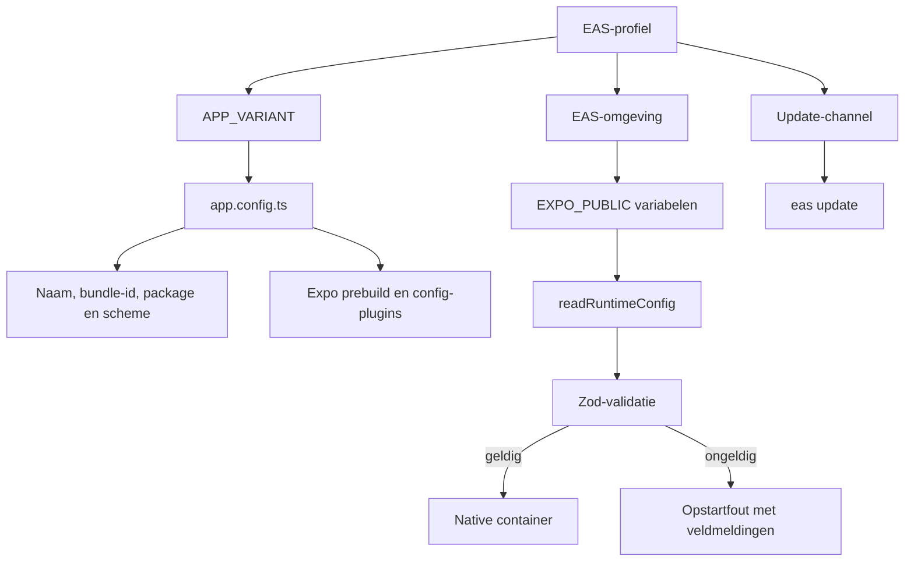

# Builds

> Gecontroleerd op: `631fa807` (2026-10-20; OSM Android)
> Bronnen: `app.config.ts`, `eas.json`, `package.json`, `src/bootstrap/env.ts`, `src/shared/config/runtime-config.ts`
> Zie ook: [ADR 0001](../decisions/0001-expo-en-prebuild.md), [ADR 0009](../decisions/0009-varianten-en-bundle-ids.md), [ADR 0031](../decisions/0031-allocations-kaart.md), [conventies](../conventions.md#10-git-en-ci)

## Waarvoor

Eén codebase levert afzonderlijke interne, acceptatie- en productieapps. Buildvarianten bepalen de
app-identiteit; publieke runtimevariabelen bepalen met welke omgeving en authenticatieconfiguratie
de app werkt. Releasebuilds kunnen daarna JavaScript-updates ontvangen via EAS Update zonder een
nieuwe APK.

## Hoe het werkt

`APP_VARIANT` kiest de installeerbare appvariant. Elk buildprofiel wijst naar een EAS-omgeving
(`development`, `preview` of `production`) waaruit `EXPO_PUBLIC_*` en Firebase-bestanden komen.
`EXPO_PUBLIC_*` wordt tijdens bundelen in de app opgenomen en bij opstarten als
runtimeconfiguratie gevalideerd.

Releaseprofielen `internal`, `acceptance` en `production` hebben een channel. Na één native build
met `expo-updates` publiceert `eas update --channel …` alleen JavaScript. Native wijzigingen
blijven een gewone `eas build`. De development client (`pnpm start`) blijft Metro gebruiken.

## Beweringen

| ID       | Bewering                                                                                                                                              | Code                                                                | Test                                       |
| -------- | ----------------------------------------------------------------------------------------------------------------------------------------------------- | ------------------------------------------------------------------- | ------------------------------------------ |
| BUILD-01 | Variant `internal` heet `Van Eijck Intern`, gebruikt id `com.vrscloud.internal` en scheme `vaneijck-internal`.                                        | `app.config.ts`                                                     | —                                          |
| BUILD-02 | Variant `acceptance` heet `Van Eijck Acceptatie`, gebruikt id `com.vrscloud.acceptance` en scheme `vaneijck-acceptance`.                              | `app.config.ts`                                                     | —                                          |
| BUILD-03 | Variant `production` heet `Van Eijck`, gebruikt id `com.vrscloud` en scheme `vaneijck`.                                                               | `app.config.ts`                                                     | —                                          |
| BUILD-04 | Een ontbrekende of onbekende `APP_VARIANT` valt terug op `internal`.                                                                                  | `app.config.ts`                                                     | —                                          |
| BUILD-24 | App-iconen volgen de variant: `internal` rood, `acceptance` oranje, `production` geel (legacy AppIcon-bronnen in `assets/icons/`).                    | `app.config.ts`, `assets/icons/`                                    | —                                          |
| BUILD-05 | De interne en acceptatieprofielen bouwen intern verspreide Android-APK's; productie bouwt een Android App Bundle met automatische versieverhoging.    | `eas.json`                                                          | —                                          |
| BUILD-06 | Het developmentprofiel bouwt een development client voor interne distributie met variant `internal`.                                                  | `eas.json`                                                          | —                                          |
| BUILD-07 | De minimale runtimeconfiguratie vereist een geldige API-basis-URL en een externe OAuth-client-id; de omgeving is standaard `internal`.                | `src/shared/config/runtime-config.ts`                               | `src/shared/config/runtime-config.test.ts` |
| BUILD-08 | Afsluitende slashes worden uit de API-basis-URL verwijderd voordat verzoeken die waarde gebruiken.                                                    | `src/shared/config/runtime-config.ts`                               | `src/shared/config/runtime-config.test.ts` |
| BUILD-09 | Alleen `internal`, `acceptance` en `production` zijn geldige runtimeomgevingen.                                                                       | `src/shared/config/runtime-config.ts`                               | `src/shared/config/runtime-config.test.ts` |
| BUILD-10 | Azure AD is uitgeschakeld wanneer alle drie Azure-variabelen ontbreken; een gedeeltelijke configuratie maakt de runtimeconfiguratie ongeldig.         | `src/shared/config/runtime-config.ts`                               | `src/shared/config/runtime-config.test.ts` |
| BUILD-11 | Een ontbrekende of ongeldige runtimeconfiguratie stopt het maken van de native container met een leesbare configuratiefout.                           | `src/bootstrap/env.ts`, `src/bootstrap/native.ts`                   | —                                          |
| BUILD-12 | `EXPO_PUBLIC_*`-waarden worden in de app gebakken en gelden daarom niet als geheim.                                                                   | `src/bootstrap/env.ts`, `.env.example`                              | —                                          |
| BUILD-13 | Het Azure AD-redirectscheme is voor alle varianten `com.vaneijck.auth://login/` en de runtime redirect-URL moet daarmee overeenkomen.                 | `app.config.ts`, `src/shared/config/runtime-config.ts`              | —                                          |
| BUILD-14 | Push gebruikt in productie de productie-APNs-omgeving en in interne en acceptatiebuilds de ontwikkelomgeving.                                         | `app.config.ts`                                                     | —                                          |
| BUILD-15 | `pnpm run prebuild` genereert de native projecten opnieuw met Expo prebuild in clean-modus.                                                           | `package.json`                                                      | —                                          |
| BUILD-16 | De CI bouwt na de kwaliteitscontroles een Android Metro-bundel met geldige tijdelijke publieke configuratie.                                          | `.github/workflows/ci.yml`                                          | —                                          |
| BUILD-17 | Buildprofielen `development` en `internal` laden EAS-omgeving `development`; `acceptance` laadt `preview`; `production` laadt `production`.           | `eas.json`                                                          | —                                          |
| BUILD-18 | Releaseprofielen publiceren updates op channel `internal`, `acceptance` of `production`; de runtimeversion volgt het fingerprint-beleid.              | `eas.json`, `app.config.ts`                                         | —                                          |
| BUILD-19 | Android en iOS lezen Firebase-config uit EAS-bestandsvariabelen `GOOGLE_SERVICES_JSON` en `GOOGLE_SERVICES_PLIST`, met lokale bestanden als terugval. | `app.config.ts`                                                     | —                                          |
| BUILD-20 | Met `EXPO_PUBLIC_ENVIRONMENT=internal` bevat de bundel de formulierdefinities uit `docs/diensten/experiment`; acceptatie- en productiebundels niet.   | `src/bootstrap/container.ts`                                        | —                                          |
| BUILD-21 | De allocations-overzichtskaart op Android gebruikt OpenStreetMap (geen `GOOGLE_MAPS_ANDROID_API_KEY` / geen Maps SDK-config in `app.config`).         | `app.config.ts`, [ADR 0031](../decisions/0031-allocations-kaart.md) | —                                          |
| BUILD-22 | iOS deployment target is 17.0 via `expo-build-properties` (eis van `expo-maps` voor Apple Maps).                                                      | `app.config.ts`                                                     | —                                          |
| BUILD-23 | Android-kaart gebruikt `react-native-webview`; na toevoegen of updaten is een native rebuild van de development client nodig.                         | `package.json`                                                      | —                                          |

## Randgevallen en bewuste keuzes

- Er zijn geen native flavors of `react-native-config`; variantkeuze loopt uitsluitend via
  `APP_VARIANT` en `app.config.ts`. Zie [ADR 0009](../decisions/0009-varianten-en-bundle-ids.md).
- Native wijzigingen horen in config-plugins en moeten na een schone prebuild reproduceerbaar zijn.
  Zie [ADR 0001](../decisions/0001-expo-en-prebuild.md).
- De Google Places-sleutel en het EAS-project-id zijn publieke appconfiguratie. Beperk de
  Google-sleutel daarom buiten de app tot de juiste bundle-id en package. Places is los van de
  overzichtskaart ([ADR 0031](../decisions/0031-allocations-kaart.md)): Android-OSM heeft geen
  Maps SDK-sleutel nodig.
- Acceptatie en productie wijzen in de oude app allebei naar de productie-API; die mapping blijft
  in de EAS-omgevingen `preview` en `production`.
- Live updates gelden alleen voor binaries die met `expo-updates` zijn gebouwd. Een development
  client die van Metro laadt, gebruikt geen channel-update.

## Open vragen

- [Open vraag 10](../functioneel/open-vragen.md): vervangt de nieuwe app de bestaande
  store-listings? De huidige builds gebruiken dezelfde bundle-id's.
- De variantmatrix, EAS-profielen, config-pluginuitvoer en fouttekst van `readRuntimeConfig` hebben
  geen geautomatiseerde test.
