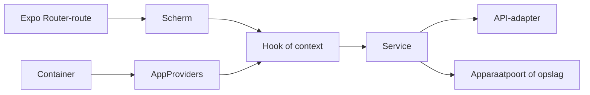

# Componenten en routes

> Gecontroleerd op: ba1383c (2026-09-23)
> Bronnen: `src/app/`, `src/bootstrap/`, `src/domeinen/`, `src/shared/ui/`
> Zie ook: [overzicht](overzicht.md), [architectuur](../architecture.md), [testen](testen.md)

## Waarvoor

Deze catalogus laat zien welke routes, schermen en herbruikbare UI-onderdelen nu in de app bestaan.
Hij maakt ook zichtbaar welk domein eigenaar is, waar de code staat en of het route- of UI-item
rechtstreeks is getest.

## Hoe het werkt

De routebestanden blijven dun. De rootlayout maakt de native container, `AppProviders` biedt de
containerafhankelijkheden aan en de beveiligde app- en auth-layouts kiezen op basis van de sessie
welke routes toegankelijk zijn.

De belangrijkste composities zijn:

| Routegroep                   | Compositie                                                                                                                                                                   |
| ---------------------------- | ---------------------------------------------------------------------------------------------------------------------------------------------------------------------------- |
| Appstart en login            | `RootLayout` → `AppProviders` → `AuthProvider` → `TokenProvider`/`SessionLifecycle` → auth-API of interne auth-adapter                                                       |
| Onboarding                   | `/` → `OnboardingGateScreen` → `useOnboardingGate` → opdrachtenquery en `AllocationUnitService` → allocation-unit-API/referentiedata                                         |
| Opdrachten                   | `/` → `AllocationsScreen` → `useAllocations`/`AllocationsApiProvider` → `AllocationsApi`; acties lopen via actionservices en de outbox                                       |
| Diensten en PLTR             | `/allocations/[id]` → `AllocationDetailScreen` → `ServicesScreen` of `PltrScreen` → allocations-hooks → allocations-API en services-domeinregels                             |
| Formulier                    | `/allocations/[id]/services/[serviceId]/form` → `ServiceFormScreen` → formulierstore/hooks → `ServiceFormService` → referentiedata, conceptopslag en formulier-API           |
| Foto's                       | `/allocations/[id]/services/[serviceId]/photos` → `PhotosScreen` → `useServicePhotos` → `PhotoService` → fotobestanden, opslag en foto-API                                   |
| Instellingen en support      | `/settings`, `/language`, `/permissions`, `/support` of sync → domeinscherm → settings-, auth- of supportcontext → apparaatpermissies, taalopslag, uitloggen of systeemdelen |
| Meldingen en beschikbaarheid | `/notifications` of `/availability` → domeinscherm → history- of workerhooks → lokale historie of worker-API                                                                 |

## Beweringen

### Routes en layouts

| ID       | Route of layout                                 | Doel en compositie                                                                                                         | Eigenaar        | Code                                                                   | Test |
| -------- | ----------------------------------------------- | -------------------------------------------------------------------------------------------------------------------------- | --------------- | ---------------------------------------------------------------------- | ---- |
| COMP-001 | Rootlayout                                      | Bouwt de native container, monteert providers, houdt de statusbar donker en beschermt app- en auth-routes op sessiestatus. | bootstrap       | `src/app/_layout.tsx`                                                  | —    |
| COMP-002 | Auth-layout                                     | Geeft de loginroute de gedeelde kaartachtergrond en auth-stack.                                                            | auth            | `src/app/(auth)/_layout.tsx`                                           | —    |
| COMP-003 | App-layout                                      | Registreert de beveiligde stack, kaartachtergrond, workerstatus en instellingenknop.                                       | app             | `src/app/(app)/_layout.tsx`                                            | —    |
| COMP-004 | `/login`                                        | Rendert `LoginScreen`; de authcontext verbindt het scherm met externe of interne aanmelding.                               | auth            | `src/app/(auth)/login.tsx`                                             | —    |
| COMP-005 | `/`                                             | Rendert de onboardinggate en daarna registratie of opdrachtenlijst.                                                        | onboarding      | `src/app/(app)/index.tsx`                                              | —    |
| COMP-006 | `/settings`                                     | Rendert werkerbalk, menu en uitloggen via `SettingsScreen`.                                                                | settings        | `src/app/(app)/settings.tsx`                                           | —    |
| COMP-140 | `/language`                                     | Rendert taalkeuze via `LanguageScreen`.                                                                                    | settings        | `src/app/(app)/language.tsx`                                           | —    |
| COMP-007 | `/support`                                      | Rendert het supportlog en de systeemdeelactie.                                                                             | support         | `src/app/(app)/support.tsx`                                            | —    |
| COMP-138 | `/permissions`                                  | Rendert locatie-, meldingen- en cameratoestemmingen via `PermissionsScreen`.                                               | settings        | `src/app/(app)/permissions.tsx`                                        | —    |
| COMP-008 | `/debug`                                        | Rendert ontwikkelinformatie uit `DevToolsProvider`.                                                                        | bootstrap       | `src/app/(app)/debug.tsx`                                              | —    |
| COMP-009 | `/unit`                                         | Kiest op gebruikerstype het externe of interne eenheidsregistratiescherm.                                                  | allocation-unit | `src/app/(app)/unit.tsx`                                               | —    |
| COMP-010 | `/availability`                                 | Rendert de keuze voor medewerkerbeschikbaarheid.                                                                           | worker          | `src/app/(app)/availability.tsx`                                       | —    |
| COMP-011 | `/notifications`                                | Rendert de lokale meldingshistorie.                                                                                        | notifications   | `src/app/(app)/notifications.tsx`                                      | —    |
| COMP-012 | `/allocations/[id]`                             | Rendert het opdrachtdetail, dat diensten of PLTR kiest.                                                                    | allocations     | `src/app/(app)/allocations/[id]/index.tsx`                             | —    |
| COMP-015 | `/allocations/[id]/services/[serviceId]`        | Rendert het afsluitscherm voor een dienst.                                                                                 | allocations     | `src/app/(app)/allocations/[id]/services/[serviceId].tsx`              | —    |
| COMP-016 | `/allocations/[id]/services/[serviceId]/form`   | Rendert het verwerkingsformulier met routeparameters en previewstatus.                                                     | service-form    | `src/app/(app)/allocations/[id]/services/[serviceId]/form.tsx`         | —    |
| COMP-017 | `/allocations/[id]/services/[serviceId]/photos` | Rendert de fotostroom voor de gekozen dienst en fase.                                                                      | photos          | `src/app/(app)/allocations/[id]/services/[serviceId]/photos/index.tsx` | —    |

### Schermen

| ID       | Scherm                       | Doel                                                                                    | Eigenaar        | Code                                                                     | Test |
| -------- | ---------------------------- | --------------------------------------------------------------------------------------- | --------------- | ------------------------------------------------------------------------ | ---- |
| COMP-018 | `LoginScreen`                | Externe SMS-login en interne Microsoft-aanmelding.                                      | auth            | `src/domeinen/auth/screens/login-screen.tsx`                             | —    |
| COMP-019 | `OnboardingGateScreen`       | Bepaalt of registratie nodig is en toont anders de opdrachtenlijst.                     | onboarding      | `src/domeinen/onboarding/screens/onboarding-gate-screen.tsx`             | —    |
| COMP-020 | `AllocationsScreen`          | Toont opdrachtsecties, voertuigafgiftes, verversen en de knoppenbalk.                   | allocations     | `src/domeinen/allocations/screens/allocations-screen.tsx`                | —    |
| COMP-021 | `AllocationDetailScreen`     | Kiest tussen gewone diensten en PLTR en ondersteunt alleen-lezen openen.                | allocations     | `src/domeinen/allocations/screens/allocation-detail-screen.tsx`          | —    |
| COMP-022 | `ServicesScreen`             | Toont actieve en wachtende diensten en hun acties.                                      | allocations     | `src/domeinen/allocations/screens/services-screen.tsx`                   | —    |
| COMP-023 | `PltrScreen`                 | Toont laad- en afleverfase met de eerstvolgende PLTR-actie.                             | allocations     | `src/domeinen/allocations/screens/pltr-screen.tsx`                       | —    |
| COMP-026 | `ServiceFinishScreen`        | Rondt een dienst af en past daarna de verwerkingsuitgang toe.                           | allocations     | `src/domeinen/allocations/screens/service-finish-screen.tsx`             | —    |
| COMP-027 | `ServiceFormScreen`          | Laadt, toont, bewaart en verstuurt een dynamisch serviceformulier.                      | service-form    | `src/domeinen/service-form/screens/service-form-screen.tsx`              | —    |
| COMP-028 | `PhotoOverviewScreen`        | Toont verplichte posities, laadfoto's en uploadstatus.                                  | photos          | `src/domeinen/photos/screens/photo-overview-screen.tsx`                  | —    |
| COMP-029 | `RegisterUnitScreen`         | Registreert kenteken, beschikbaarheid en eindtijd voor externe bergers.                 | allocation-unit | `src/domeinen/allocation-unit/screens/register-unit-screen.tsx`          | —    |
| COMP-030 | `RegisterInternalUnitScreen` | Registreert trekker, aanhanger, beschikbaarheid en eindtijd voor interne bergers.       | allocation-unit | `src/domeinen/allocation-unit/screens/register-internal-unit-screen.tsx` | —    |
| COMP-032 | `AvailabilityScreen`         | Laat een medewerker een beschikbare statusoptie kiezen.                                 | worker          | `src/domeinen/worker/screens/availability-screen.tsx`                    | —    |
| COMP-033 | `NotificationsScreen`        | Toont en wist de lokale meldingshistorie.                                               | notifications   | `src/domeinen/notifications/screens/notifications-screen.tsx`            | —    |
| COMP-034 | `SettingsScreen`             | Toont werkerbalk, menu naar taal/toestemmingen/sync/support/debug, versie en uitloggen. | settings        | `src/domeinen/settings/screens/settings-screen.tsx`                      | —    |
| COMP-141 | `LanguageScreen`             | Toont de taaltoggle om NL of EN te kiezen.                                              | settings        | `src/domeinen/settings/screens/language-screen.tsx`                      | —    |
| COMP-139 | `PermissionsScreen`          | Toont locatie-, meldingen- en cameratoestemming met vraag of systeeminstellingen.       | settings        | `src/domeinen/settings/screens/permissions-screen.tsx`                   | —    |
| COMP-035 | `SupportScreen`              | Toont het geredigeerde supportlog en biedt delen aan.                                   | support         | `src/domeinen/support/screens/support-screen.tsx`                        | —    |
| COMP-036 | `DebugScreen`                | Toont een ontwikkelsnapshot van lokale appstatus.                                       | bootstrap       | `src/bootstrap/dev/debug-screen.tsx`                                     | —    |

### Domeincomponenten

| ID       | Component                 | Doel                                                          | Eigenaar        | Code                                                                 | Test |
| -------- | ------------------------- | ------------------------------------------------------------- | --------------- | -------------------------------------------------------------------- | ---- |
| COMP-037 | `AllocationActions`       | Toont de beschikbare hoofdacties van een opdrachtkaart.       | allocations     | `src/domeinen/allocations/components/allocation-actions.tsx`         | —    |
| COMP-038 | `AllocationCardFrame`     | Levert de gedeelde visuele omlijsting voor opdrachtkaarten.   | allocations     | `src/domeinen/allocations/components/allocation-card-frame.tsx`      | —    |
| COMP-039 | `AllocationRow`           | Rendert één opdracht in de opdrachtenlijst.                   | allocations     | `src/domeinen/allocations/components/allocation-row.tsx`             | —    |
| COMP-136 | `AllocationDeclineSheet`  | Laat een reden kiezen en een opdracht afwijzen of afronden.   | allocations     | `src/domeinen/allocations/components/allocation-decline-sheet.tsx`   | —    |
| COMP-137 | `AllocationReassignSheet` | Zoekt een collega en draagt een wachtende opdracht over.      | allocations     | `src/domeinen/allocations/components/allocation-reassign-sheet.tsx`  | —    |
| COMP-040 | `LocationBlock`           | Toont één of meer adresregels op een kaart.                   | allocations     | `src/domeinen/allocations/components/card-blocks.tsx`                | —    |
| COMP-041 | `VehicleBlock`            | Toont de bekende voertuiggegevens van een dienst.             | allocations     | `src/domeinen/allocations/components/card-blocks.tsx`                | —    |
| COMP-042 | `PartyBlock`              | Toont de betrokken partij als die bekend is.                  | allocations     | `src/domeinen/allocations/components/card-blocks.tsx`                | —    |
| COMP-043 | `ContactBlock`            | Toont contactgegevens en de belactie.                         | allocations     | `src/domeinen/allocations/components/card-blocks.tsx`                | —    |
| COMP-044 | `ReferenceBlock`          | Toont de referentie van een opdracht of dienst.               | allocations     | `src/domeinen/allocations/components/card-blocks.tsx`                | —    |
| COMP-045 | `TimeBlock`               | Toont de aanmaaktijd van een incident.                        | allocations     | `src/domeinen/allocations/components/card-blocks.tsx`                | —    |
| COMP-046 | `PhasePill`               | Markeert de fase en voltooiing op een kaart.                  | allocations     | `src/domeinen/allocations/components/card-blocks.tsx`                | —    |
| COMP-047 | `CardActionButton`        | Levert een compacte kaartactie.                               | allocations     | `src/domeinen/allocations/components/card-blocks.tsx`                | —    |
| COMP-048 | `IncidentCard`            | Toont incidentinformatie met swipe- en opdrachtacties.        | allocations     | `src/domeinen/allocations/components/incident-card.tsx`              | —    |
| COMP-049 | `PltrPhaseCard`           | Toont één laad- of afleverkaart van PLTR.                     | allocations     | `src/domeinen/allocations/components/pltr-phase-card.tsx`            | —    |
| COMP-050 | `PreviewBanner`           | Maakt zichtbaar dat een opdracht alleen-lezen is geopend.     | allocations     | `src/domeinen/allocations/components/preview-banner.tsx`             | —    |
| COMP-051 | `ServiceCard`             | Toont de samenvatting en acties van één dienst.               | allocations     | `src/domeinen/allocations/components/service-card.tsx`               | —    |
| COMP-052 | `ServiceDeclineSheet`     | Begeleidt kiezen en bevestigen van dienst weigeren.           | allocations     | `src/domeinen/allocations/components/service-decline-sheet.tsx`      | —    |
| COMP-053 | `ServiceRow`              | Rendert één dienst in een dienstensectie.                     | allocations     | `src/domeinen/allocations/components/service-row.tsx`                | —    |
| COMP-054 | `SwipePanel`              | Toont acties achter een horizontale swipe.                    | allocations     | `src/domeinen/allocations/components/swipe-panel.tsx`                | —    |
| COMP-055 | `VehicleReleaseRow`       | Toont één voertuigafgiftelocatie.                             | allocations     | `src/domeinen/allocations/components/vehicle-release-row.tsx`        | —    |
| COMP-056 | `BooleanToggle`           | Toont een twee- of driestandenkeuze in het formulier.         | service-form    | `src/domeinen/service-form/components/boolean-toggle.tsx`            | —    |
| COMP-057 | `FieldFrame`              | Omkadert een formulierveld en toont label en fouttekst.       | service-form    | `src/domeinen/service-form/components/field-frame.tsx`               | —    |
| COMP-058 | `ProgressCircle`          | Toont voortgang van een formuliersectie.                      | service-form    | `src/domeinen/service-form/components/progress-circle.tsx`           | —    |
| COMP-059 | `ReadonlyFieldSummary`    | Toont een niet-wijzigbare formulierwaarde.                    | service-form    | `src/domeinen/service-form/components/readonly-field-summary.tsx`    | —    |
| COMP-060 | `SelectSheet`             | Toont en filtert keuzes in een bottom sheet.                  | service-form    | `src/domeinen/service-form/components/select-sheet.tsx`              | —    |
| COMP-061 | `ServiceFieldRenderer`    | Kiest de invoerweergave voor een ondersteund veldtype.        | service-form    | `src/domeinen/service-form/components/service-field-renderer.tsx`    | —    |
| COMP-062 | `ServiceFormHeader`       | Toont dienst, fase en voortgang.                              | service-form    | `src/domeinen/service-form/components/service-form-header.tsx`       | —    |
| COMP-063 | `ServiceFormSection`      | Groepeert formuliervelden met voortgang en fouten.            | service-form    | `src/domeinen/service-form/components/service-form-section.tsx`      | —    |
| COMP-100 | `ServiceFormToolbar`      | Losse knoppenbalk met formulieracties, elders te plaatsen.    | service-form    | `src/domeinen/service-form/components/service-form-toolbar.tsx`      | —    |
| COMP-064 | `CountryCodePicker`       | Laat de landcode voor externe login kiezen.                   | auth            | `src/domeinen/auth/components/country-code-picker.tsx`               | —    |
| COMP-065 | `AllocationsToolbar`      | Bundelt GPS, meldkamer, wagen wisselen en meldingen.          | onboarding      | `src/domeinen/onboarding/components/allocations-toolbar.tsx`         | —    |
| COMP-066 | `AvailabilityFields`      | Toont de beschikbaarheidsschakelaars bij eenheidsregistratie. | allocation-unit | `src/domeinen/allocation-unit/components/availability-fields.tsx`    | —    |
| COMP-067 | `ChangeVehicleButton`     | Beslist of wagen wisselen direct kan of uitleg vraagt.        | allocation-unit | `src/domeinen/allocation-unit/components/change-vehicle-button.tsx`  | —    |
| COMP-068 | `DispatchButton`          | Biedt bellen met dispatch en interne support aan.             | allocation-unit | `src/domeinen/allocation-unit/components/dispatch-button.tsx`        | —    |
| COMP-069 | `EndDateField`            | Laat de eindtijd van de eenheid kiezen en valideren.          | allocation-unit | `src/domeinen/allocation-unit/components/end-date-field.tsx`         | —    |
| COMP-031 | `FleetPickerSheet`        | Laat een intern voertuig of aanhanger uit de vloot kiezen.    | allocation-unit | `src/domeinen/allocation-unit/components/fleet-picker-sheet.tsx`     | —    |
| COMP-142 | `NumberPlate`             | Toont of bewerkt een kenteken in NL-plaatvorm.                | allocation-unit | `src/domeinen/allocation-unit/components/number-plate.tsx`           | —    |
| COMP-143 | `RegisterUnitLayout`      | Gedeelde hero, fouttekst en sticky submit bij registratie.    | allocation-unit | `src/domeinen/allocation-unit/components/register-unit-layout.tsx`   | —    |
| COMP-070 | `LanguageToggle`          | Wisselt direct tussen Nederlands en Engels.                   | settings        | `src/domeinen/settings/components/language-toggle.tsx`               | —    |
| COMP-071 | `SettingsHeaderButton`    | Opent instellingen vanuit de app-header.                      | settings        | `src/domeinen/settings/screens/settings-screen.tsx`                  | —    |
| COMP-072 | `LocationStatusButton`    | Toont GPS-status, coördinaten en kaartactie.                  | location        | `src/domeinen/location/components/location-status-button.tsx`        | —    |
| COMP-073 | `NotificationBellButton`  | Opent de historie en toont de ongelezen teller.               | notifications   | `src/domeinen/notifications/components/notification-bell-button.tsx` | —    |
| COMP-074 | `WorkerStatusPill`        | Toont medewerkerbeschikbaarheid en opent de keuzeroute.       | worker          | `src/domeinen/worker/components/worker-status-pill.tsx`              | —    |

### Gedeelde UI

| ID       | Component of functie       | Doel                                                           | Eigenaar  | Code                                           | Test |
| -------- | -------------------------- | -------------------------------------------------------------- | --------- | ---------------------------------------------- | ---- |
| COMP-075 | `Button`                   | Gedeelde primaire en secundaire actieknop.                     | shared UI | `src/shared/ui/button.tsx`                     | —    |
| COMP-076 | `ToolbarButton`            | Compacte knop of tab voor headers en knoppenbalken.            | shared UI | `src/shared/ui/toolbar-button.tsx`             | —    |
| COMP-077 | `Screen`                   | Veilige basisschermcontainer.                                  | shared UI | `src/shared/ui/screen.tsx`                     | —    |
| COMP-078 | `ScreenFooter`             | Vaste actieruimte onder aan een scherm.                        | shared UI | `src/shared/ui/screen-footer.tsx`              | —    |
| COMP-079 | `MapBackground`            | Kaartachtergrond, per scherm getekend via `screenLayout`.      | shared UI | `src/shared/ui/map-background.tsx`             | —    |
| COMP-080 | `SplashScreenView`         | Houdt de eigen splash zichtbaar tijdens appherstel.            | shared UI | `src/shared/ui/splash-screen.tsx`              | —    |
| COMP-081 | `TextField`                | Gedeeld tekstinvoerveld met fout- en actieweergave.            | shared UI | `src/shared/ui/text-field.tsx`                 | —    |
| COMP-082 | `BottomSheet`              | Modale keuzelaag vanaf de onderzijde.                          | shared UI | `src/shared/ui/bottom-sheet.tsx`               | —    |
| COMP-083 | `confirm`                  | Toont een binaire systeembevestiging en levert de keuze terug. | shared UI | `src/shared/ui/confirm.ts`                     | —    |
| COMP-084 | `choose`                   | Toont een systeemkeuze uit meerdere acties.                    | shared UI | `src/shared/ui/confirm.ts`                     | —    |
| COMP-085 | `FeedbackProvider`         | Biedt de toastqueue aan de componentboom aan.                  | shared UI | `src/shared/ui/toast-host.tsx`                 | —    |
| COMP-086 | `useFeedback`              | Geeft schermen toegang tot de toastqueue.                      | shared UI | `src/shared/ui/toast-host.tsx`                 | —    |
| COMP-087 | `ToastHost`                | Rendert de actieve toast boven de routes.                      | shared UI | `src/shared/ui/toast-host.tsx`                 | —    |
| COMP-088 | `StatusOverlayProvider`    | Biedt procesfeedback aan de componentboom aan.                 | shared UI | `src/shared/ui/status-overlay-host.tsx`        | —    |
| COMP-089 | `useStatusOverlay`         | Laat acties een procesoverlay uitvoeren.                       | shared UI | `src/shared/ui/status-overlay-host.tsx`        | —    |
| COMP-090 | `StatusOverlayHost`        | Rendert verwerken, succes en foutstatus boven de routes.       | shared UI | `src/shared/ui/status-overlay-host.tsx`        | —    |
| COMP-091 | `SchedulerProvider`        | Biedt de geïnjecteerde scheduler aan UI-hooks aan.             | shared UI | `src/shared/ui/scheduler-context.tsx`          | —    |
| COMP-092 | `useScheduler`             | Geeft UI-code toegang tot de schedulerpoort.                   | shared UI | `src/shared/ui/scheduler-context.tsx`          | —    |
| COMP-135 | `Toolbar`                  | Verdeelt een knoppenbalk in even brede vakken.                 | shared UI | `src/shared/ui/toolbar.tsx`                    | —    |
| COMP-144 | `CollapsibleSectionHeader` | Inklapbare sectiekop met titel en chevron.                     | shared UI | `src/shared/ui/collapsible-section-header.tsx` | —    |

### Gedeelde iconen

| ID       | Icoon                   | Doel                        | Eigenaar  | Code                                         | Test |
| -------- | ----------------------- | --------------------------- | --------- | -------------------------------------------- | ---- |
| COMP-093 | `BellIcon`              | Meldingen.                  | shared UI | `src/shared/ui/icons/bell.tsx`               | —    |
| COMP-094 | `BellSlashIcon`         | Meldingen uitgeschakeld.    | shared UI | `src/shared/ui/icons/bell.tsx`               | —    |
| COMP-095 | `BooksIcon`             | Documentatie of referentie. | shared UI | `src/shared/ui/icons/books.tsx`              | —    |
| COMP-096 | `BroomWide`             | Opschonen.                  | shared UI | `src/shared/ui/icons/broom-wide.tsx`         | —    |
| COMP-097 | `BusinessTime`          | Werktijd.                   | shared UI | `src/shared/ui/icons/business-time.tsx`      | —    |
| COMP-098 | `CalendarSVG`           | Datum.                      | shared UI | `src/shared/ui/icons/calendar.tsx`           | —    |
| COMP-099 | `CameraSVG`             | Camera of foto.             | shared UI | `src/shared/ui/icons/camera.tsx`             | —    |
| COMP-100 | `CameraReverseIcon`     | Camera wisselen.            | shared UI | `src/shared/ui/icons/camera-reverse.tsx`     | —    |
| COMP-101 | `CheckIcon`             | Bevestigd of afgerond.      | shared UI | `src/shared/ui/icons/check.tsx`              | —    |
| COMP-102 | `ChevronIcon`           | Richting of uitklappen.     | shared UI | `src/shared/ui/icons/chevron.tsx`            | —    |
| COMP-103 | `ChevronLeftSVG`        | Terug.                      | shared UI | `src/shared/ui/icons/chevron-left.tsx`       | —    |
| COMP-104 | `ClockSVG`              | Tijd.                       | shared UI | `src/shared/ui/icons/clock.tsx`              | —    |
| COMP-105 | `CloseCircle`           | Sluiten of afwijzen.        | shared UI | `src/shared/ui/icons/close.tsx`              | —    |
| COMP-106 | `CogIcon`               | Instellingen.               | shared UI | `src/shared/ui/icons/cog.tsx`                | —    |
| COMP-107 | `CrashSVG`              | Incident of schade.         | shared UI | `src/shared/ui/icons/crash.tsx`              | —    |
| COMP-108 | `DebugIcon`             | Ontwikkelinformatie.        | shared UI | `src/shared/ui/icons/debug.tsx`              | —    |
| COMP-109 | `DispatchIcon`          | Dispatch of meldkamer.      | shared UI | `src/shared/ui/icons/dispatch.tsx`           | —    |
| COMP-110 | `ExclamationCircleIcon` | Waarschuwing.               | shared UI | `src/shared/ui/icons/exclamation-circle.tsx` | —    |
| COMP-111 | `EyeIcon`               | Bekijken of preview.        | shared UI | `src/shared/ui/icons/eye.tsx`                | —    |
| COMP-112 | `FilesIcon`             | Bestanden of logexport.     | shared UI | `src/shared/ui/icons/files.tsx`              | —    |
| COMP-113 | `FlashIcon`             | Flitser aan.                | shared UI | `src/shared/ui/icons/flash.tsx`              | —    |
| COMP-114 | `FlashOffIcon`          | Flitser uit.                | shared UI | `src/shared/ui/icons/flash.tsx`              | —    |
| COMP-115 | `GlobeIcon`             | Taal of land.               | shared UI | `src/shared/ui/icons/globe.tsx`              | —    |
| COMP-116 | `LocationIcon`          | Locatie.                    | shared UI | `src/shared/ui/icons/location.tsx`           | —    |
| COMP-117 | `MinusIcon`             | Verminderen of verwijderen. | shared UI | `src/shared/ui/icons/minus.tsx`              | —    |
| COMP-118 | `NavigationIcon`        | Navigeren.                  | shared UI | `src/shared/ui/icons/navigation.tsx`         | —    |
| COMP-119 | `PhoneIcon`             | Bellen.                     | shared UI | `src/shared/ui/icons/phone.tsx`              | —    |
| COMP-120 | `PickerWheelIcon`       | Keuze of selectie.          | shared UI | `src/shared/ui/icons/picker-wheel.tsx`       | —    |
| COMP-121 | `PlusIcon`              | Toevoegen.                  | shared UI | `src/shared/ui/icons/plus.tsx`               | —    |
| COMP-122 | `Preview`               | Alleen-lezen bekijken.      | shared UI | `src/shared/ui/icons/preview.tsx`            | —    |
| COMP-123 | `QRSVG`                 | QR-code.                    | shared UI | `src/shared/ui/icons/qrcode.tsx`             | —    |
| COMP-124 | `RefreshSVG`            | Vernieuwen.                 | shared UI | `src/shared/ui/icons/refresh.tsx`            | —    |
| COMP-125 | `ShieldIcon`            | Beveiliging of toestemming. | shared UI | `src/shared/ui/icons/shield.tsx`             | —    |
| COMP-126 | `StopwatchSVG`          | Duur of voortgang.          | shared UI | `src/shared/ui/icons/stopwatch.tsx`          | —    |
| COMP-127 | `SwipeIcon`             | Swipehandeling.             | shared UI | `src/shared/ui/icons/swipe-icon.tsx`         | —    |
| COMP-128 | `TrashcanIcon`          | Verwijderen.                | shared UI | `src/shared/ui/icons/trashcan.tsx`           | —    |
| COMP-129 | `UnknownSVG`            | Onbekend type.              | shared UI | `src/shared/ui/icons/unknown.tsx`            | —    |
| COMP-130 | `UserIcon`              | Gebruiker of medewerker.    | shared UI | `src/shared/ui/icons/user.tsx`               | —    |
| COMP-131 | `TowTruckSVG`           | Bergingsvoertuig.           | shared UI | `src/shared/ui/icons/vehicles.tsx`           | —    |
| COMP-132 | `TruckSVG`              | Vrachtwagen.                | shared UI | `src/shared/ui/icons/vehicles.tsx`           | —    |
| COMP-133 | `MotorcycleSVG`         | Motorfiets.                 | shared UI | `src/shared/ui/icons/vehicles.tsx`           | —    |
| COMP-134 | `CarSVG`                | Personenauto.               | shared UI | `src/shared/ui/icons/vehicles.tsx`           | —    |

## Randgevallen en bewuste keuzes

- Routegroepen tussen haakjes horen niet bij de zichtbare URL.
- `PltrScreen` en `ServicesScreen` zijn actuele schermen zonder eigen routebestand; een ander
  scherm kiest ze. De vlootkeuze van interne registratie zit in `FleetPickerSheet`.
- Een test van domeinlogica, service of API geldt hier niet als test van route, rendering of
  interactie. Daarom staat bij alle catalogusitems `—`, ook wanneer onderliggende regels wel zijn
  getest.
- `IconProps` en de themaconstanten zijn geen runtimecomponenten en staan niet als afzonderlijk
  catalogusitem in de lijst.
- Bekende regressies die de UI raken staan in
  [bekende fouten](../functioneel/bekende-fouten-oude-app.md).

## Open vragen

- De catalogus heeft geen inhoudelijke open vraag; ontbrekende UI-tests en toestelvalidaties staan
  in [ontwikkelstatus](ontwikkelstatus.md).
- Open product- en backendvragen die gedrag van componenten beïnvloeden staan in
  [open vragen](../functioneel/open-vragen.md).
