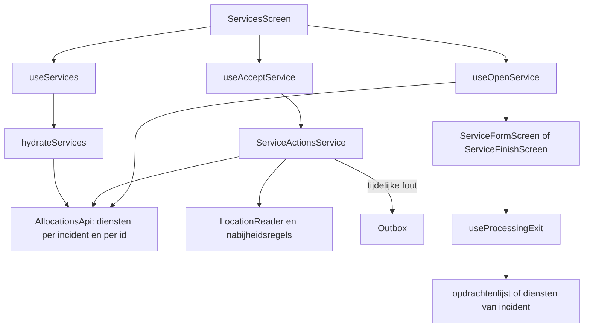

# Diensten

> Gecontroleerd op: `ba1383c` (2026-09-23)
> Bronnen: `src/domeinen/allocations/`, `src/domeinen/services/`, `src/domeinen/location/`, `src/domeinen/outbox/`, `src/app/(app)/allocations/`, `src/bootstrap/container.ts`
> Zie ook: [ADR 0016](../decisions/0016-diensten-en-locatie.md), [ADR 0018](../decisions/0018-verwerken-naad-en-overdragen.md), [ADR 0024](../decisions/0024-feedback-en-dialogen.md), [flows](../functioneel/flows.md#3-een-opdracht-uitvoeren-regels-klaar-schermen-volgen), [statussen](../functioneel/statussen.md#dienststatussen)

## Waarvoor

Een opdracht bevat een of meer diensten. Het dienstenscherm haalt de volledige dienstgegevens op,
laat zien welke dienst actief of wachtend is en vormt de ingang naar accepteren, bekijken,
verwerken, foto's en weigeren.

## Hoe het werkt

De volledige diensten worden server-state in TanStack Query. Beslissingen over statussen,
nabijheid, vroeg afronden en de bestemming na verwerken zijn pure functies; schermen en hooks
verzorgen bevestiging, feedback en navigatie.

## Beweringen

| ID        | Bewering                                                                                                                                                                                                                                | Code                                                                                                                                                        | Test                                                                                                                          |
| --------- | --------------------------------------------------------------------------------------------------------------------------------------------------------------------------------------------------------------------------------------- | ----------------------------------------------------------------------------------------------------------------------------------------------------------- | ----------------------------------------------------------------------------------------------------------------------------- |
| DIENST-01 | Bij openen haalt de app alle diensten van het incident op; die opgehaalde lijst bepaalt welke diensten bestaan.                                                                                                                         | `src/domeinen/allocations/hooks/use-services.ts`, `src/domeinen/allocations/service/hydrate-services.ts`, `src/domeinen/allocations/api/allocations-api.ts` | `src/domeinen/allocations/service/hydrate-services.test.ts`, `src/domeinen/allocations/api/allocations-api.test.ts`           |
| DIENST-02 | Bestaande gevulde velden blijven behouden wanneer een dunnere response een leeg veld bevat.                                                                                                                                             | `src/domeinen/allocations/domain/merge.ts`, `src/domeinen/allocations/service/hydrate-services.ts`                                                          | `src/domeinen/allocations/domain/merge.test.ts`, `src/domeinen/allocations/service/hydrate-services.test.ts`                  |
| DIENST-03 | Een ontbrekende `dn_servicetypecode` wordt, als de dienst een id heeft, aangevuld via `GET /api/services/{id}`; een mislukte detailfetch laat de dienst zonder type in de lijst staan.                                                  | `src/domeinen/allocations/service/hydrate-services.ts`                                                                                                      | `src/domeinen/allocations/service/hydrate-services.test.ts`                                                                   |
| DIENST-04 | Het scherm toont twee secties: alleen de statusbak `pending` staat onder wachtend; actieve en afgeronde diensten staan onder actief.                                                                                                    | `src/domeinen/allocations/screens/services-screen.tsx`, `src/domeinen/services/domain/status.ts`                                                            | —                                                                                                                             |
| DIENST-05 | Een onbekende dienststatus blijft als open werk zichtbaar, maar mag niet worden verstuurd.                                                                                                                                              | `src/domeinen/services/domain/status.ts`                                                                                                                    | `src/domeinen/services/domain/status.test.ts`                                                                                 |
| DIENST-06 | De nabijheidsbeslissing vraagt om bevestiging bij een onbekende positie, onbekend doel of een afstand van minstens 500 meter.                                                                                                           | `src/domeinen/allocations/service/service-actions-service.ts`, `src/domeinen/location/domain/proximity.ts`                                                  | `src/domeinen/allocations/service/service-actions-service.test.ts`, `src/domeinen/location/domain/proximity.test.ts`          |
| DIENST-07 | Na bevestiging accepteert de app de dienst met statuscode `875920000` via `PUT /api/services/{id}/accept`.                                                                                                                              | `src/domeinen/allocations/service/service-actions-service.ts`, `src/domeinen/allocations/api/allocations-api.ts`                                            | `src/domeinen/allocations/service/service-actions-service.test.ts`, `src/domeinen/allocations/api/allocations-api.test.ts`    |
| DIENST-08 | Een tijdelijke fout bij dienst accepteren zet `accept-service` in de outbox; een niet-retrybare fout geeft foutfeedback en wordt niet ingepland.                                                                                        | `src/domeinen/allocations/service/service-actions-service.ts`, `src/domeinen/outbox/domain/delivery.ts`                                                     | `src/domeinen/allocations/service/service-actions-service.test.ts`, `src/domeinen/outbox/domain/delivery.test.ts`             |
| DIENST-09 | Bij het openen van een actieve dienst haalt de app die dienst opnieuw op; een inmiddels niet-verzendbare status verlaat de verwerking, status `875920005` opent het afsluitscherm en andere verzendbare statussen openen het formulier. | `src/domeinen/allocations/hooks/use-open-service.ts`                                                                                                        | —                                                                                                                             |
| DIENST-10 | Een preview slaat de controle op een verzendbare status over en opent hetzelfde formulier read-only.                                                                                                                                    | `src/domeinen/allocations/hooks/use-open-service.ts`, `src/app/(app)/allocations/[id]/services/[serviceId]/form.tsx`                                        | —                                                                                                                             |
| DIENST-11 | Dienst weigeren doorloopt in de sheet eerst kiezen, daarna bevestigen en pas daarna versturen.                                                                                                                                          | `src/domeinen/allocations/domain/service-decline.ts`, `src/domeinen/allocations/components/service-decline-sheet.tsx`                                       | `src/domeinen/allocations/domain/service-decline.test.ts`                                                                     |
| DIENST-12 | “Vergeefse rit” verstuurt status `875920006`; “terug naar dispatch” verstuurt status `1`.                                                                                                                                               | `src/domeinen/allocations/domain/service-decline.ts`, `src/domeinen/allocations/service/service-actions-service.ts`                                         | `src/domeinen/allocations/domain/service-decline.test.ts`, `src/domeinen/allocations/service/service-actions-service.test.ts` |
| DIENST-13 | Een tijdelijke fout bij dienst weigeren zet `decline-service` in de outbox; een niet-retrybare fout wordt niet ingepland.                                                                                                               | `src/domeinen/allocations/service/service-actions-service.ts`, `src/domeinen/outbox/domain/delivery.ts`                                                     | `src/domeinen/allocations/service/service-actions-service.test.ts`, `src/bootstrap/container.test.ts`                         |
| DIENST-14 | Na verwerken is de uitkomst `blocked`, `continueIncident`, `processingFinish` of `terminal`, afhankelijk van trigger, huidige status, geposte gegevens en diensttype.                                                                   | `src/domeinen/services/domain/processing-exit.ts`                                                                                                           | `src/domeinen/services/domain/processing-exit.test.ts`                                                                        |
| DIENST-15 | Na een terminale uitkomst gaat de app naar het overzicht als geen ander open werk resteert, anders naar het diensten- of PLTR-scherm van de opdracht.                                                                                   | `src/domeinen/services/domain/exit-target.ts`, `src/domeinen/allocations/hooks/use-processing-exit.ts`                                                      | `src/domeinen/services/domain/exit-target.test.ts`                                                                            |
| DIENST-16 | Een Assistance-dienst rondt vroeg af zodra `dn_assisistancetypeofbreakdowncode` gevuld is.                                                                                                                                              | `src/domeinen/services/domain/early-complete.ts`                                                                                                            | `src/domeinen/services/domain/early-complete.test.ts`                                                                         |
| DIENST-17 | Een Pechhulp-dienst rondt vroeg af bij een gevulde `dn_breakdownsettlementcode`, behalve bij codes `1004` en `1005`.                                                                                                                    | `src/domeinen/services/domain/early-complete.ts`                                                                                                            | `src/domeinen/services/domain/early-complete.test.ts`                                                                         |
| DIENST-18 | Een Berging-dienst rondt vroeg af wanneer `dn_ekv` de boolean `true` of optiecode `1` is.                                                                                                                                               | `src/domeinen/services/domain/early-complete.ts`                                                                                                            | `src/domeinen/services/domain/early-complete.test.ts`                                                                         |
| DIENST-19 | Een dienstkaart toont “wacht op verbinding” zolang voor die dienst een queued outbox-item bestaat.                                                                                                                                      | `src/domeinen/allocations/components/service-row.tsx`, `src/domeinen/outbox/domain/pending.ts`                                                              | —                                                                                                                             |
| DIENST-20 | De acceptatiehook toont de gevraagde nabijheidsbevestiging en verstuurt pas nadat de berger doorgaan kiest.                                                                                                                             | `src/domeinen/allocations/hooks/use-accept-service.ts`                                                                                                      | —                                                                                                                             |
| DIENST-21 | Na een queued dienstweigering vervolgt de hook de exit-flow; na een harde fout blijft de bevestigingsstap open.                                                                                                                         | `src/domeinen/allocations/hooks/use-decline-service.ts`, `src/domeinen/allocations/domain/service-decline.ts`                                               | —                                                                                                                             |

## Randgevallen en bewuste keuzes

- Als incident of dienst zelf ontbreekt, laat `checkAcceptLocation` accepteren zonder
  nabijheidsbevestiging doorgaan; bij aanwezige records maar ontbrekende coördinaten volgt wel de
  bevestiging voor een onbekend doel (`src/domeinen/services/domain/target-location.ts`).
- Een afgeronde dienst (`875920005`) blijft op het scherm onder actief staan. De pure statusfunctie
  kent hiervoor wel de aparte bak `completed`; het scherm voegt alles behalve `pending` samen.
- Een fout bij dienst accepteren wordt zichtbaar als toast. Dit voorkomt regressie 37 uit
  [bekende fouten](../functioneel/bekende-fouten-oude-app.md).
- Dienst weigeren vereist een keuze en bevestiging. Dit voorkomt regressie 38 uit
  [bekende fouten](../functioneel/bekende-fouten-oude-app.md).
- De oudere tekst in ADR 0016 en ADR 0018 dat het verwerkingsformulier ontbreekt, is ingehaald door
  de huidige route naar `ServiceFormScreen`.

## Open vragen

- [Open vraag 5](../functioneel/open-vragen.md): moet een onbekende dienststatus open werk blijven?
  De huidige aanname is ja, maar versturen is geblokkeerd.
- [Open vraag 7](../functioneel/open-vragen.md): wat betekenen statussen `875920003` en `875920005`
  precies voor de lijst? De huidige regels behandelen beide als niet meer open.
- [Open vraag 26](../functioneel/open-vragen.md): is `PUT /api/services/{id}` het definitieve
  contract voor formulierverzending? De huidige app gebruikt `PUT`.
- [Open vraag 30](../functioneel/open-vragen.md): mag dienst weigeren offline in de outbox? De
  huidige aanname is ja.
- De scherm- en hookvertakkingen voor openen, preview, bevestigen en navigeren hebben geen directe
  component- of hooktests.
