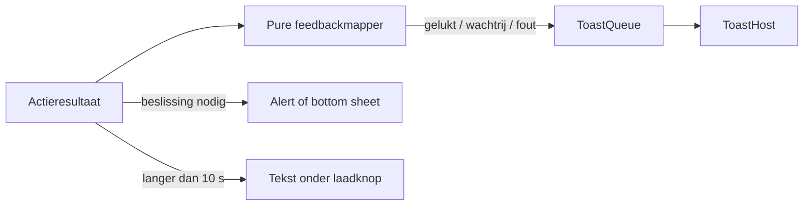

# Feedback en dialogen

> Gecontroleerd op: `ba1383c` (2026-09-23)
> Bronnen: `src/shared/feedback/`, `src/shared/ui/`, `src/domeinen/allocations/domain/action-feedback.ts`, `src/domeinen/allocations/hooks/`, `src/domeinen/allocations/components/service-decline-sheet.tsx`, `src/domeinen/service-form/screens/service-form-screen.tsx`
> Zie ook: [ADR 0024](../decisions/0024-feedback-en-dialogen.md), [flows](../functioneel/flows.md#3-een-opdracht-uitvoeren-regels-klaar-schermen-volgen)

## Waarvoor

Feedback laat de berger weten of een actie bezig, gelukt, mislukt of veilig in de wachtrij gezet is.
Alleen een keuze blokkeert de bediening: voortgang en resultaten blijven zichtbaar zonder de flow
onnodig te onderbreken.

## Hoe het werkt

Een domeinfunctie zet het resultaat van een actie om in een feedbackvorm en i18n-sleutel. De hook
vertaalt die sleutel en stuurt hem naar de gedeelde `ToastQueue`; beslissingen gebruiken
`confirm()`, `choose()` of een domeinspecifieke bottom sheet.

| Situatie                  | UI-patroon                                                       | Belangrijkste codepad                                                                                                            |
| ------------------------- | ---------------------------------------------------------------- | -------------------------------------------------------------------------------------------------------------------------------- |
| Actie is bezig            | Laadstatus op de knop; na circa 10 seconden een trage-actietekst | `src/shared/ui/use-slow-hint.ts`                                                                                                 |
| Gelukt of in de wachtrij  | Niet-blokkerende toast; eventueel blijvend kaartlabel            | `src/shared/feedback/toast-queue.ts`, `src/domeinen/outbox/domain/pending.ts`                                                    |
| Ja/nee-beslissing         | Native bevestigingsdialoog                                       | `src/shared/ui/confirm.ts`                                                                                                       |
| Keuze uit meerdere acties | Bottom sheet of native keuzedialoog                              | `src/shared/ui/bottom-sheet.tsx`, `src/shared/ui/confirm.ts`, `src/domeinen/allocations/components/allocation-decline-sheet.tsx` |
| Meer invoer               | Eigen scherm met inline validatie                                | `src/domeinen/service-form/screens/service-form-screen.tsx`                                                                      |

## Beweringen

| ID      | Bewering                                                                                                                   | Code                                                                                                                  | Test                                                      |
| ------- | -------------------------------------------------------------------------------------------------------------------------- | --------------------------------------------------------------------------------------------------------------------- | --------------------------------------------------------- |
| FEED-01 | Als een toast wordt getoond, verdwijnt die standaard na drie seconden.                                                     | `src/shared/feedback/toast-queue.ts`                                                                                  | `src/shared/feedback/toast-queue.test.ts`                 |
| FEED-02 | Als een andere toast verschijnt terwijl er al één staat, vervangt de nieuwe toast de vorige.                               | `src/shared/feedback/toast-queue.ts`                                                                                  | `src/shared/feedback/toast-queue.test.ts`                 |
| FEED-03 | Als exact dezelfde zichtbare toast opnieuw wordt aangeboden, negeert de queue hem zonder tweede trilling.                  | `src/shared/feedback/toast-queue.ts`                                                                                  | `src/shared/feedback/toast-queue.test.ts`                 |
| FEED-04 | Als een toast de toon succes, waarschuwing of fout heeft, trilt het apparaat; een informatietoast trilt niet.              | `src/shared/feedback/toast-queue.ts`                                                                                  | `src/shared/feedback/toast-queue.test.ts`                 |
| FEED-05 | Als een opdracht- of dienstactie in de offlinewachtrij komt, toont de app een informatietoast en geen dialoog.             | `src/domeinen/allocations/domain/action-feedback.ts`                                                                  | `src/domeinen/allocations/domain/action-feedback.test.ts` |
| FEED-06 | Als het accepteren van een dienst hard mislukt, toont de app een fouttoast.                                                | `src/domeinen/allocations/domain/action-feedback.ts`                                                                  | `src/domeinen/allocations/domain/action-feedback.test.ts` |
| FEED-07 | Als accepteren geblokkeerd is of herregistratie nodig is, laat de feedbackmapper de beslissing aan het dialoogpad over.    | `src/domeinen/allocations/domain/action-feedback.ts`                                                                  | `src/domeinen/allocations/domain/action-feedback.test.ts` |
| FEED-08 | Als de toast zichtbaar wordt, kondigt de host de tekst aan voor toegankelijkheid; aantikken sluit hem direct.              | `src/shared/ui/toast-host.tsx`                                                                                        | —                                                         |
| FEED-09 | Als een actie tien seconden onafgebroken bezig is, wordt de tekst "dit duurt langer" onder de laadknop zichtbaar.          | `src/shared/ui/use-slow-hint.ts`, `src/domeinen/service-form/screens/service-form-screen.tsx`                         | —                                                         |
| FEED-10 | Als een native bevestiging wordt geannuleerd of buitenom gesloten, levert `confirm()` `false` en `choose()` `null`.        | `src/shared/ui/confirm.ts`                                                                                            | —                                                         |
| FEED-11 | Als de berger een dienstweigering kiest, wordt pas na een aparte bevestiging de stap `submitting` bereikt.                 | `src/domeinen/allocations/domain/service-decline.ts`, `src/domeinen/allocations/components/service-decline-sheet.tsx` | `src/domeinen/allocations/domain/service-decline.test.ts` |
| FEED-12 | Als het serviceformulier niet kan worden verstuurd, blijft het scherm staan en toont het een dialoog met opnieuw proberen. | `src/domeinen/service-form/screens/service-form-screen.tsx`                                                           | —                                                         |

## Randgevallen en bewuste keuzes

- `ToastHost` staat in de root-layout en blijft daardoor bestaan tijdens navigatie na een actie.
- De queue toont steeds één toast. Er is geen stapel of geschiedenis van eerdere toasts.
- De oude globale succesoverlay komt niet terug. Dit voorkomt dat succesfeedback direct door een
  `finally`-pad wordt gesloten; zie
  [bekende fouten, rij 36](../functioneel/bekende-fouten-oude-app.md).
- Een fout bij dienst accepteren verdwijnt niet meer stil; zie
  [bekende fouten, rij 37](../functioneel/bekende-fouten-oude-app.md).
- Dienst weigeren vraagt na de keuze expliciet bevestiging; zie
  [bekende fouten, rij 38](../functioneel/bekende-fouten-oude-app.md).
- Versturen zonder verplichte foto's is geblokkeerd; de oude bypass is verwijderd. Zie
  [bekende fouten, rij 39](../functioneel/bekende-fouten-oude-app.md).

## Open vragen

- [Open vraag 30](../functioneel/open-vragen.md): de huidige aanname is dat een dienstweigering na
  een tijdelijke fout offline in de outbox mag worden gezet.
