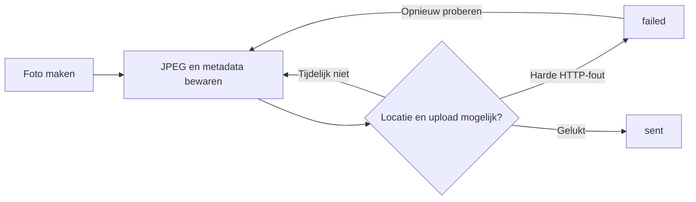

# Foto's

> Gecontroleerd op: ba1383c (2026-09-23)
> Bijgewerkt op: `ba1383c` (2026-09-30; fotoregels, versleutelde opslag en finish-opruiming)
> Bronnen: `src/domeinen/photos/`, `src/bootstrap/container.ts`, `src/bootstrap/native.ts`, `src/app/(app)/allocations/[id]/services/[serviceId]/photos/`
> Zie ook: [ADR 0020](../decisions/0020-fotos.md), [ADR 0022](../decisions/0022-offline-en-support.md), [flows](../functioneel/flows.md), [API-contract](../functioneel/api-contract.md)

## Waarvoor

De fotostroom laat de berger per dienst en fase bewijs vastleggen, ook zonder bruikbare verbinding of
locatie. De versleutelde JPEG en metadata blijven lokaal bewaard, ook na upload, totdat de server
de opdracht afrondt of de gebruiker uitlogt.

## Hoe het werkt

Het scherm bepaalt uit de dienststatus of de foto bij laden of afleveren hoort. De berger kiest een
fototype en, voor buitenkant of banden, een subpositie. Na de camera-opname versleutelt de app de
JPEG met een sleutel uit de beveiligde opslag, bewaart de metadata als `queued` in diezelfde
beveiligde opslag en start de wachtrij. Het tijdelijke camerabestand wordt verwijderd.

De dienstdefinitie bepaalt per fase welke posities verplicht zijn. In de afleverfase wordt voor
iedere extra laadfoto een eigen tegenfoto verplicht, ook bij meerdere foto's op dezelfde positie.
Een al aanwezige CRM-foto kan een verplicht vak vullen. Het overzicht toont laadfoto's apart als
alleen-lezen vergelijking. Alleen wanneer lokaal geen foto's van die fase staan, leest de app de
CRM-foto's; hun URL en metadata worden beveiligd opgeslagen, niet hun JPEG-bytes. Een mislukte
CRM-opvraag zonder cache mag de fotoverplichting niet stilzwijgend goedkeuren.

Een tijdelijke fout of ontbrekende locatie stopt de drain bij de eerste wachtende foto; later
probeert de wachtrij opnieuw. Een harde HTTP-afwijzing krijgt `failed` en kan via de fotoservice
handmatig opnieuw worden aangeboden. De UI probeert alle mislukte foto's van de huidige fase
opnieuw wanneer de berger daarvoor kiest. `Versturen` verlaat het overzicht alleen als alle
verplichte plekken een foto met status `queued` of `sent` hebben; het uploaden loopt onafhankelijk
door.

## Beweringen

| ID      | Bewering                                                                                                                       | Code                                                    | Test                                                                                   |
| ------- | ------------------------------------------------------------------------------------------------------------------------------ | ------------------------------------------------------- | -------------------------------------------------------------------------------------- |
| FOTO-01 | Een dienst in de afleverfase maakt afleverfoto's; iedere andere of onbekende status maakt laadfoto's.                          | `src/domeinen/photos/domain/phase.ts`                   | `src/domeinen/photos/domain/phase.test.ts`                                             |
| FOTO-02 | Buiten- en bandenfoto's verzenden hun subpositie; andere categorieën verzenden alleen hun Nederlandse categorienaam.           | `src/domeinen/photos/domain/photo-type.ts`              | `src/domeinen/photos/domain/photo-type.test.ts`                                        |
| FOTO-03 | Een opname wordt eerst versleuteld opgeslagen en daarna met status `queued` aan de beveiligde lokale lijst toegevoegd.         | `src/domeinen/photos/service/photo-service.ts`          | `src/domeinen/photos/service/photo-service.test.ts`                                    |
| FOTO-04 | De opnametijd komt van de geïnjecteerde klok en wordt voor upload als UTC-string geformatteerd.                                | `src/domeinen/photos/domain/utc.ts`                     | `src/domeinen/photos/domain/utc.test.ts`                                               |
| FOTO-05 | Een laadfoto krijgt uploadcommentaar `Aanvang` en een afleverfoto `Aflevering`.                                                | `src/domeinen/photos/domain/phase.ts`                   | `src/domeinen/photos/domain/phase.test.ts`                                             |
| FOTO-06 | Alleen de eerste foto van hetzelfde dienst-, fase- en fototype heeft `isExtra: false`; latere foto's hebben `true`.            | `src/domeinen/photos/domain/extra.ts`                   | `src/domeinen/photos/domain/extra.test.ts`                                             |
| FOTO-07 | Een reeds verzonden foto blijft meetellen bij het bepalen van `isExtra` voor een latere foto.                                  | `src/domeinen/photos/domain/extra.ts`                   | `src/domeinen/photos/domain/extra.test.ts`                                             |
| FOTO-08 | Zonder bruikbare locatie blijft de JPEG behouden en de foto `queued`; de locatie wordt bij een volgende drain opnieuw gelezen. | `src/domeinen/photos/service/photo-service.ts`          | `src/domeinen/photos/service/photo-service.test.ts`                                    |
| FOTO-09 | Een tijdelijke uploadfout behoudt de JPEG en status `queued` en plant een nieuwe poging.                                       | `src/domeinen/photos/service/photo-service.ts`          | `src/domeinen/photos/service/photo-service.test.ts`                                    |
| FOTO-10 | Een harde HTTP-fout zet alleen die foto op `failed`, behoudt de JPEG en laat handmatig opnieuw proberen toe.                   | `src/domeinen/photos/service/photo-service.ts`          | `src/domeinen/photos/service/photo-service.test.ts`                                    |
| FOTO-11 | Een geslaagde upload zet de foto op `sent`.                                                                                    | `src/domeinen/photos/service/photo-service.ts`          | `src/domeinen/photos/service/photo-service.test.ts`                                    |
| FOTO-12 | Uploaden gebruikt multipart `POST /api/binary/upload?content=photo` met dienst, incident, locatie, positie en JPEG.            | `src/domeinen/photos/api/photos-api.ts`                 | `src/domeinen/photos/service/photo-service.test.ts`                                    |
| FOTO-13 | Foto's van één afgeronde of afgewezen dienst kunnen met hun JPEGs worden gewist zonder foto's van andere diensten te wissen.   | `src/domeinen/photos/service/photo-service.ts`          | `src/domeinen/photos/service/photo-service.test.ts`                                    |
| FOTO-14 | Bij uitloggen stopt de wachtrij en worden alle fotometadata en lokale JPEGs gewist.                                            | `src/bootstrap/container.ts`                            | `src/domeinen/photos/service/photo-service.test.ts`, `src/bootstrap/container.test.ts` |
| FOTO-15 | In de afleverfase toont het overzicht laadfoto's als alleen-lezen vergelijking.                                                | `src/domeinen/photos/screens/photo-overview-screen.tsx` | —                                                                                      |
| FOTO-16 | Als foto's in de huidige fase `failed` zijn, biedt het overzicht één actie om ze allemaal opnieuw te versturen.                | `src/domeinen/photos/screens/photo-overview-screen.tsx` | —                                                                                      |
| FOTO-17 | Bij geweigerde cameratoestemming vraagt het scherm opnieuw wanneer dat mag en opent anders de systeeminstellingen.             | `src/domeinen/photos/components/photo-camera.tsx`       | —                                                                                      |

### Huidige schermstroom

| ID      | Bewering                                                                                                                | Code                                                                                                                    | Test                                                        |
| ------- | ----------------------------------------------------------------------------------------------------------------------- | ----------------------------------------------------------------------------------------------------------------------- | ----------------------------------------------------------- |
| FOTO-18 | Het overzicht toont verplichte posities uit de dienstdefinitie en extra foto's van de huidige fase.                     | `src/app/(app)/allocations/[id]/services/[serviceId]/photos/index.tsx`                                                  | —                                                           |
| FOTO-19 | Voor een positie met camerahoek-uitleg toont de app eerst die uitleg als popup op de camera.                            | `src/domeinen/photos/components/mandatory-photo-help-popup.tsx`, `src/domeinen/photos/screens/photo-capture-screen.tsx` | —                                                           |
| FOTO-20 | Voor een extra foto kan de berger pas verder als een geldige positie, en zo nodig hoek of band, is gekozen.             | `src/domeinen/photos/screens/extra-photo-position-screen.tsx`                                                           | —                                                           |
| FOTO-21 | Een ongeldige of onvolledige positie in de cameraroute opent de camera niet.                                            | `src/domeinen/photos/screens/photo-capture-screen.tsx`                                                                  | `src/domeinen/photos/domain/photo-position-route.test.ts`   |
| FOTO-22 | Na opname in verplichte modus keert de app terug naar het overzicht; na opname in extra modus volgt een bevestiging.    | `src/domeinen/photos/screens/photo-capture-screen.tsx`                                                                  | —                                                           |
| FOTO-23 | De bevestiging van een extra foto toont de actuele uploadstatus, ook als de foto nog wacht of is mislukt.               | `src/domeinen/photos/screens/photo-sent-confirmation-screen.tsx`                                                        | —                                                           |
| FOTO-24 | Een extra laadfoto vereist een afzonderlijke tegenfoto in fase 2, ook bij een herhaalde positie.                        | `src/domeinen/photos/domain/photo-position-options.ts`                                                                  | `src/domeinen/photos/domain/photo-position-options.test.ts` |
| FOTO-25 | Als lokale foto's van een fase ontbreken, blijven eerder opgehaalde CRM-foto-URL's beschikbaar bij een netwerkfout.     | `src/domeinen/photos/service/photo-service.ts`                                                                          | `src/domeinen/photos/service/photo-service.test.ts`         |
| FOTO-26 | Pas na een door de server bevestigde finish worden de foto's van die opdracht opgeruimd, ook na een uitgestelde finish. | `src/bootstrap/container.ts`                                                                                            | `src/bootstrap/container.test.ts`                           |

## Randgevallen en bewuste keuzes

- `isExtra` wordt niet opgeslagen, maar bij upload opnieuw berekend uit alle lokale foto's van
  dezelfde dienst, fase en type. Een laadfoto maakt een afleverfoto dus nooit extra.
- De wachtrij verwerkt op volgorde. Een tijdelijk probleem aan de kop laat latere foto's wachten.
- `sent` foto's blijven lokaal aanwezig totdat de opdracht is afgerond of alle gebruikersdata worden gewist.
- Upload heeft een timeout van 120 seconden omdat JPEGs op een zwakke verbinding langer kunnen
  duren dan de standaardtimeout.
- De oude upload verloor het bestand na een fout; de nieuwe wachtrij bewaart het bestand. Zie
  [bekende fout 29](../functioneel/bekende-fouten-oude-app.md).
- De oude verspreide `isExtra`-regels zijn vervangen door één berekening per fase en type. Zie
  [bekende fout 30](../functioneel/bekende-fouten-oude-app.md).
- Foto's met `failed` tellen niet mee als gemaakte verplichte foto; `queued` wel. Een eenvoudige
  extra fotocategorie is al gepositioneerd zonder hoek- of bandkeuze.
- De schermstappen FOTO-18 tot en met FOTO-23 hebben nog geen volledige scherm- of routetest; de
  genoemde domeintests toetsen alleen de positie-opties en de routevalidatie.

## Open vragen

- [Vraag 22](../functioneel/open-vragen.md): de uploadcomment is vastgesteld als `Aanvang` bij laden
  en `Aflevering` bij afleveren.
- [Vragen 34 en 35](../functioneel/open-vragen.md) zijn door de productkeuzes voor vergelijking,
  herstel, verzenden en eenvoudige posities ingevuld.
