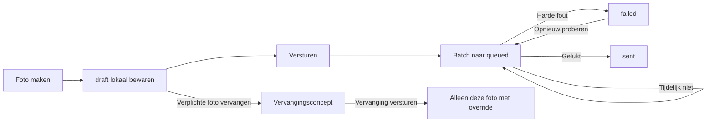

# Foto's

> Gecontroleerd op: c0687077 (2026-10-07)
> Bijgewerkt op: `c0687077` (2026-10-07; concepten, batchverzending, overrides en fasehistory)
> Bronnen: `src/domeinen/photos/`, `src/bootstrap/container.ts`, `src/bootstrap/native.ts`, `src/app/(app)/allocations/[id]/services/[serviceId]/photos/`
> Zie ook: [ADR 0020](../decisions/0020-fotos.md), [ADR 0022](../decisions/0022-offline-en-support.md), [flows](../functioneel/flows.md), [API-contract](../functioneel/api-contract.md)

## Waarvoor

De fotostroom laat de berger per dienst en fase bewijs vastleggen, ook zonder bruikbare verbinding of
locatie. De versleutelde JPEG en metadata blijven lokaal bewaard, ook na upload, totdat de server
de opdracht afrondt of de gebruiker uitlogt.

## Hoe het werkt

Het scherm bepaalt uit de dienststatus of de foto bij laden of afleveren hoort. De berger kiest een
fototype en, voor buitenkant of banden, een subpositie. Na de camera-opname versleutelt de app de
JPEG met een sleutel uit de beveiligde opslag en bewaart de metadata als lokaal `draft`. Er start
nog geen upload. Het tijdelijke camerabestand wordt verwijderd. Pas bij `Versturen` gaan alle
gewone concepten van de huidige dienst en fase samen naar de wachtrij.

De dienstdefinitie bepaalt of er één of twee fases zijn en welke posities in de huidige fase
verplicht zijn. In fase 2 wordt daarnaast iedere werkelijk gemaakte fase-1-foto een eigen
verplichte tegenfoto, inclusief extra's en herhaalde posities. De fase-1-history staat als
klikbare, vergrootbare strip boven het overzicht. Een eenfasige afgifte toont geen history.

De app leest de CRM-foto's ook wanneer lokale foto's bestaan en voegt beide bronnen occurrence-
voor-occurrence samen. Een CRM-foto kan een verplicht vak vullen. Overblijvende verzonden foto's
zijn extra's en blijven vergrendeld. Hun URL en metadata worden beveiligd opgeslagen, niet hun
JPEG-bytes. Een mislukte CRM-opvraag zonder cache mag de fotoverplichting niet stilzwijgend
goedkeuren.

Na expliciet versturen stopt een tijdelijke fout of ontbrekende locatie de drain bij de eerste
wachtende foto; later probeert de wachtrij opnieuw. Een harde HTTP-afwijzing krijgt `failed` en kan
handmatig opnieuw worden aangeboden. Een opnieuw gemaakte verzonden verplichte foto blijft eerst
een apart concept. `Vervanging versturen` uploadt alleen die foto met `overrideExisting`; de oude
serverfoto blijft geldig totdat de vervanging is bevestigd.

## Beweringen

| ID      | Bewering                                                                                                                                        | Code                                                    | Test                                                                                   |
| ------- | ----------------------------------------------------------------------------------------------------------------------------------------------- | ------------------------------------------------------- | -------------------------------------------------------------------------------------- |
| FOTO-01 | Een dienst in de afleverfase maakt afleverfoto's; iedere andere of onbekende status maakt laadfoto's.                                           | `src/domeinen/photos/domain/phase.ts`                   | `src/domeinen/photos/domain/phase.test.ts`                                             |
| FOTO-02 | Buiten- en bandenfoto's verzenden hun subpositie; andere categorieën verzenden alleen hun Nederlandse categorienaam.                            | `src/domeinen/photos/domain/photo-type.ts`              | `src/domeinen/photos/domain/photo-type.test.ts`                                        |
| FOTO-03 | Een opname wordt versleuteld met status `draft` opgeslagen en start geen upload.                                                                | `src/domeinen/photos/service/photo-service.ts`          | `src/domeinen/photos/service/photo-service.test.ts`                                    |
| FOTO-04 | De opnametijd komt van de geïnjecteerde klok en wordt voor upload als UTC-string geformatteerd.                                                 | `src/domeinen/photos/domain/utc.ts`                     | `src/domeinen/photos/domain/utc.test.ts`                                               |
| FOTO-05 | Een laadfoto krijgt uploadcommentaar `Aanvang` en een afleverfoto `Aflevering`.                                                                 | `src/domeinen/photos/domain/phase.ts`                   | `src/domeinen/photos/domain/phase.test.ts`                                             |
| FOTO-06 | Alleen de eerste foto van hetzelfde dienst-, fase- en fototype heeft `isExtra: false`; latere foto's hebben `true`.                             | `src/domeinen/photos/domain/extra.ts`                   | `src/domeinen/photos/domain/extra.test.ts`                                             |
| FOTO-07 | Een reeds verzonden foto blijft meetellen bij het bepalen van `isExtra` voor een latere foto.                                                   | `src/domeinen/photos/domain/extra.ts`                   | `src/domeinen/photos/domain/extra.test.ts`                                             |
| FOTO-08 | Zonder bruikbare locatie blijft de JPEG behouden en de foto `queued`; de locatie wordt bij een volgende drain opnieuw gelezen.                  | `src/domeinen/photos/service/photo-service.ts`          | `src/domeinen/photos/service/photo-service.test.ts`                                    |
| FOTO-09 | Een tijdelijke uploadfout behoudt de JPEG en status `queued` en plant een nieuwe poging.                                                        | `src/domeinen/photos/service/photo-service.ts`          | `src/domeinen/photos/service/photo-service.test.ts`                                    |
| FOTO-10 | Een harde HTTP-fout of niet-herhaalbare lokale fout zet die foto op `failed`, behoudt de JPEG en laat handmatige retry en volgende uploads toe. | `src/domeinen/photos/service/photo-service.ts`          | `src/domeinen/photos/service/photo-service.test.ts`                                    |
| FOTO-11 | Een geslaagde upload zet de foto op `sent`.                                                                                                     | `src/domeinen/photos/service/photo-service.ts`          | `src/domeinen/photos/service/photo-service.test.ts`                                    |
| FOTO-12 | Uploaden gebruikt multipart `POST /api/binary/upload?content=photo` met dienst, incident, locatie, positie en JPEG.                             | `src/domeinen/photos/api/photos-api.ts`                 | `src/domeinen/photos/service/photo-service.test.ts`                                    |
| FOTO-13 | Foto's van één afgeronde of afgewezen dienst kunnen met hun JPEGs worden gewist zonder foto's van andere diensten te wissen.                    | `src/domeinen/photos/service/photo-service.ts`          | `src/domeinen/photos/service/photo-service.test.ts`                                    |
| FOTO-14 | Bij uitloggen stopt de wachtrij en worden alle fotometadata en lokale JPEGs gewist.                                                             | `src/bootstrap/container.ts`                            | `src/domeinen/photos/service/photo-service.test.ts`, `src/bootstrap/container.test.ts` |
| FOTO-15 | In fase 2 toont het overzicht alle fase-1-foto's in een aanklikbare strip met vergrote preview.                                                 | `src/domeinen/photos/screens/photo-overview-screen.tsx` | —                                                                                      |
| FOTO-16 | Als foto's in de huidige fase `failed` zijn, biedt het overzicht één actie om ze allemaal opnieuw te versturen.                                 | `src/domeinen/photos/screens/photo-overview-screen.tsx` | —                                                                                      |
| FOTO-17 | Bij geweigerde cameratoestemming vraagt het scherm opnieuw wanneer dat mag en opent anders de systeeminstellingen.                              | `src/domeinen/photos/components/photo-camera.tsx`       | —                                                                                      |

### Huidige schermstroom

| ID      | Bewering                                                                                                                | Code                                                                                                                    | Test                                                        |
| ------- | ----------------------------------------------------------------------------------------------------------------------- | ----------------------------------------------------------------------------------------------------------------------- | ----------------------------------------------------------- |
| FOTO-18 | Het overzicht toont verplichte posities uit de dienstdefinitie en extra foto's van de huidige fase.                     | `src/app/(app)/allocations/[id]/services/[serviceId]/photos/index.tsx`                                                  | —                                                           |
| FOTO-19 | Voor een positie met camerahoek-uitleg toont de app eerst die uitleg als popup op de camera.                            | `src/domeinen/photos/components/mandatory-photo-help-popup.tsx`, `src/domeinen/photos/screens/photo-capture-screen.tsx` | —                                                           |
| FOTO-20 | Voor een extra foto kan de berger pas verder als een geldige positie, en zo nodig hoek of band, is gekozen.             | `src/domeinen/photos/screens/extra-photo-position-screen.tsx`                                                           | —                                                           |
| FOTO-21 | Een ongeldige of onvolledige positie in de cameraroute opent de camera niet.                                            | `src/domeinen/photos/screens/photo-capture-screen.tsx`                                                                  | `src/domeinen/photos/domain/photo-position-route.test.ts`   |
| FOTO-22 | Na iedere opname keert de app terug naar het overzicht; de foto blijft lokaal tot een expliciete verzendactie.          | `src/domeinen/photos/screens/photo-capture-screen.tsx`                                                                  | `src/domeinen/photos/service/photo-service.test.ts`         |
| FOTO-23 | `Versturen` biedt alle gewone concepten van alleen de huidige dienst en fase als één batch aan.                         | `src/domeinen/photos/service/photo-service.ts`, `src/domeinen/photos/screens/photo-overview-screen.tsx`                 | `src/domeinen/photos/service/photo-service.test.ts`         |
| FOTO-24 | Iedere fase-1-foto vereist een afzonderlijke tegenfoto in fase 2, inclusief extra's en herhaalde posities.              | `src/domeinen/photos/domain/photo-position-options.ts`                                                                  | `src/domeinen/photos/domain/photo-position-options.test.ts` |
| FOTO-25 | CRM-foto's worden naast lokale foto's opgehaald en gecachet; een netwerkfout gebruikt de laatste cache.                 | `src/domeinen/photos/service/photo-service.ts`, `src/domeinen/photos/screens/photo-overview-screen.tsx`                 | `src/domeinen/photos/service/photo-service.test.ts`         |
| FOTO-26 | Pas na een door de server bevestigde finish worden de foto's van die opdracht opgeruimd, ook na een uitgestelde finish. | `src/bootstrap/container.ts`                                                                                            | `src/bootstrap/container.test.ts`                           |
| FOTO-27 | Een verzonden verplichte foto kan als één afzonderlijke override worden vervangen; een verzonden extra foto is locked.  | `src/domeinen/photos/service/photo-service.ts`, `src/domeinen/photos/screens/photo-overview-screen.tsx`                 | `src/domeinen/photos/service/photo-service.test.ts`         |
| FOTO-28 | Een eenfasige afgifte toont alleen de verplichtingen van de dienst en geen fasehistory.                                 | `src/domeinen/photos/domain/phase.ts`, `src/domeinen/photos/screens/photo-overview-screen.tsx`                          | `src/domeinen/photos/domain/phase.test.ts`                  |

## Randgevallen en bewuste keuzes

- Opname- en uploadstatusupdates verwerken de volledige lees-wijzig-schrijfstap na elkaar.
  Daardoor kan een upload die tijdens de volgende opname afrondt geen foto uit de lijst wissen.
  Een mislukte opslagupdate blokkeert latere updates niet. Regressies staan in
  `src/domeinen/photos/service/photo-service.test.ts`.
- De teller bij verplichte foto's gebruikt het werkelijke aantal posities in het overzicht,
  inclusief eventuele tegenfoto's. Het totaal is niet vast vier. NL en EN worden getoetst in
  `src/shared/i18n/i18n.test.ts`.

- Foto-upload gebruikt dezelfde tijdelijke Expo-`File`-poort als handtekeningen, niet een
  byte-`Blob`. Het tijdelijke uploadbestand wordt na de request verwijderd; de versleutelde
  originele foto blijft bewaard volgens de bestaande opruimregels.
- Formulierverzending controleert de actuele dienstfoto's opnieuw. Zolang een foto `draft`,
  `queued` of `failed` is, wordt de dienst niet bijgewerkt. Daarna wordt een aanwezige handtekening eerst
  geüpload; ook die upload moet slagen. Zie [verwerkingsformulier](verwerkingsformulier.md).

- `isExtra` wordt bij gewone upload berekend uit lokale én opgehaalde serverfoto's van dezelfde
  dienst, fase en type. Bij een override blijft de `isExtra`-waarde van de vervangen serverfoto
  behouden. Een laadfoto maakt een afleverfoto nooit extra.
- De wachtrij start pas na een expliciete verzendactie en verwerkt daarna op volgorde. Een tijdelijk
  probleem aan de kop laat latere foto's wachten.
- `sent` foto's blijven lokaal aanwezig totdat de opdracht is afgerond of alle gebruikersdata worden gewist.
- Upload heeft een timeout van 120 seconden omdat JPEGs op een zwakke verbinding langer kunnen
  duren dan de standaardtimeout.
- De oude upload verloor het bestand na een fout; de nieuwe wachtrij bewaart het bestand. Zie
  [bekende fout 29](../functioneel/bekende-fouten-oude-app.md).
- De oude verspreide `isExtra`-regels zijn vervangen door één berekening per fase en type. Zie
  [bekende fout 30](../functioneel/bekende-fouten-oude-app.md).
- Foto's met `failed` tellen niet mee als gemaakte verplichte foto; `draft` en `queued` wel. Een eenvoudige
  extra fotocategorie is al gepositioneerd zonder hoek- of bandkeuze.
- De schermstappen FOTO-18 tot en met FOTO-23 hebben nog geen volledige scherm- of routetest; de
  genoemde domeintests toetsen alleen de positie-opties en de routevalidatie.

## Open vragen

- [Vraag 22](../functioneel/open-vragen.md): de uploadcomment is vastgesteld als `Aanvang` bij laden
  en `Aflevering` bij afleveren.
- [Vragen 34 en 35](../functioneel/open-vragen.md) zijn door de productkeuzes voor vergelijking,
  herstel, verzenden en eenvoudige posities ingevuld.
- [Vraag 36](../functioneel/open-vragen.md): de backend moet nog bevestigen hoe een override bij
  meerdere identieke `isExtra: true`-foto's exact één serverrecord kiest.
