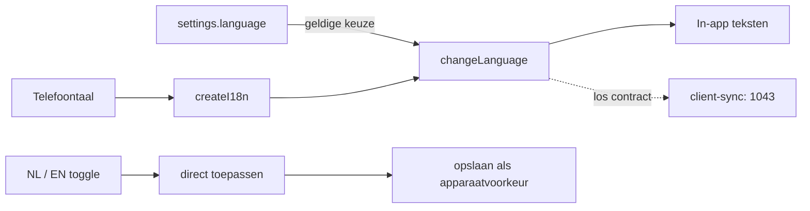

# Internationalisatie

> Gecontroleerd op: `ba1383c` (2026-09-23)
> Bronnen: `src/shared/i18n/`, `src/domeinen/settings/service/language-settings.ts`, `src/domeinen/settings/components/language-toggle.tsx`, `src/domeinen/reference-data/domain/language-code.ts`, `src/bootstrap/native.ts`, `src/bootstrap/container.ts`
> Zie ook: [ADR 0013](../decisions/0013-referentiedata-sync.md), [ADR 0021](../decisions/0021-instellingen-en-toestemmingen.md), [conventies](../conventions.md#7-tekst-i18n)

## Waarvoor

De app toont alle in-app teksten in Nederlands of Engels en kan direct wisselen zonder herstart. De
gekozen UI-taal is een apparaatvoorkeur; de taalcode voor CRM-referentiedata is een afzonderlijk,
nog niet bevestigd backendcontract.

## Hoe het werkt

De native bootstrap kiest eerst Nederlands voor een telefoontaal die met `nl` begint en anders
Engels. `createI18n` maakt daarna een eigen, direct geïnitialiseerde i18next-instance. Tijdens
`container.start()` past `LanguageSettings.restore()` een geldige opgeslagen keuze toe voordat de
eerste appweergave verschijnt.

De Nederlandse resource is de typesleutel voor `t(...)`; Engels heeft via het type
`Translations` dezelfde structuur. De runtime-test controleert bovendien gelijke sleutels, niet-lege
teksten en gelijke `{{placeholders}}`.

## Beweringen

| ID      | Bewering                                                                                                                                          | Code                                                                                                        | Test                                                                                         |
| ------- | ------------------------------------------------------------------------------------------------------------------------------------------------- | ----------------------------------------------------------------------------------------------------------- | -------------------------------------------------------------------------------------------- |
| I18N-01 | De app ondersteunt precies de UI-talen Nederlands (`nl`) en Engels (`en`).                                                                        | `src/shared/i18n/resources.ts`                                                                              | `src/shared/i18n/i18n.test.ts`                                                               |
| I18N-02 | Als een vertaling wordt toegevoegd, moeten Nederlands en Engels dezelfde sleutels en placeholders hebben en mogen teksten niet leeg zijn.         | `src/shared/i18n/resources.ts`, `src/shared/i18n/i18next.d.ts`                                              | `src/shared/i18n/i18n.test.ts`                                                               |
| I18N-03 | Als i18n wordt gemaakt, is de instance direct gereed en valt een ontbrekende runtime-sleutel zichtbaar terug op de sleutel zelf.                  | `src/shared/i18n/i18n.ts`                                                                                   | `src/shared/i18n/i18n.test.ts`                                                               |
| I18N-04 | Als de telefoontaal met `nl` begint, start de app in het Nederlands; anders start hij in het Engels.                                              | `src/bootstrap/native.ts`                                                                                   | —                                                                                            |
| I18N-05 | Als de berger een taal kiest, wisselt de app direct en bewaart hij die onder `settings.language`.                                                 | `src/domeinen/settings/service/language-settings.ts`                                                        | `src/domeinen/settings/service/language-settings.test.ts`                                    |
| I18N-06 | Als een geldige taalkeuze is opgeslagen, herstelt de app die bij de volgende start, ook nadat de vorige gebruiker is uitgelogd (open vraag 12).   | `src/domeinen/settings/service/language-settings.ts`, `src/bootstrap/container.ts`                          | `src/domeinen/settings/service/language-settings.test.ts`, `src/bootstrap/container.test.ts` |
| I18N-07 | Als geen geldige keuze bestaat of opslag niet leesbaar is, houdt de app de al gekozen telefoontaal.                                               | `src/domeinen/settings/service/language-settings.ts`                                                        | `src/domeinen/settings/service/language-settings.test.ts`                                    |
| I18N-08 | Als het opslaan van een nieuwe taal mislukt, wisselt de app toch direct en schrijft hij een waarschuwing naar de logger.                          | `src/domeinen/settings/service/language-settings.ts`                                                        | `src/domeinen/settings/service/language-settings.test.ts`                                    |
| I18N-09 | Als de UI-taal Engels is, gebruikt `client-sync` toch taalcode 1043 totdat de backend een Engelse code bevestigt (open vraag 6).                  | `src/domeinen/reference-data/domain/language-code.ts`                                                       | `src/domeinen/reference-data/domain/language-code.test.ts`                                   |
| I18N-10 | Als de taalwissel op het instellingenscherm wordt aangetikt, geeft de component alleen een andere, ondersteunde taal door aan `LanguageSettings`. | `src/domeinen/settings/components/language-toggle.tsx`, `src/domeinen/settings/screens/settings-screen.tsx` | —                                                                                            |

## Randgevallen en bewuste keuzes

- De opgeslagen taal is gewone apparaatopslag en geen gebruikers- of sessiegegeven. Uitloggen wist
  haar daarom niet.
- Een ongeldige opgeslagen waarde, zoals `de`, wordt genegeerd en niet automatisch overschreven.
- `createI18n` gebruikt Nederlands als fallbacktaal, maar de native startkeuze is Engels voor iedere
  niet-Nederlandse telefoontaal.
- De taal voor `reference-data` wordt bij het bouwen van de container bepaald. Omdat beide
  ondersteunde UI-talen nu 1043 opleveren, verandert een UI-wissel het CRM-contract niet.
- Native permissieteksten uit `app.config.ts` staan buiten i18next en blijven Nederlands.
- De oude app wiste de taal bij uitloggen; dit is bewust niet overgenomen. Zie
  [bekende fouten en bewuste verschillen](../functioneel/bekende-fouten-oude-app.md) onder "Niet
  overgenomen, ter controle".

## Open vragen

- [Open vraag 6](../functioneel/open-vragen.md): welke taalcode accepteert `client-sync` voor Engels?
  De app stuurt voor `nl` en `en` nu 1043 omdat 1033 op tst 500-antwoorden gaf.
- [Open vraag 12](../functioneel/open-vragen.md): product moet nog bevestigen dat uitloggen de
  apparaatvoorkeur voor taal niet wist.
