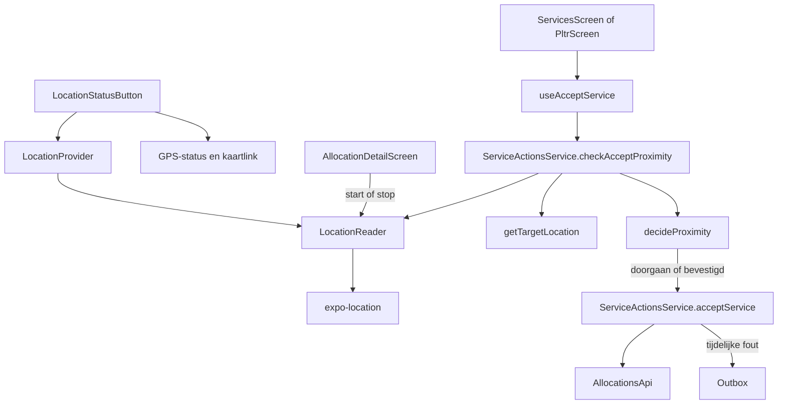

# Locatie

> Gecontroleerd op: `ea9b92c3` (2026-10-19)
> Bronnen: `src/domeinen/location/`, `src/domeinen/services/domain/target-location.ts`, `src/domeinen/allocations/hooks/use-accept-service.ts`, `src/domeinen/allocations/service/service-actions-service.ts`, `src/domeinen/allocations/screens/allocation-detail-screen.tsx`, `src/bootstrap/container.ts`, `src/bootstrap/providers.tsx`, `src/bootstrap/native.ts`
> Zie ook: [ADR 0016](../decisions/0016-diensten-en-locatie.md), [flows](../functioneel/flows.md#7-instellingen-werkt), [statussen](../functioneel/statussen.md#doellocatie-en-de-500-m-controle)

## Waarvoor

Locatie ondersteunt twee gebruikersfuncties: de GPS-status in de opdrachtenbalk en de
nabijheidscontrole voordat een dienst wordt geaccepteerd. De app leest alleen voorgrondposities
en stuurt geen live locatie naar de backend.

## Hoe het werkt

De locatielezer is als poort in bootstrap gekoppeld. Op het diensten- of PLTR-detailscherm loopt
een voorgrond-watch (Balanced) zolang het scherm focus heeft. Accepteren vraagt een meting die
hoogstens 5 seconden oud is en nauwkeuriger dan 500 meter; ontbreekt die, dan wacht de lezer op
de volgende watch-update of geeft na 10 seconden een ongeldige positie. Pure functies kiezen het
doel en berekenen de afstand; de hook toont alleen wanneer nodig een bevestiging.

## Beweringen

| ID     | Bewering                                                                                                                                                                                     | Code                                                                                                                                                                    | Test                                                                                                                                                                                   |
| ------ | -------------------------------------------------------------------------------------------------------------------------------------------------------------------------------------------- | ----------------------------------------------------------------------------------------------------------------------------------------------------------------------- | -------------------------------------------------------------------------------------------------------------------------------------------------------------------------------------- |
| LOC-01 | Eenmalige lezingen gebruiken hoge of lage nauwkeurigheid; accepteren gebruikt een voorgrond-watch met Balanced-nauwkeurigheid die alleen loopt terwijl het detailscherm focus heeft.         | `src/domeinen/location/platform/rn/expo-location-reader.ts`, `src/domeinen/allocations/screens/allocation-detail-screen.tsx`                                            | —                                                                                                                                                                                      |
| LOC-02 | Bij een nog onbepaalde toestemming vraagt de locatielezer voorgrondtoestemming; bij weigering, geen fix of een leesfout levert hij een ongeldige positie op.                                 | `src/domeinen/location/platform/rn/expo-location-reader.ts`, `src/domeinen/location/service/location-reader.ts`                                                         | —                                                                                                                                                                                      |
| LOC-03 | Een coördinaat is alleen bruikbaar als breedte en lengte beide eindige getallen binnen hun bereik zijn; alleen het paar `(0, 0)` geldt als onbekend.                                         | `src/domeinen/location/domain/geo.ts`                                                                                                                                   | `src/domeinen/location/domain/geo.test.ts`                                                                                                                                             |
| LOC-04 | Een geldige positie op minder dan 500 meter van het doel gaat zonder bevestiging door; vanaf 500 meter is bevestiging nodig.                                                                 | `src/domeinen/location/domain/proximity.ts`                                                                                                                             | `src/domeinen/location/domain/proximity.test.ts`                                                                                                                                       |
| LOC-05 | Een onbekende actuele positie vraagt bevestiging met reden `no-current-location`; een onbekend doel met bekende positie gebruikt `no-target-location`.                                       | `src/domeinen/location/domain/proximity.ts`                                                                                                                             | `src/domeinen/location/domain/proximity.test.ts`                                                                                                                                       |
| LOC-06 | Voor een gewone dienst is de afleverlocatie het doel als die bruikbaar is, anders de incidentlocatie.                                                                                        | `src/domeinen/services/domain/target-location.ts`                                                                                                                       | `src/domeinen/services/domain/target-location.test.ts`                                                                                                                                 |
| LOC-07 | Voor PLTR is de laadlocatie het doel totdat status `875920004` is bereikt; in die afleverfase krijgt de afleverlocatie voorrang.                                                             | `src/domeinen/services/domain/target-location.ts`                                                                                                                       | `src/domeinen/services/domain/target-location.test.ts`                                                                                                                                 |
| LOC-08 | Wanneer een PLTR-faselocatie ontbreekt, valt de doelkeuze terug op een bruikbare afleverlocatie en daarna op de incidentlocatie.                                                             | `src/domeinen/services/domain/target-location.ts`                                                                                                                       | `src/domeinen/services/domain/target-location.test.ts`                                                                                                                                 |
| LOC-09 | De GPS-knop is groen wanneer toestemming is verleend, ook zonder fix; bij nog te vragen of definitief geweigerde toestemming is hij rood.                                                    | `src/domeinen/location/domain/gps-status.ts`, `src/domeinen/location/components/location-status-button.tsx`                                                             | `src/domeinen/location/domain/gps-status.test.ts`                                                                                                                                      |
| LOC-10 | Bij focus en bij handmatig verversen leest de GPS-knop toestemming en positie opnieuw; alleen een bruikbare positie werkt het tijdstip bij.                                                  | `src/domeinen/location/components/location-status-button.tsx`                                                                                                           | —                                                                                                                                                                                      |
| LOC-11 | De GPS-sheet vraagt toestemming zolang dat nog kan en opent systeeminstellingen wanneer opnieuw vragen niet meer mogelijk is.                                                                | `src/domeinen/location/domain/gps-status.ts`, `src/domeinen/location/components/location-status-button.tsx`                                                             | —                                                                                                                                                                                      |
| LOC-12 | De knop om de huidige positie op een kaart te openen verschijnt alleen bij een bruikbare coördinaat en gebruikt een Google Maps-zoek-URL.                                                    | `src/domeinen/location/components/location-status-button.tsx`, `src/domeinen/location/domain/maps-url.ts`                                                               | `src/domeinen/location/domain/maps-url.test.ts`                                                                                                                                        |
| LOC-13 | Het accepteren van een dienst voert eerst de locatiebeslissing uit; bij een bevestigingsuitkomst wordt pas na toestemming van de berger verstuurd.                                           | `src/domeinen/allocations/hooks/use-accept-service.ts`, `src/domeinen/allocations/service/service-actions-service.ts`                                                   | —                                                                                                                                                                                      |
| LOC-14 | Als het incident of de dienst zelf ontbreekt, laat `checkAcceptLocation` de acceptatie zonder nabijheidsbevestiging doorgaan.                                                                | `src/domeinen/services/domain/target-location.ts`                                                                                                                       | `src/domeinen/services/domain/target-location.test.ts`                                                                                                                                 |
| LOC-15 | De app registreert vanuit het locatiedomein geen live positie bij de backend.                                                                                                                | `src/domeinen/location/platform/rn/expo-location-reader.ts`, `src/bootstrap/container.ts`                                                                               | —                                                                                                                                                                                      |
| LOC-16 | Een acceptatiemeting telt alleen als de onzekerheid kleiner is dan 500 meter en de meting hoogstens 5 seconden oud is; anders wacht de lezer of levert na 10 seconden een ongeldige positie. | `src/domeinen/location/domain/fresh-sample.ts`, `src/domeinen/location/service/wait-for-fresh-sample.ts`, `src/domeinen/allocations/service/service-actions-service.ts` | `src/domeinen/location/domain/fresh-sample.test.ts`, `src/domeinen/location/service/wait-for-fresh-sample.test.ts`, `src/domeinen/allocations/service/service-actions-service.test.ts` |
| LOC-17 | In voorbeeldmodus start het detailscherm geen locatiewatch.                                                                                                                                  | `src/domeinen/allocations/screens/allocation-detail-screen.tsx`                                                                                                         | —                                                                                                                                                                                      |

## Randgevallen en bewuste keuzes

- Eén bruikbare coördinaat is niet genoeg; beide waarden zijn vereist. Dit voorkomt regressie 10
  uit [bekende fouten](../functioneel/bekende-fouten-oude-app.md).
- `(0, 5)` en `(52, 0)` zijn geldige coördinaten; alleen `(0, 0)` wordt als onbekend behandeld.
- De nabijheidscheck blokkeert niet definitief bij ontbrekende locatie. De berger krijgt een
  bevestiging en kan bewust doorgaan.
- Er is geen aparte locatie-uitlegroute bij de eerste start. Uitleg en toestemmingsbeheer staan in
  instellingen; de toolbar gebruikt direct de systeemtoestemming.
- De Expo-adapter en de GPS-sheet hebben geen geautomatiseerde apparaat- of componenttest.
- De 500 m-drempel is de speling rond het doeladres. De acceptatiemeting moet die straal kunnen
  onderscheiden (onzekerheid kleiner dan 500 m) en van het moment van accepteren zijn (maximaal
  5 seconden oud).

## Open vragen

- [Open vraag 14](../functioneel/open-vragen.md): moet de app live positie naar
  `POST /api/incidents/{id}/registerlocation` sturen, en zo ja hoe vaak? Dit is niet gebouwd.
- [Open vraag 31](../functioneel/open-vragen.md): moet er alsnog een apart
  locatie-uitlegscherm komen? De huidige aanname is nee.
- Het gedrag van systeemdialogen, GPS-fixes en terugkeer uit systeeminstellingen is niet in een
  apparaattest vastgelegd.
