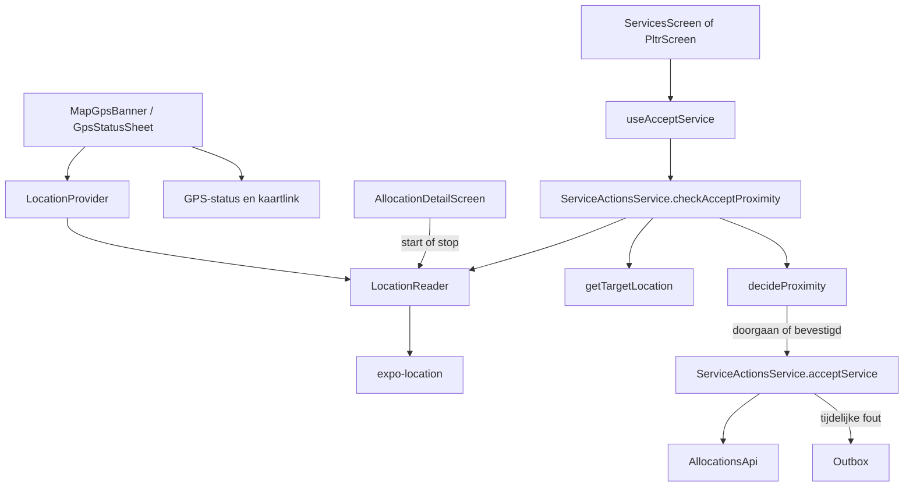

# Locatie

> Gecontroleerd op: `631fa807` (2026-10-20; OSM Android)
> Bronnen: `src/domeinen/location/`, `src/domeinen/services/domain/target-location.ts`, `src/domeinen/allocations/hooks/use-accept-service.ts`, `src/domeinen/allocations/service/service-actions-service.ts`, `src/domeinen/allocations/screens/allocation-detail-screen.tsx`, `src/domeinen/allocations/screens/allocations-map-screen.tsx`, `src/domeinen/allocations/components/allocations-map-view.tsx`, `src/domeinen/allocations/components/osm-allocations-map-view.tsx`, `src/bootstrap/container.ts`, `src/bootstrap/providers.tsx`, `src/bootstrap/native.ts`
> Zie ook: [ADR 0016](../decisions/0016-diensten-en-locatie.md), [ADR 0031](../decisions/0031-allocations-kaart.md), [flows](../functioneel/flows.md#7-instellingen-werkt), [statussen](../functioneel/statussen.md#doellocatie-en-de-500-m-controle)

## Waarvoor

Locatie ondersteunt twee gebruikersfuncties: de GPS-status op de allocations-kaart (banner +
sheet) en de nabijheidscontrole voordat een dienst wordt geaccepteerd. De app leest alleen
voorgrondposities en stuurt geen live locatie naar de backend.

## Hoe het werkt

De locatielezer is als poort in bootstrap gekoppeld. Op het diensten- of PLTR-detailscherm loopt
een voorgrond-watch (Balanced) zolang het scherm focus heeft. Accepteren vraagt een meting die
hoogstens 5 seconden oud is en nauwkeuriger dan 500 meter; ontbreekt die, dan wacht de lezer op
de volgende watch-update of geeft na 10 seconden een ongeldige positie. Pure functies kiezen het
doel en berekenen de afstand; de hook toont alleen wanneer nodig een bevestiging.

## Beweringen

| ID     | Bewering                                                                                                                                                                                                                                                                                                                                                                                     | Code                                                                                                                                                                                                                                                                                   | Test                                                                                                                                                                                   |
| ------ | -------------------------------------------------------------------------------------------------------------------------------------------------------------------------------------------------------------------------------------------------------------------------------------------------------------------------------------------------------------------------------------------- | -------------------------------------------------------------------------------------------------------------------------------------------------------------------------------------------------------------------------------------------------------------------------------------- | -------------------------------------------------------------------------------------------------------------------------------------------------------------------------------------- |
| LOC-01 | Eenmalige lezingen gebruiken hoge of lage nauwkeurigheid; accepteren gebruikt een voorgrond-watch met Balanced-nauwkeurigheid die alleen loopt terwijl het detailscherm focus heeft.                                                                                                                                                                                                         | `src/domeinen/location/platform/rn/expo-location-reader.ts`, `src/domeinen/allocations/screens/allocation-detail-screen.tsx`                                                                                                                                                           | —                                                                                                                                                                                      |
| LOC-02 | Bij een nog onbepaalde toestemming vraagt de locatielezer voorgrondtoestemming; bij weigering, geen fix of een leesfout levert hij een ongeldige positie op.                                                                                                                                                                                                                                 | `src/domeinen/location/platform/rn/expo-location-reader.ts`, `src/domeinen/location/service/location-reader.ts`                                                                                                                                                                        | —                                                                                                                                                                                      |
| LOC-03 | Een coördinaat is alleen bruikbaar als breedte en lengte beide eindige getallen binnen hun bereik zijn; alleen het paar `(0, 0)` geldt als onbekend.                                                                                                                                                                                                                                         | `src/domeinen/location/domain/geo.ts`                                                                                                                                                                                                                                                  | `src/domeinen/location/domain/geo.test.ts`                                                                                                                                             |
| LOC-04 | Een geldige positie op minder dan 500 meter van het doel gaat zonder bevestiging door; vanaf 500 meter is bevestiging nodig.                                                                                                                                                                                                                                                                 | `src/domeinen/location/domain/proximity.ts`                                                                                                                                                                                                                                            | `src/domeinen/location/domain/proximity.test.ts`                                                                                                                                       |
| LOC-05 | Een onbekende actuele positie vraagt bevestiging met reden `no-current-location`; een onbekend doel met bekende positie gebruikt `no-target-location`.                                                                                                                                                                                                                                       | `src/domeinen/location/domain/proximity.ts`                                                                                                                                                                                                                                            | `src/domeinen/location/domain/proximity.test.ts`                                                                                                                                       |
| LOC-06 | Voor een gewone dienst is de afleverlocatie het doel als die bruikbaar is, anders de incidentlocatie.                                                                                                                                                                                                                                                                                        | `src/domeinen/services/domain/target-location.ts`                                                                                                                                                                                                                                      | `src/domeinen/services/domain/target-location.test.ts`                                                                                                                                 |
| LOC-07 | Voor PLTR is de laadlocatie het doel totdat status `875920004` is bereikt; in die afleverfase krijgt de afleverlocatie voorrang.                                                                                                                                                                                                                                                             | `src/domeinen/services/domain/target-location.ts`                                                                                                                                                                                                                                      | `src/domeinen/services/domain/target-location.test.ts`                                                                                                                                 |
| LOC-08 | Wanneer een PLTR-faselocatie ontbreekt, valt de doelkeuze terug op een bruikbare afleverlocatie en daarna op de incidentlocatie.                                                                                                                                                                                                                                                             | `src/domeinen/services/domain/target-location.ts`                                                                                                                                                                                                                                      | `src/domeinen/services/domain/target-location.test.ts`                                                                                                                                 |
| LOC-09 | De GPS-indicator (banner-dot / toolbar-variant) is groen wanneer toestemming is verleend, ook zonder fix; bij nog te vragen of definitief geweigerde toestemming is hij rood.                                                                                                                                                                                                                | `src/domeinen/location/domain/gps-status.ts`, `src/domeinen/allocations/components/map-gps-banner.tsx`                                                                                                                                                                                 | `src/domeinen/location/domain/gps-status.test.ts`                                                                                                                                      |
| LOC-10 | Bij focus, periodieke refresh op de kaart en handmatig verversen leest de GPS-status toestemming en positie opnieuw; alleen een bruikbare positie werkt het tijdstip bij.                                                                                                                                                                                                                    | `src/domeinen/location/hooks/use-gps-status.ts`, `src/domeinen/allocations/screens/allocations-map-screen.tsx`                                                                                                                                                                         | —                                                                                                                                                                                      |
| LOC-11 | De GPS-sheet vraagt toestemming zolang dat nog kan en opent systeeminstellingen wanneer opnieuw vragen niet meer mogelijk is.                                                                                                                                                                                                                                                                | `src/domeinen/location/domain/gps-status.ts`, `src/domeinen/location/components/gps-status-sheet.tsx`                                                                                                                                                                                  | —                                                                                                                                                                                      |
| LOC-12 | De knop om de huidige positie op een kaart te openen verschijnt alleen bij een bruikbare coördinaat en gebruikt een Google Maps-zoek-URL.                                                                                                                                                                                                                                                    | `src/domeinen/location/components/gps-status-sheet.tsx`, `src/domeinen/location/domain/maps-url.ts`                                                                                                                                                                                    | `src/domeinen/location/domain/maps-url.test.ts`                                                                                                                                        |
| LOC-13 | Het accepteren van een dienst voert eerst de locatiebeslissing uit; bij een bevestigingsuitkomst wordt pas na toestemming van de berger verstuurd.                                                                                                                                                                                                                                           | `src/domeinen/allocations/hooks/use-accept-service.ts`, `src/domeinen/allocations/service/service-actions-service.ts`                                                                                                                                                                  | —                                                                                                                                                                                      |
| LOC-14 | Als het incident of de dienst zelf ontbreekt, laat `checkAcceptLocation` de acceptatie zonder nabijheidsbevestiging doorgaan.                                                                                                                                                                                                                                                                | `src/domeinen/services/domain/target-location.ts`                                                                                                                                                                                                                                      | `src/domeinen/services/domain/target-location.test.ts`                                                                                                                                 |
| LOC-15 | De app registreert vanuit het locatiedomein geen live positie bij de backend.                                                                                                                                                                                                                                                                                                                | `src/domeinen/location/platform/rn/expo-location-reader.ts`, `src/bootstrap/container.ts`                                                                                                                                                                                              | —                                                                                                                                                                                      |
| LOC-16 | Een acceptatiemeting telt alleen als de onzekerheid kleiner is dan 500 meter en de meting hoogstens 5 seconden oud is; anders wacht de lezer of levert na 10 seconden een ongeldige positie.                                                                                                                                                                                                 | `src/domeinen/location/domain/fresh-sample.ts`, `src/domeinen/location/service/wait-for-fresh-sample.ts`, `src/domeinen/allocations/service/service-actions-service.ts`                                                                                                                | `src/domeinen/location/domain/fresh-sample.test.ts`, `src/domeinen/location/service/wait-for-fresh-sample.test.ts`, `src/domeinen/allocations/service/service-actions-service.test.ts` |
| LOC-17 | In voorbeeldmodus start het detailscherm geen locatiewatch.                                                                                                                                                                                                                                                                                                                                  | `src/domeinen/allocations/screens/allocation-detail-screen.tsx`                                                                                                                                                                                                                        | —                                                                                                                                                                                      |
| LOC-18 | De allocations-kaart toont één marker per opdracht met bruikbare incidentcoördinaten (`dn_latitude` / `dn_longtitude`); ontbrekende of `(0, 0)`-paren vallen weg. Markers zijn genummerd 1…n in lijstvolgorde (actief, dan pending); het cijfer staat zichtbaar op de pin (iOS annotation-tekst, Android Leaflet DivIcon). PLTR is paars, overige blauw.                                     | `src/domeinen/allocations/domain/map-markers.ts`, `src/domeinen/allocations/components/allocations-map-view.tsx`, `src/domeinen/allocations/components/osm-allocations-map-view.tsx`                                                                                                   | `src/domeinen/allocations/domain/map-markers.test.ts`                                                                                                                                  |
| LOC-19 | De kaart opent meteen op markers, of op de eigen GPS als er geen markers zijn (anders Nederland). Na mount herspringt de camera niet meer naar “alle pins + GPS” (dat trok het beeld naar verre/foute coördinaten). Alleen zonder markers centreert coarse `getCurrent` op de berger. Live positie: iOS via `isMyLocationEnabled`, Android als OSM-circle marker.                            | `src/domeinen/location/domain/map-camera.ts`, `src/domeinen/allocations/screens/allocations-map-screen.tsx`, `src/domeinen/allocations/components/allocations-map-view.tsx`                                                                                                            | `src/domeinen/location/domain/map-camera.test.ts`                                                                                                                                      |
| LOC-24 | Een opdrachtkaart in de lijst met bruikbare incidentcoördinaten krijgt bij naar rechts vegen een actie “Bekijk op kaart”. Die opent `/allocations-map?allocationId=…` en de kaart start dan ingezoomd (straatniveau) op die pin in plaats van alle pins te omkaderen. Zonder coördinaten is er geen veegactie naar rechts; een onbekend id valt terug op het normale startbeeld.             | `src/domeinen/allocations/components/allocation-row.tsx`, `src/domeinen/allocations/components/allocation-actions.tsx`, `src/domeinen/allocations/domain/map-markers.ts`, `src/domeinen/location/domain/map-camera.ts`, `src/domeinen/allocations/screens/allocations-map-screen.tsx`  | `src/domeinen/allocations/domain/map-markers.test.ts`, `src/domeinen/location/domain/map-camera.test.ts`                                                                               |
| LOC-23 | Een center-knop op de kaart (boven de GPS-banner) centreert op de live GPS op buurtzoom; tijdens het ophalen toont de knop een spinner.                                                                                                                                                                                                                                                      | `src/domeinen/allocations/components/map-center-button.tsx`, `src/domeinen/allocations/screens/allocations-map-screen.tsx`                                                                                                                                                             | —                                                                                                                                                                                      |
| LOC-22 | Android-overzichtskaart gebruikt OpenStreetMap via Leaflet in een WebView (geen Google Maps SDK-sleutel); iOS blijft Apple Maps via `expo-maps`. WebView-berichten voor marker-/kaarttik en camera worden in domain geparsed.                                                                                                                                                                | `src/domeinen/allocations/components/osm-allocations-map-view.tsx`, `src/domeinen/allocations/domain/osm-map-bridge.ts`                                                                                                                                                                | `src/domeinen/allocations/domain/osm-map-bridge.test.ts`                                                                                                                               |
| LOC-20 | Alleen zonder locatietoestemming toont de kaart een melding met link naar toestemmingen; een ontbrekende GPS-fix blokkeert het openen van de kaart niet. Zonder markers een informatieve melding, de kaart en GPS-banner blijven zichtbaar.                                                                                                                                                  | `src/domeinen/allocations/screens/allocations-map-screen.tsx`                                                                                                                                                                                                                          | —                                                                                                                                                                                      |
| LOC-21 | Zonder geselecteerde opdracht toont de kaart onderaan een GPS-banner met status en coördinaten; tippen opent de GPS-sheet. Tijdens een GPS-refresh toont de banner een kleine spinner terwijl de vorige coördinaten zichtbaar blijven. Een opdrachtmarker verbergt de banner; tippen nabij de eigen positie opent de GPS-sheet weer. De allocations-toolbar heeft geen aparte GPS-knop meer. | `src/domeinen/allocations/components/map-gps-banner.tsx`, `src/domeinen/allocations/screens/allocations-map-screen.tsx`, `src/domeinen/location/hooks/use-gps-status.ts`, `src/domeinen/location/domain/map-self-tap.ts`, `src/domeinen/onboarding/components/allocations-toolbar.tsx` | `src/domeinen/location/domain/map-self-tap.test.ts`                                                                                                                                    |

## Randgevallen en bewuste keuzes

- Eén bruikbare coördinaat is niet genoeg; beide waarden zijn vereist. Dit voorkomt regressie 10
  uit [bekende fouten](../functioneel/bekende-fouten-oude-app.md).
- `(0, 5)` en `(52, 0)` zijn geldige coördinaten; alleen `(0, 0)` wordt als onbekend behandeld.
- De nabijheidscheck blokkeert niet definitief bij ontbrekende locatie. De berger krijgt een
  bevestiging en kan bewust doorgaan.
- Er is geen aparte locatie-uitlegroute bij de eerste start. Uitleg en toestemmingsbeheer staan in
  instellingen; de toolbar gebruikt direct de systeemtoestemming.
- De Expo-adapter en de GPS-sheet hebben geen geautomatiseerde apparaat- of componenttest.
- De 500 m-drempel is de speling rond het doeladres. De acceptatiemeting moet die straal kunnen
  onderscheiden (onzekerheid kleiner dan 500 m) en van het moment van accepteren zijn (maximaal
  5 seconden oud).
- De overzichtskaart (`/allocations-map`, [ADR 0031](../decisions/0031-allocations-kaart.md)):
  iOS Apple Maps (`expo-maps`), Android OpenStreetMap (Leaflet/WebView). Navigatie naar één
  adres blijft via externe apps. Marker-tik opent het detail (iOS 18+ / Android); op iOS 17
  alleen de titel.
- De kaart wacht niet op GPS: markers verschijnen meteen; de live stip volgt op de achtergrond.
  Fine GPS wordt voor framing niet gebruikt. OSM-tegels en Leaflet laden online; attribution
  blijft zichtbaar.
- De startcamera wordt één keer vastgezet. Automatische hersprong naar markers+GPS gebeurt niet
  meer; terug naar jezelf via de center-knop (`setCameraPosition`). Android toont Leaflet
  zoom-controls.
- GPS-controle zit op de kaart (banner/sheet), niet meer als toolbartegel. Tippen nabij de eigen
  positie is best-effort via map-press; de banner is het zekere pad.
- “Bekijk op kaart” (LOC-24) is alleen tikbaar dankzij
  `patches/react-native-gesture-handler@2.32.0.patch`: in 2.32 ligt de (onzichtbare) container
  van de rechteracties over de linkeracties en vangt de tik af. Upstream is dit vanaf 2.33
  opgelost; de patch kan weg zodra Expo een versie ≥ 2.33 meelevert.
- `expo-maps` (iOS) zit in alpha en werkt niet in Expo Go; een development build is verplicht.
  `react-native-webview` is nodig voor de Android-kaart.

## Open vragen

- [Open vraag 14](../functioneel/open-vragen.md): moet de app live positie naar
  `POST /api/incidents/{id}/registerlocation` sturen, en zo ja hoe vaak? Dit is niet gebouwd.
- [Open vraag 31](../functioneel/open-vragen.md): moet er alsnog een apart
  locatie-uitlegscherm komen? De huidige aanname is nee.
- [Open vraag 44](../functioneel/open-vragen.md): hebben alle opdrachttypen bruikbare
  incidentcoördinaten voor de kaartmarkers?
- Het gedrag van systeemdialogen, GPS-fixes en terugkeer uit systeeminstellingen is niet in een
  apparaattest vastgelegd.
