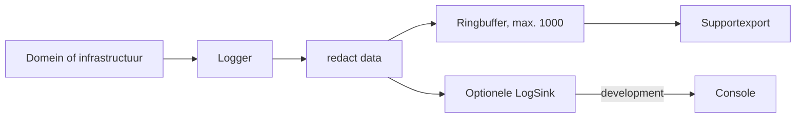

# Logging en privacy

> Gecontroleerd op: `ba1383c` (2026-09-23)
> Bronnen: `src/shared/logging/`, `src/shared/api/http-client.ts`, `src/domeinen/notifications/service/push-runtime.ts`, `src/shared/platform/rn/console-sink.ts`, `src/bootstrap/container.ts`
> Zie ook: [ADR 0010](../decisions/0010-logging-en-monitoring.md), [ADR 0022](../decisions/0022-offline-en-support.md), [architectuur](../architecture.md#logging-en-privacy)

## Waarvoor

De logger geeft developers en support genoeg context om fouten te onderzoeken zonder tokens,
codes, volledige contactgegevens of ruwe payloads te bewaren. Logging blijft onafhankelijk van een
monitoringdienst: domeincode schrijft alleen naar de gedeelde `Logger`.

## Hoe het werkt

Iedere logaanroep krijgt een niveau, categorie, bericht en optionele data. De logger maakt met de
`Clock` een tijdstempel, haalt de data door `redact`, bewaart de geredigeerde entry in een
ringbuffer en stuurt dezelfde entry eventueel naar een `LogSink`.

De categorieën zijn `app`, `auth`, `http`, `sync`, `notifications`, `location`, `photos`,
`navigation` en `serviceForm`. Niveaus zijn `debug`, `info`, `warn` en `error`.

## Beweringen

| ID     | Bewering                                                                                                                                                                 | Code                                                 | Test                                                      |
| ------ | ------------------------------------------------------------------------------------------------------------------------------------------------------------------------ | ---------------------------------------------------- | --------------------------------------------------------- |
| LOG-01 | Als een bericht wordt gelogd, bewaart de logger tijdstempel, niveau, categorie, bericht en eventuele geredigeerde data.                                                  | `src/shared/logging/logger.ts`                       | `src/shared/logging/logger.test.ts`                       |
| LOG-02 | Als de ringbuffer zijn capaciteit overschrijdt, verwijdert de logger steeds de oudste entry.                                                                             | `src/shared/logging/logger.ts`                       | `src/shared/logging/logger.test.ts`                       |
| LOG-03 | Als logdata een sleutel met token, authorization, wachtwoord, secret, jwt, cookie, sms-code, verificatiecode of otp bevat, wordt de waarde op ieder niveau `[redacted]`. | `src/shared/logging/redact.ts`                       | `src/shared/logging/redact.test.ts`                       |
| LOG-04 | Als logdata een telefoonnummer, e-mail, gebruikersnaam of IBAN als tekst bevat, blijven alleen de laatste drie tekens zichtbaar.                                         | `src/shared/logging/redact.ts`                       | `src/shared/logging/redact.test.ts`                       |
| LOG-05 | Als logdata te lang, te groot of te diep is, kapt `redact` tekst na 500 tekens, arrays na 50 items en objecten na vijf niveaus af.                                       | `src/shared/logging/redact.ts`                       | `src/shared/logging/redact.test.ts`                       |
| LOG-06 | Als een `Error` wordt gelogd, bewaart `redact` alleen naam en bericht en niet de stack.                                                                                  | `src/shared/logging/redact.ts`                       | `src/shared/logging/redact.test.ts`                       |
| LOG-07 | Als een optionele sink is ingesteld, ontvangt die iedere opgebouwde logentry.                                                                                            | `src/shared/logging/logger.ts`                       | `src/shared/logging/logger.test.ts`                       |
| LOG-08 | Als de API een ProblemDetails-fout teruggeeft, logt de HTTP-client wel de trace-id maar niet de menselijke responsebody.                                                 | `src/shared/api/http-client.ts`                      | `src/shared/api/http-client.test.ts`                      |
| LOG-09 | Als de HTTP-client een verzoek verstuurt, schrijft hij de requestbody niet naar de logger.                                                                               | `src/shared/api/http-client.ts`                      | —                                                         |
| LOG-10 | Als een pushbericht wordt verwerkt, komt de ruwe payload niet in de logger.                                                                                              | `src/domeinen/notifications/service/push-runtime.ts` | `src/domeinen/notifications/service/push-runtime.test.ts` |
| LOG-11 | Als de inlog- en refreshflow tokens, een sms-code of een telefoonnummer verwerkt, komen de oorspronkelijke waarden niet in de containerlog.                              | `src/bootstrap/container.ts`                         | `src/bootstrap/container.test.ts`                         |
| LOG-12 | Als de app geen developmentbuild is, schrijft de console-sink niets naar de console.                                                                                     | `src/shared/platform/rn/console-sink.ts`             | —                                                         |
| LOG-13 | Als logs worden geëxporteerd, kan de formatter op categorie en leeftijd filteren, het aantal beperken en de nieuwste entries eerst zetten.                               | `src/shared/logging/logger.ts`                       | `src/shared/logging/logger.test.ts`                       |

## Randgevallen en bewuste keuzes

- De standaardbuffer bevat maximaal 1000 entries en leeft alleen in het geheugen. Een app-herstart
  wist de buffer; er is geen persistente logopslag.
- `redact` beslist op sleutelnaam. Vrije tekst in het logbericht zelf wordt niet op telefoonnummer,
  e-mail of tokenpatronen gescand; callers moeten daarom geen persoonsgegevens in berichten
  interpoleren.
- Een `Error.message` wordt bewaard. Callers mogen dus geen geheim of persoonsgegeven in een
  foutbericht stoppen.
- `entries()` geeft een kopie van de buffer terug, zodat een consument de interne buffer niet kan
  wijzigen.
- Alleen `src/shared/platform/rn/` mag `console.*` gebruiken; de architectuurtest bewaakt dit.
- De oude app logde de volledige pushpayload. Die regressie is afgedekt; zie
  [bekende fouten, rij 19](../functioneel/bekende-fouten-oude-app.md).
- Er is nog geen remote crash- of foutmonitoring en dus ook geen upload van de lokale buffer.

## Open vragen

- [Open vraag 15](../functioneel/open-vragen.md): het team moet nog een monitoringoplossing kiezen.
  Voorwaarde is dat gegevens door dezelfde redactielaag gaan en domeincode alleen een `LogSink`
  kent.
