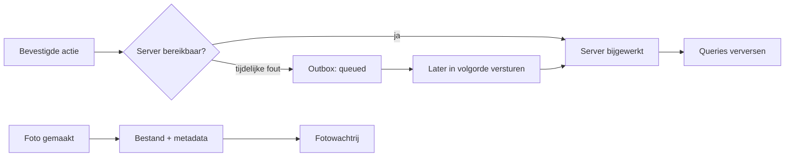

# Offline werken

> Gecontroleerd op: `ba1383c` (2026-09-23)
> Bronnen: `src/domeinen/outbox/`, `src/domeinen/photos/service/`, `src/domeinen/allocations/service/`, `src/shared/query/query-cache-store.ts`, `src/bootstrap/container.ts`
> Zie ook: [ADR 0005](../decisions/0005-state.md), [ADR 0020](../decisions/0020-fotos.md), [ADR 0022](../decisions/0022-offline-en-support.md), [flows](../functioneel/flows.md#8-offline-en-support-werkt-deels)

## Waarvoor

Een berger moet bevestigd werk en foto's niet kwijtraken wanneer het netwerk wegvalt. De app bewaart
mutaties en foto-uploads lokaal voor latere bezorging en herstelt geslaagde queryresultaten zodat de
laatst bekende lijst zonder verbinding beschikbaar blijft.

## Hoe het werkt

Er zijn drie verschillende offline-mechanismen. De mutatie-outbox bewaart bevestigde opdrachten en
diensten, de fotowachtrij bewaart metadata in beveiligde opslag plus versleutelde JPEG-bestanden en TanStack Query bewaart alleen
geslaagde queryresultaten.

De outbox verwerkt steeds het oudste `queued`-item. Een tijdelijk probleem houdt dat item aan de
kop; een harde HTTP-afwijzing maakt alleen dat item `failed`, waarna het volgende `queued`-item mag
worden verstuurd. Alleen `queued`-items leveren op opdracht- en dienstkaarten het label "wacht op
verbinding".

## Beweringen

| ID     | Bewering                                                                                                                                                     | Code                                                                                           | Test                                                                                                     |
| ------ | ------------------------------------------------------------------------------------------------------------------------------------------------------------ | ---------------------------------------------------------------------------------------------- | -------------------------------------------------------------------------------------------------------- |
| OFF-01 | Als een nieuwe mutatie faalt door netwerk, time-out, 408, 429 of 5xx, mag de service haar in de outbox zetten; een harde 4xx of gewone programmeerfout niet. | `src/domeinen/outbox/domain/delivery.ts`                                                       | `src/domeinen/outbox/domain/delivery.test.ts`                                                            |
| OFF-02 | Als het oudste outboxitem tijdelijk faalt, blijft het aan de kop en worden latere items nog niet verstuurd.                                                  | `src/domeinen/outbox/service/outbox-service.ts`                                                | `src/domeinen/outbox/service/outbox-service.test.ts`                                                     |
| OFF-03 | Als een outboxpoging tijdelijk faalt, plant de app nieuwe pogingen na 5, 15, 60 en daarna steeds 300 seconden.                                               | `src/domeinen/outbox/service/outbox-service.ts`                                                | —                                                                                                        |
| OFF-04 | Als een outboxitem hard door HTTP wordt afgewezen, krijgt alleen dat item status `failed` en gaat de verwerking door met het volgende item.                  | `src/domeinen/outbox/service/outbox-service.ts`                                                | `src/domeinen/outbox/service/outbox-service.test.ts`                                                     |
| OFF-05 | Als opdracht afronden tijdelijk faalt, bewaart de app een `finish-allocation`-commando en verstuurt dat later.                                               | `src/domeinen/allocations/service/allocation-actions-service.ts`, `src/bootstrap/container.ts` | `src/domeinen/allocations/service/allocation-actions-service.test.ts`, `src/bootstrap/container.test.ts` |
| OFF-06 | Als opdracht afwijzen tijdelijk faalt, bewaart de app een `decline-allocation`-commando met de gekozen statuscode.                                           | `src/domeinen/allocations/service/allocation-actions-service.ts`                               | —                                                                                                        |
| OFF-07 | Als opdracht accepteren na een geslaagde eenheidscontrole tijdelijk faalt, bewaart de app een `accept-allocation`-commando.                                  | `src/domeinen/allocations/service/allocation-actions-service.ts`                               | —                                                                                                        |
| OFF-08 | Als dienst accepteren tijdelijk faalt, bewaart de app een `accept-service`-commando.                                                                         | `src/domeinen/allocations/service/service-actions-service.ts`                                  | `src/domeinen/allocations/service/service-actions-service.test.ts`                                       |
| OFF-09 | Als dienst weigeren tijdelijk faalt, bewaart de app een `decline-service`-commando met de gekozen statuscode (open vraag 30).                                | `src/domeinen/allocations/service/service-actions-service.ts`                                  | `src/domeinen/allocations/service/service-actions-service.test.ts`, `src/bootstrap/container.test.ts`    |
| OFF-10 | Als een outboxcommando de server bereikt, verwijdert de app het item en invalideert hij opdrachten en diensten.                                              | `src/domeinen/outbox/service/outbox-service.ts`, `src/bootstrap/container.ts`                  | —                                                                                                        |
| OFF-11 | Als alleen `failed`-items voor een opdracht of dienst bestaan, toont de kaart geen label "wacht op verbinding".                                              | `src/domeinen/outbox/domain/pending.ts`                                                        | `src/domeinen/outbox/domain/pending.test.ts`                                                             |
| OFF-12 | Als een query succesvol is, kan de app die bewaren en in een nieuwe QueryClient herstellen.                                                                  | `src/shared/query/query-cache-store.ts`                                                        | `src/shared/query/query-cache-store.test.ts`                                                             |
| OFF-13 | Als de bewaarde querycache geen geldige gedehydrateerde state is, verwijdert de app die cache.                                                               | `src/shared/query/query-cache-store.ts`                                                        | `src/shared/query/query-cache-store.test.ts`                                                             |
| OFF-14 | Als een querycachewijziging binnenkomt, bewaart de container de cache na 500 ms; alleen succesvolle queries worden opgenomen.                                | `src/bootstrap/container.ts`, `src/shared/query/query-cache-store.ts`                          | —                                                                                                        |
| OFF-15 | Als een foto-upload tijdelijk faalt, blijven beveiligde metadata en versleutelde JPEG bestaan en probeert de fotowachtrij later opnieuw.                     | `src/domeinen/photos/service/photo-service.ts`, `src/domeinen/photos/service/photo-files.ts`   | `src/domeinen/photos/service/photo-service.test.ts`, `src/bootstrap/container.test.ts`                   |
| OFF-16 | Als een foto geen bruikbare locatie heeft, blijft hij `queued` en wordt bij een volgende verwerking opnieuw een locatie gelezen.                             | `src/domeinen/photos/service/photo-service.ts`                                                 | `src/domeinen/photos/service/photo-service.test.ts`                                                      |
| OFF-17 | Als een foto-upload hard met 4xx wordt afgewezen, wordt de foto `failed` zonder het JPEG-bestand te verwijderen.                                             | `src/domeinen/photos/service/photo-service.ts`                                                 | `src/domeinen/photos/service/photo-service.test.ts`                                                      |
| OFF-18 | Als de sessie eindigt, wist de container de QueryClient, de bewaarde querycache, alle foto's en de outbox.                                                   | `src/bootstrap/container.ts`                                                                   | —                                                                                                        |

## Randgevallen en bewuste keuzes

- De outbox bevat alleen acties die de berger al bevestigd heeft. Queryfouten of formulierinhoud
  worden niet automatisch als mutatie opgeslagen.
- Een `failed` outboxitem blijft bewaard maar blokkeert de rest niet en heeft nog geen
  gebruikersscherm voor handmatig herstel. Een mislukte foto kan op het fotoscherm wel opnieuw op
  `queued` worden gezet.
- Een onbekende niet-HTTP-fout tijdens het verwerken van een al opgeslagen outboxitem wordt opnieuw
  geprobeerd. Zo'n fout wordt bij een nieuwe mutatie niet aan de outbox toegevoegd.
- De fotowachtrij en mutatie-outbox hebben ieder hun eigen opslag en retrylus; een succes in de ene
  wachtrij zegt niets over de andere.
- De oude app verloor een foto na een tijdelijke uploadfout. De nieuwe app bewaart het bestand; zie
  [bekende fouten, rij 29](../functioneel/bekende-fouten-oude-app.md).
- Er is geen expliciete integratietest die bewijst dat uitloggen zowel `outbox.queue`, `photos.queue`
  als `query.cache` op opslag wist. De losse clear-functies en de containerkoppeling bestaan wel.

## Open vragen

- [Open vraag 30](../functioneel/open-vragen.md): product moet nog bevestigen dat dienst weigeren
  offline in de outbox mag; de huidige implementatie doet dit wel.
