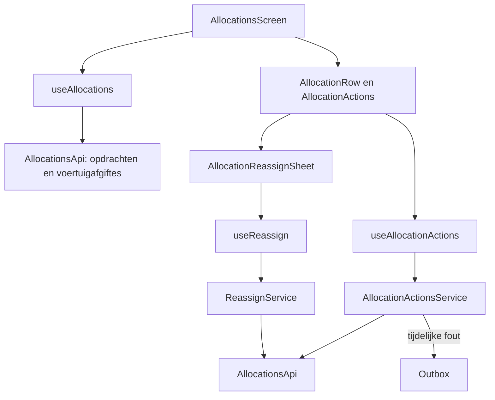

# Opdrachten

> Gecontroleerd op: `4cf3132b` (2026-10-13; werkboom, tijdzone op kaarten)
> Bronnen: `src/domeinen/allocations/`, `src/domeinen/worker/`, `src/domeinen/outbox/`, `src/shared/utils/time.ts`, `src/app/(app)/allocations/`, `src/bootstrap/container.ts`
> Zie ook: [ADR 0015](../decisions/0015-opdrachtenlijst-acties.md), [ADR 0018](../decisions/0018-verwerken-naad-en-overdragen.md), [flows](../functioneel/flows.md#2-opdrachtenlijst-werkt), [statussen](../functioneel/statussen.md#opdrachten-allocations)

## Waarvoor

De opdrachtenlijst is het werkoverzicht van de berger. Vanuit dit overzicht kan de berger een
opdracht openen, accepteren, afwijzen, afronden of aan een collega overdragen en de lijst met
voertuigafgiftes bekijken.

## Hoe het werkt

De route `/` opent via de onboarding-gate het opdrachtenoverzicht. De lijstquery en de query voor
voertuigafgiftes blijven gescheiden. Acties op een opdracht lopen via een hook en service naar de
API; alleen retrybare mutatiefouten worden als opdracht in de outbox bewaard.

## Beweringen

| ID      | Bewering                                                                                                                                                                                                                                                                                                                      | Code                                                                                                                                                                                                                                          | Test                                                                                                                          |
| ------- | ----------------------------------------------------------------------------------------------------------------------------------------------------------------------------------------------------------------------------------------------------------------------------------------------------------------------------- | --------------------------------------------------------------------------------------------------------------------------------------------------------------------------------------------------------------------------------------------- | ----------------------------------------------------------------------------------------------------------------------------- |
| OPDR-01 | De API leest `GET /api/allocations` rij voor rij; een ongeldige rij wordt overgeslagen en maakt niet de hele lijst onbruikbaar.                                                                                                                                                                                               | `src/domeinen/allocations/api/allocations-api.ts`, `src/domeinen/allocations/api/schemas.ts`                                                                                                                                                  | `src/domeinen/allocations/api/allocations-api.test.ts`, `src/domeinen/allocations/api/schemas.test.ts`                        |
| OPDR-02 | De lijst bevat achtereenvolgens actieve opdrachten, wachtende opdrachten en voertuigafgiftes; actief staat in omgekeerde servervolgorde en wachtend op incidentnaam.                                                                                                                                                          | `src/domeinen/allocations/domain/sections.ts`                                                                                                                                                                                                 | `src/domeinen/allocations/domain/sections.test.ts`                                                                            |
| OPDR-03 | Een gesloten opdracht is verborgen, behalve status `875920007` (wacht op overdracht); een onbekende opdrachtstatus is ook verborgen.                                                                                                                                                                                          | `src/domeinen/allocations/domain/status.ts`                                                                                                                                                                                                   | `src/domeinen/allocations/domain/status.test.ts`                                                                              |
| OPDR-04 | Trek-om-te-verversen laadt zowel de opdrachten als de voertuigafgiftes opnieuw.                                                                                                                                                                                                                                               | `src/domeinen/allocations/screens/allocations-screen.tsx`, `src/domeinen/allocations/hooks/use-allocations.ts`                                                                                                                                | —                                                                                                                             |
| OPDR-05 | Voor het accepteren controleert de app opnieuw of de eenheid bruikbaar is; bij herregistratie of blokkade wordt de acceptatie niet verstuurd.                                                                                                                                                                                 | `src/domeinen/allocations/service/allocation-actions-service.ts`                                                                                                                                                                              | `src/domeinen/allocations/service/allocation-actions-service.test.ts`                                                         |
| OPDR-06 | Een geaccepteerde opdracht wordt met statuscode `875920000` naar `PUT /api/allocations/{id}/accept` gestuurd.                                                                                                                                                                                                                 | `src/domeinen/allocations/service/allocation-actions-service.ts`, `src/domeinen/allocations/api/allocations-api.ts`                                                                                                                           | `src/domeinen/allocations/service/allocation-actions-service.test.ts`, `src/domeinen/allocations/api/allocations-api.test.ts` |
| OPDR-07 | Bij een tijdelijke fout tijdens accepteren, afwijzen of afronden bewaart de app de mutatie in de outbox; een niet-retrybare fout wordt niet in de wachtrij gezet.                                                                                                                                                             | `src/domeinen/allocations/service/allocation-actions-service.ts`, `src/domeinen/outbox/domain/delivery.ts`                                                                                                                                    | `src/domeinen/allocations/service/allocation-actions-service.test.ts`, `src/domeinen/outbox/domain/delivery.test.ts`          |
| OPDR-08 | Afwijsredenen komen uit `dn_allocation_statuscode`; voortgangsstatussen worden uitgefilterd en de afrondcode wordt alleen opgenomen wanneer afronden is toegestaan.                                                                                                                                                           | `src/domeinen/allocations/service/allocation-actions-service.ts`, `src/domeinen/allocations/domain/decline.ts`                                                                                                                                | `src/domeinen/allocations/service/allocation-actions-service.test.ts`, `src/domeinen/allocations/domain/decline.test.ts`      |
| OPDR-09 | Een opdracht kan niet worden afgewezen zolang minstens één dienst in de actieve werkbak staat; alleen wachtende diensten blokkeren afwijzen niet.                                                                                                                                                                             | `src/domeinen/allocations/domain/decline.ts`, `src/domeinen/services/domain/status.ts`                                                                                                                                                        | `src/domeinen/allocations/domain/decline.test.ts`, `src/domeinen/services/domain/status.test.ts`                              |
| OPDR-10 | Afronden gebruikt geen apart endpoint maar verstuurt statuscode `875920014` via de afwijsaanroep.                                                                                                                                                                                                                             | `src/domeinen/allocations/service/allocation-actions-service.ts`, `src/domeinen/allocations/api/allocations-api.ts`                                                                                                                           | `src/domeinen/allocations/service/allocation-actions-service.test.ts`, `src/domeinen/allocations/api/allocations-api.test.ts` |
| OPDR-11 | Een opdracht geldt als afgerond wanneer het incident de status laatste vertrek heeft of alle geladen diensten `875920005` of `875920003` hebben.                                                                                                                                                                              | `src/domeinen/allocations/domain/finished.ts`                                                                                                                                                                                                 | `src/domeinen/allocations/domain/finished.test.ts`                                                                            |
| OPDR-12 | Een opdracht zonder geladen diensten geldt niet als afgerond.                                                                                                                                                                                                                                                                 | `src/domeinen/allocations/domain/finished.ts`                                                                                                                                                                                                 | `src/domeinen/allocations/domain/finished.test.ts`                                                                            |
| OPDR-13 | Overdragen wordt alleen aangeboden bij een wachtende opdracht en wanneer het eigen medewerkerrecord `dn_canforwardallocationcode` als waar oplevert.                                                                                                                                                                          | `src/domeinen/allocations/components/allocation-row.tsx`, `src/domeinen/worker/domain/status.ts`                                                                                                                                              | —                                                                                                                             |
| OPDR-14 | Het aantikken van een collega in de bottom sheet start het overdragen direct, zonder extra bevestigingsstap.                                                                                                                                                                                                                  | `src/domeinen/allocations/components/allocation-reassign-sheet.tsx`, `src/domeinen/allocations/hooks/use-reassign.ts`                                                                                                                         | —                                                                                                                             |
| OPDR-15 | Als de toewijzingen van één voertuigafgiftelocatie niet laden, verdwijnt alleen die locatie en blijven de overige locaties zichtbaar.                                                                                                                                                                                         | `src/domeinen/allocations/api/allocations-api.ts`                                                                                                                                                                                             | `src/domeinen/allocations/api/allocations-api.test.ts`                                                                        |
| OPDR-16 | Een opdrachtkaart toont “wacht op verbinding” zolang voor die opdracht een queued outbox-item bestaat.                                                                                                                                                                                                                        | `src/domeinen/allocations/components/allocation-row.tsx`, `src/domeinen/outbox/domain/pending.ts`                                                                                                                                             | —                                                                                                                             |
| OPDR-17 | Overdragen verstuurt `POST /api/incidents/{incidentId}/reassign/{colleagueId}` en ververst na succes de opdrachtenquery.                                                                                                                                                                                                      | `src/domeinen/allocations/hooks/use-reassign.ts`, `src/domeinen/allocations/service/reassign-service.ts`, `src/domeinen/allocations/api/allocations-api.ts`                                                                                   | `src/domeinen/allocations/service/reassign-service.test.ts`, `src/domeinen/allocations/api/allocations-api.test.ts`           |
| OPDR-18 | Datum en klok op de incidentkaart tonen UTC-tijdstempels in de tijdzone van het apparaat (of een expliciet doorgegeven zone).                                                                                                                                                                                                 | `src/domeinen/allocations/domain/incident-card.ts`, `src/shared/utils/time.ts`                                                                                                                                                                | `src/domeinen/allocations/domain/incident-card.test.ts`, `src/shared/utils/time.test.ts`                                      |
| OPDR-19 | Tikken op een voertuigafgifte opent direct het Afgifte-formulier (typecode 9000) met `locationId` en `serviceId`, zonder diensten- of PLTR-scherm. Het Afgifte-schema vereist vier foto's (`links-voor`, `rechts-voor`, `rechts-achter`, `links-achter`); de fotoflow deelt `locationId` en ruimt lokale foto's op na submit. | `src/domeinen/allocations/components/vehicle-release-row.tsx`, `src/app/(app)/vehicle-releases/[locationId]/services/[serviceId]/form.tsx`, `src/domeinen/allocations/domain/release-service.ts`, `src/domeinen/photos/screens/photo-flow.ts` | `src/domeinen/allocations/domain/release-service.test.ts`, `src/bootstrap/container.test.ts`                                  |
| OPDR-20 | Na submit van een locatie-afgifte gaat de exit naar terminal en ververst de app de voertuigafgifte-query.                                                                                                                                                                                                                     | `src/domeinen/allocations/hooks/use-processing-exit.ts`, `src/domeinen/services/domain/processing-exit.ts`, `src/domeinen/service-form/domain/submission.ts`                                                                                  | `src/domeinen/services/domain/processing-exit.test.ts`, `src/domeinen/service-form/domain/submission.test.ts`                 |

## Randgevallen en bewuste keuzes

- Een lege dienstenlijst maakt een verse opdracht niet afrondbaar. Dit voorkomt regressie 9 uit
  [bekende fouten](../functioneel/bekende-fouten-oude-app.md).
- Een kapotte API-rij breekt niet de hele opdrachtenlijst. Dit voorkomt regressie 21 uit
  [bekende fouten](../functioneel/bekende-fouten-oude-app.md).
- Succes en “wacht op verbinding” verschijnen als toast in plaats van een blokkerende dialoog. Dit
  voorkomt regressie 36 en volgt [ADR 0024](../decisions/0024-feedback-en-dialogen.md).
- Een voertuigafgiftelocatie kan worden opengeklapt; een afzonderlijk voertuig opent het
  Afgifte-formulier (`vehicle-releases/.../form`), zoals de oude `ReleaseCard` → `ProcessingService`.
- De code ververst de lijst bij trek-om-te-verversen en na geslaagde acties. In het
  `allocations`-domein staat geen afzonderlijke focus-hook die bij elke terugkeer naar het scherm
  ververst.

## Open vragen

- [Open vraag 2](../functioneel/open-vragen.md): moet een opdracht zonder diensten toch als
  afgerond gelden? De huidige aanname is nee.
- [Open vraag 8](../functioneel/open-vragen.md): betekent omgekeerde servervolgorde werkelijk
  “nieuwste eerst”? De huidige implementatie keert de ontvangen actieve lijst om.
- De zichtbaarheid van overdragen en de bottom sheet hebben geen componenttest; alleen de
  losse bevoegdheidsregel en de service/API-aanroep zijn getest.
