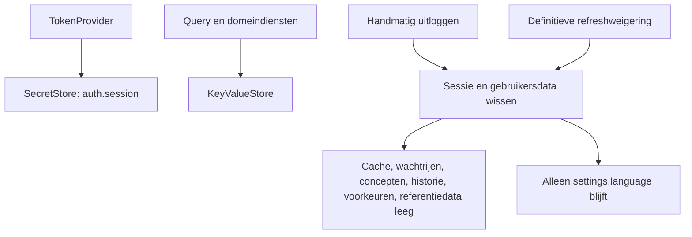

# Opslagsleutels

> Gecontroleerd op: `c1506088` (2026-10-08)
> Bronnen: `src/shared/query/query-cache-store.ts`, `src/domeinen/*/service/`, `src/shared/platform/`, `src/bootstrap/container.ts`
> Zie ook: [ADR 0006](../decisions/0006-opslag.md), [ADR 0005](../decisions/0005-state.md), [bekende fouten](../functioneel/bekende-fouten-oude-app.md)

## Waarvoor

De app bewaart een sessie beveiligd en houdt gewone caches, voorkeuren en wachtrijen apart. Deze
pagina is de volledige lijst van logische sleutels die de huidige broncode via `SecretStore` of
`KeyValueStore` gebruikt.

## Hoe het werkt

De secure adapter verdeelt de logische sessiewaarde over fysieke stukken. De gewone opslagadapter
gebruikt SQLite en bewaart niet-geheime gegevens zonder chunking.

## Beweringen

| ID        | Bewering                                                                                                                                                                                                               | Code                                                                                                                              | Test                                                                                                        |
| --------- | ---------------------------------------------------------------------------------------------------------------------------------------------------------------------------------------------------------------------- | --------------------------------------------------------------------------------------------------------------------------------- | ----------------------------------------------------------------------------------------------------------- |
| OPSLAG-01 | `auth.session` bevat de volledige sessie als één logische JSON-waarde in `SecretStore`; uitloggen verwijdert deze waarde.                                                                                              | `src/domeinen/auth/service/session-repository.ts`                                                                                 | `src/domeinen/auth/service/session-repository.test.ts`                                                      |
| OPSLAG-02 | De secure opslag verdeelt `auth.session` in stukken van maximaal 1800 tekens onder `auth.session.0`, `auth.session.1`, enzovoort en schrijft het aantal onder `auth.session`.                                          | `src/shared/platform/chunked-store.ts`, `src/shared/platform/rn/secure-store.ts`                                                  | `src/shared/platform/chunked-store.test.ts`                                                                 |
| OPSLAG-03 | Een beschadigde of onvolledige opgeslagen sessie geldt als afwezig en wordt verwijderd.                                                                                                                                | `src/domeinen/auth/service/session-repository.ts`, `src/shared/platform/chunked-store.ts`                                         | `src/domeinen/auth/service/session-repository.test.ts`, `src/shared/platform/chunked-store.test.ts`         |
| OPSLAG-04 | `query.cache` bevat alleen geslaagde Query-resultaten; uitloggen verwijdert de sleutel.                                                                                                                                | `src/shared/query/query-cache-store.ts`, `src/bootstrap/container.ts`                                                             | `src/shared/query/query-cache-store.test.ts`, `src/bootstrap/container.test.ts`                             |
| OPSLAG-05 | `outbox.queue` bevat de duurzame mutatiewachtrij; uitloggen bewaart onder deze sleutel een lege lijst.                                                                                                                 | `src/domeinen/outbox/service/outbox-repository.ts`, `src/domeinen/outbox/service/outbox-service.ts`, `src/bootstrap/container.ts` | `src/domeinen/outbox/service/outbox-service.test.ts`, `src/bootstrap/container.test.ts`                     |
| OPSLAG-06 | `photos.queue` bevat fotometadata in beveiligde opslag; uitloggen verwijdert de sleutel en de versleutelde fotobestanden.                                                                                              | `src/domeinen/photos/service/photo-repository.ts`, `src/domeinen/photos/service/photo-service.ts`, `src/bootstrap/container.ts`   | `src/domeinen/photos/service/photo-service.test.ts`, `src/bootstrap/container.test.ts`                      |
| OPSLAG-07 | `serviceForm.drafts` bevat alle formulierconcepten; uitloggen verwijdert de sleutel.                                                                                                                                   | `src/domeinen/service-form/service/draft-storage.ts`, `src/bootstrap/container.ts`                                                | `src/domeinen/service-form/service/draft-storage.test.ts`, `src/bootstrap/container.test.ts`                |
| OPSLAG-08 | `notifications.history` bevat de meldingshistorie; uitloggen maakt de geheugenstatus leeg en verwijdert de sleutel.                                                                                                    | `src/domeinen/notifications/service/notification-history.ts`, `src/bootstrap/container.ts`                                        | `src/domeinen/notifications/service/notification-history.test.ts`, `src/bootstrap/container.test.ts`        |
| OPSLAG-09 | `settings.language` bevat `nl` of `en`; de keuze wordt bij starten hersteld en blijft na uitloggen bewaard — de enige sleutel die uitloggen niet wist.                                                                 | `src/domeinen/settings/service/language-settings.ts`, `src/bootstrap/container.ts`                                                | `src/domeinen/settings/service/language-settings.test.ts`, `src/bootstrap/container.test.ts` (taal)         |
| OPSLAG-17 | `settings.permissionDisclosure.seen` bevat een JSON-array van afgehandelde disclosure-kinds (`notifications`, `location`, `camera`); uitloggen verwijdert de sleutel.                                                  | `src/domeinen/settings/service/permission-disclosure-preference.ts`, `src/bootstrap/container.ts`                                 | `src/domeinen/settings/service/permission-disclosure-preference.test.ts`, `src/bootstrap/container.test.ts` |
| OPSLAG-10 | `allocationUnit.rememberedEndDate` bevat de onthouden eindtijd als ISO-datum; uitloggen verwijdert de sleutel.                                                                                                         | `src/domeinen/allocation-unit/service/end-date-preference.ts`, `src/bootstrap/container.ts`                                       | `src/domeinen/allocation-unit/service/end-date-preference.test.ts`, `src/bootstrap/container.test.ts`       |
| OPSLAG-11 | `referenceData.pending` bevat een nog niet afgeronde syncbatch en `referenceData.since` pas de datum van een volledig afgeronde batch.                                                                                 | `src/domeinen/reference-data/service/reference-data-service.ts`                                                                   | `src/domeinen/reference-data/service/reference-data-service.test.ts`                                        |
| OPSLAG-12 | `referenceData.entities` bevat de namen van eerder gesynchroniseerde entiteiten en elke entiteit staat onder `referenceData.entity.<naam>`.                                                                            | `src/domeinen/reference-data/service/reference-data-service.ts`                                                                   | `src/domeinen/reference-data/service/reference-data-service.test.ts`                                        |
| OPSLAG-13 | Uitloggen wist via `clearAll()` `referenceData.pending`, `referenceData.since`, `referenceData.entities` en elke `referenceData.entity.<naam>`.                                                                        | `src/domeinen/reference-data/service/reference-data-service.ts`, `src/bootstrap/container.ts`                                     | `src/domeinen/reference-data/service/reference-data-service.test.ts`, `src/bootstrap/container.test.ts`     |
| OPSLAG-14 | Handmatig uitloggen wacht op het wissen van alle gebruikersgebonden opslag voordat de auth-service klaar is.                                                                                                           | `src/domeinen/auth/service/auth-service.ts`, `src/bootstrap/container.ts`                                                         | `src/domeinen/auth/service/auth-service.test.ts`, `src/bootstrap/container.test.ts`                         |
| OPSLAG-15 | Bij een definitief verlopen sessie start dezelfde opslagopschoning; alleen de taalkeuze blijft.                                                                                                                        | `src/bootstrap/container.ts`                                                                                                      | `src/bootstrap/container.test.ts` (sessie kan niet worden behouden)                                         |
| OPSLAG-16 | `allocationUnit.rememberedHomebaseLocationId` bevat het `dn_companylocationid` van de laatst gekozen uitvoerlocatie; uitloggen verwijdert de sleutel. De lijst zelf komt uit `referenceData.entity.homebaselocations`. | `src/domeinen/allocation-unit/service/homebase-preference.ts`, `src/bootstrap/container.ts`                                       | `src/domeinen/allocation-unit/service/homebase-preference.test.ts`, `src/bootstrap/container.test.ts`       |

## Randgevallen en bewuste keuzes

- Foto-JPEG's staan versleuteld in de documentmap; `photos.encryptionKey`, `photos.queue` en
  `photos.server` staan in `SecretStore`. Uitloggen verwijdert sleutel en metadata, niet alleen
  een lege JSON-lijst. CRM-foto's bewaren alleen URL en metadata, geen gedownloade JPEG.
- `photos.encryptionKey` bevat de AES-256-GCM-sleutel; `photos.server` bevat alleen gevalideerde
  CRM-foto-URL's en posities per opdracht, dienst en fase. Beide sleutels worden bij uitloggen
  verwijderd; bij een geslaagde opdracht-finish verdwijnen de bijbehorende foto- en formulierdata.
- `outbox.queue` blijft na leegmaken als JSON-lijst `[]` bestaan; foto- en andere
  gebruikersgebonden sleutels worden verwijderd.
- De sessie gebruikt één logische sleutel. Dit voorkomt de oude inconsistentie tussen losse token-
  en vervaltijdsleutels en herstelt regressies 2 en 3 uit
  [bekende fouten](../functioneel/bekende-fouten-oude-app.md).
- Referentiedata wordt bij uitloggen volledig gewist (`clearAll`); de volgende login synchroniseert
  alles opnieuw. Alleen `settings.language` blijft (open vraag 12).
- `allocationUnit.recentTruckIds` wordt eveneens bij uitloggen gewist.

## Open vragen

- [Open vraag 12](../functioneel/open-vragen.md): besloten — alles weg behalve taal.
- [Open vraag 19](../functioneel/open-vragen.md): sessies uit een eerdere appversie worden niet
  gemigreerd.
