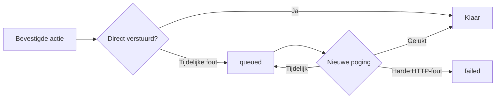

# Outbox

> Gecontroleerd op: ba1383c (2026-09-23)
> Bronnen: `src/domeinen/outbox/`, `src/bootstrap/container.ts`, `src/bootstrap/providers.tsx`
> Zie ook: [ADR 0022](../decisions/0022-offline-en-support.md), [ADR 0024](../decisions/0024-feedback-en-dialogen.md), [API-contract](../functioneel/api-contract.md), [statussen](../functioneel/statussen.md)

## Waarvoor

De outbox bewaart bevestigde mutaties die door een tijdelijke storing niet bij de backend aankomen.
Daardoor hoeft de berger een geaccepteerde, afgewezen of afgeronde actie niet opnieuw uit te voeren
zodra de verbinding terugkomt.

## Hoe het werkt

Een actieservice probeert eerst de backend. Alleen bij een tijdelijke fout maakt zij een command en
zet dat achteraan in de duurzame wachtrij. De outbox verstuurt `queued` items in volgorde.

Een tijdelijke fout houdt het eerste item aan de kop en plant een retry. Een harde HTTP-afwijzing
markeert alleen dat item als `failed`; het volgende `queued` item mag daarna door. Geslaagde commands
worden verwijderd en laten de opdrachten- en dienstencaches verversen.

## Beweringen

| ID        | Bewering                                                                                                                  | Code                                                          | Test                                                               |
| --------- | ------------------------------------------------------------------------------------------------------------------------- | ------------------------------------------------------------- | ------------------------------------------------------------------ |
| OUTBOX-01 | Alleen een retrybare netwerk-, timeout-, 408-, 429- of 5xx-fout is reden om een direct mislukte mutatie in te plannen.    | `src/domeinen/outbox/domain/delivery.ts`                      | `src/domeinen/outbox/domain/delivery.test.ts`                      |
| OUTBOX-02 | De wachtrij kent vijf commands: opdracht afronden, afwijzen en accepteren, en dienst accepteren en afwijzen.              | `src/domeinen/outbox/domain/delivery.ts`                      | —                                                                  |
| OUTBOX-03 | Een nieuw command wordt achteraan toegevoegd met status `queued` en nul pogingen.                                         | `src/domeinen/outbox/service/outbox-service.ts`               | `src/domeinen/outbox/service/outbox-service.test.ts`               |
| OUTBOX-04 | `queued` commands worden in opslagvolgorde één voor één verstuurd.                                                        | `src/domeinen/outbox/service/outbox-service.ts`               | `src/domeinen/outbox/service/outbox-service.test.ts`               |
| OUTBOX-05 | Een tijdelijke verzendfout houdt het eerste item `queued`, verhoogt zijn pogingen en blokkeert latere items tot de retry. | `src/domeinen/outbox/service/outbox-service.ts`               | `src/domeinen/outbox/service/outbox-service.test.ts`               |
| OUTBOX-06 | Retryvertragingen lopen op van 5 naar 15, 60 en maximaal 300 seconden.                                                    | `src/domeinen/outbox/service/outbox-service.ts`               | —                                                                  |
| OUTBOX-07 | Een harde HTTP-afwijzing zet alleen dat item op `failed` en laat het volgende `queued` item doorgaan.                     | `src/domeinen/outbox/service/outbox-service.ts`               | `src/domeinen/outbox/service/outbox-service.test.ts`               |
| OUTBOX-08 | Een geslaagd command wordt uit de wachtrij verwijderd.                                                                    | `src/domeinen/outbox/service/outbox-service.ts`               | `src/domeinen/outbox/service/outbox-service.test.ts`               |
| OUTBOX-09 | Alleen `queued` items leveren een wacht-op-verbindingmarkering voor hun opdracht of dienst.                               | `src/domeinen/outbox/domain/pending.ts`                       | `src/domeinen/outbox/domain/pending.test.ts`                       |
| OUTBOX-10 | Een beschadigde opgeslagen wachtrij wordt als leeg gelezen.                                                               | `src/domeinen/outbox/service/outbox-repository.ts`            | —                                                                  |
| OUTBOX-11 | Een tijdelijk mislukte dienstweigering wordt als `decline-service` met dienst-id en statuscode bewaard.                   | `src/domeinen/allocations/service/service-actions-service.ts` | `src/domeinen/allocations/service/service-actions-service.test.ts` |
| OUTBOX-12 | Na een geslaagd outbox-command worden de opdrachten- en dienstencaches ongeldig gemaakt.                                  | `src/bootstrap/container.ts`                                  | —                                                                  |
| OUTBOX-13 | Bij een herstelde of nieuwe sessie start de outbox; bij uitloggen stopt en leegt zij.                                     | `src/bootstrap/container.ts`                                  | `src/bootstrap/container.test.ts`                                  |

## Randgevallen en bewuste keuzes

- Een `failed` item wordt niet automatisch opnieuw aangeboden en telt niet als wachtend item in de
  kaartmarkering. Er is nog geen gebruikersactie om zo'n item opnieuw aan te bieden of te verwijderen.
- Repositorywijzigingen lopen door één keten, zodat gelijktijdig toevoegen en verwerken elkaar niet
  overschrijven.
- Formulierverzending en foto's gebruiken deze mutatie-outbox niet. Het formulier blijft bij een
  fout open; foto's hebben een eigen wachtrij met lokale JPEG-opslag.
- Uitloggen wist de hele outbox, zodat een volgende gebruiker geen mutaties van de vorige gebruiker
  verstuurt.

## Open vragen

- [Vraag 30](../functioneel/open-vragen.md): een dienstweigering mag offline in de outbox; de huidige
  implementatie gebruikt daarvoor `decline-service` na een tijdelijke fout.
