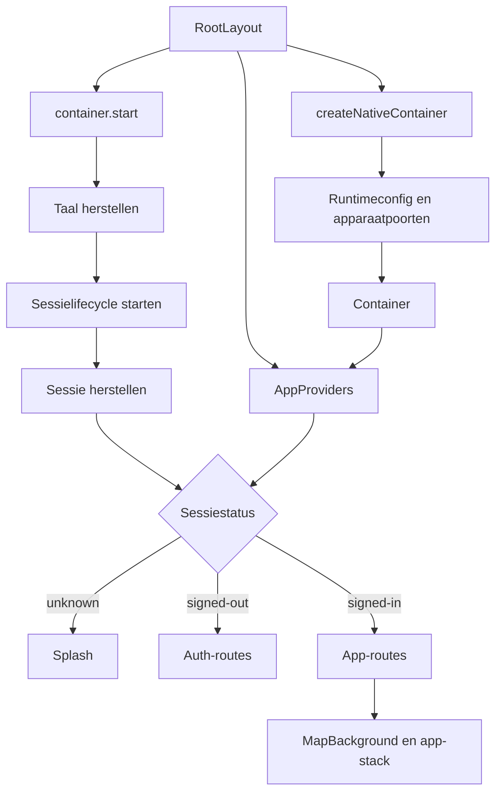

# Overzicht

> Gecontroleerd op: `ba1383c` (2026-09-23)
> Bronnen: `src/bootstrap/`, `src/app/_layout.tsx`, `src/app/(app)/_layout.tsx`, `src/domeinen/auth/store/session-store.ts`
> Zie ook: [architectuur](../architecture.md), [ADR 0002](../decisions/0002-expo-router.md), [ADR 0008](../decisions/0008-sessies-en-tokens.md), [flows](../functioneel/flows.md#1-opstarten-en-inloggen-werkt)

## Waarvoor

De opstartlaag bouwt de app rond één container en maakt de apparaatvoorzieningen beschikbaar aan de
schermen. De sessiestatus bepaalt of de berger de inlogroute of de afgeschermde app-routes ziet.

## Hoe het werkt

De rootlayout houdt de splash zichtbaar totdat de sessie bekend is. Daarna bewaakt Expo Router de
twee routegroepen; inloggen en uitloggen hoeven daarom geen routewisseling aan te roepen.

## Beweringen

| ID     | Bewering                                                                                                                                   | Code                                                                            | Test                                                                    |
| ------ | ------------------------------------------------------------------------------------------------------------------------------------------ | ------------------------------------------------------------------------------- | ----------------------------------------------------------------------- |
| OVZ-01 | Bij het laden bouwt de rootlayout één native container met de gevalideerde runtimeconfiguratie en apparaatpoorten.                         | `src/app/_layout.tsx`, `src/bootstrap/native.ts`, `src/bootstrap/env.ts`        | —                                                                       |
| OVZ-02 | Bij het aankoppelen start de rootlayout de container; bij het afkoppelen stopt zij de container.                                           | `src/app/_layout.tsx`                                                           | —                                                                       |
| OVZ-03 | Bij starten herstelt de container eerst de taalkeuze en daarna de sessie.                                                                  | `src/bootstrap/container.ts`                                                    | `src/bootstrap/container.test.ts` (taal, starten)                       |
| OVZ-04 | Zolang de sessiestatus `unknown` is, toont de rootlayout de splash in plaats van een routegroep.                                           | `src/app/_layout.tsx`, `src/domeinen/auth/store/session-store.ts`               | —                                                                       |
| OVZ-05 | Een ingelogde sessie geeft toegang tot `(app)` en een uitgelogde sessie tot `(auth)`.                                                      | `src/app/_layout.tsx`                                                           | —                                                                       |
| OVZ-06 | Een verlopen sessie bewaart reden `expired`, zodat de inlogflow kan uitleggen waarom de sessie eindigde.                                   | `src/domeinen/auth/store/session-store.ts`                                      | `src/domeinen/auth/store/session-store.test.ts`                         |
| OVZ-07 | Alle routes delen de Query-client, vertalingen, feedback, scheduler en gekoppelde domeindiensten uit dezelfde container.                   | `src/bootstrap/providers.tsx`                                                   | —                                                                       |
| OVZ-08 | Wanneer de app actief wordt, vraagt de provider de sessielifecycle onmiddellijk om de sessie te controleren.                               | `src/bootstrap/providers.tsx`, `src/domeinen/auth/service/session-lifecycle.ts` | `src/domeinen/auth/service/session-lifecycle.test.ts` (voorgrondgedrag) |
| OVZ-09 | Uitloggen wist de sessie en de gebruikersgebonden cache, wachtrijen, concepten en meldingshistorie voordat de auth-service klaar is.       | `src/bootstrap/container.ts`                                                    | `src/bootstrap/container.test.ts` (uitloggen)                           |
| OVZ-10 | Een definitief geweigerde tokenverversing zet de sessie op uitgelogd en start dezelfde opschoning als handmatig uitloggen.                 | `src/bootstrap/container.ts`, `src/domeinen/auth/service/token-provider.ts`     | `src/bootstrap/container.test.ts` (sessie kan niet worden behouden)     |
| OVZ-11 | De app-stack toont standaard de medewerkerstatus in de kop en een knop naar instellingen; detailroutes kunnen die koponderdelen vervangen. | `src/app/(app)/_layout.tsx`                                                     | —                                                                       |
| OVZ-12 | Stoppen beëindigt het volgen van de sessie en stopt push, foto-upload en outboxverwerking.                                                 | `src/bootstrap/container.ts`                                                    | `src/bootstrap/container.test.ts` (stoppen)                             |

## Randgevallen en bewuste keuzes

- De navigatie volgt declaratief de sessiestatus met `Stack.Protected`; er is geen imperatieve
  login- of logoutnavigatie. Zie [ADR 0002](../decisions/0002-expo-router.md).
- Een onleesbare opgeslagen sessie leidt naar inloggen in plaats van een leeg scherm. Dit is
  vastgelegd in `src/bootstrap/container.test.ts`.
- Opgeslagen sessies van een eerdere appversie worden niet gemigreerd. Zie
  [ADR 0006](../decisions/0006-opslag.md).

## Open vragen

- [Open vraag 12](../functioneel/open-vragen.md): welke gegevens moet uitloggen precies wissen? De
  huidige flow bewaart apparaatvoorkeuren zoals taal.
- [Open vraag 19](../functioneel/open-vragen.md): opgeslagen sessies worden niet gemigreerd; de
  berger logt na vervanging van de app opnieuw in.
- De rootlayout, providerboom en app-stack hebben geen componenttest; de onderliggende sessie- en
  containerflow zijn wel in Node getest.
