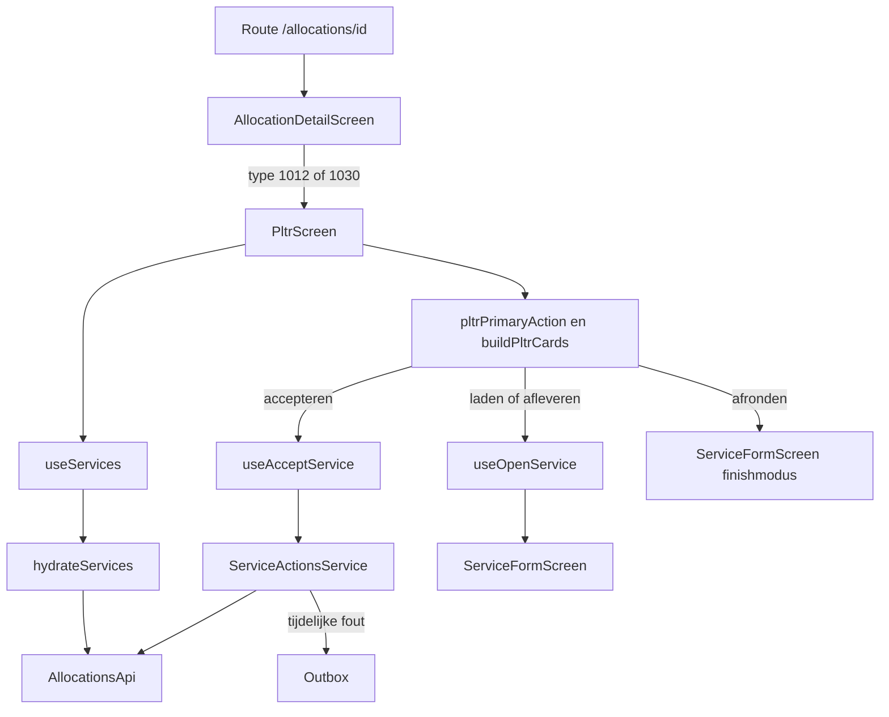

# PLTR

> Gecontroleerd op: `c0127855` (2026-10-16; finishmodus)
> Bronnen: `src/domeinen/services/domain/pltr.ts`, `src/domeinen/services/domain/service-types.ts`, `src/domeinen/allocations/screens/pltr-screen.tsx`, `src/domeinen/allocations/screens/allocation-detail-screen.tsx`, `src/domeinen/allocations/hooks/`, `src/app/(app)/allocations/`
> Zie ook: [ADR 0019](../decisions/0019-pltr.md), [flows](../functioneel/flows.md#3-een-opdracht-uitvoeren-regels-klaar-schermen-volgen), [statussen](../functioneel/statussen.md#types-dn_servicetypecode-van-de-eerste-dienst)

## Waarvoor

PLTR toont een planbaar transport als één opeenvolging van laden en afleveren. De berger ziet de
twee locaties, kan voor de actuele fase navigeren of bellen en krijgt één primaire vervolgstap.

## Hoe het werkt

Het scherm gebruikt de eerste dienst van de opdracht. Het diensttype kiest de PLTR-variant; de
dienststatus kiest de primaire actie en welke locatiekaart actueel of afgerond is.

## Beweringen

| ID      | Bewering                                                                                                                                                                                                                                                                                            | Code                                                                                                                                                                                                                      | Test                                                                                            |
| ------- | --------------------------------------------------------------------------------------------------------------------------------------------------------------------------------------------------------------------------------------------------------------------------------------------------- | ------------------------------------------------------------------------------------------------------------------------------------------------------------------------------------------------------------------------- | ----------------------------------------------------------------------------------------------- |
| PLTR-01 | Diensttypen `1012` en `1030` gelden beide als PLTR; andere of ontbrekende typen niet.                                                                                                                                                                                                               | `src/domeinen/services/domain/service-types.ts`                                                                                                                                                                           | `src/domeinen/services/domain/service-types.test.ts`                                            |
| PLTR-02 | De gedeelde opdracht-detailroute toont `PltrScreen` wanneer het type van de opdracht PLTR is en anders `ServicesScreen`.                                                                                                                                                                            | `src/app/(app)/allocations/[id]/index.tsx`, `src/domeinen/allocations/screens/allocation-detail-screen.tsx`                                                                                                               | —                                                                                               |
| PLTR-03 | Het PLTR-scherm baseert kaarten en acties op de eerste dienst van de opdracht.                                                                                                                                                                                                                      | `src/domeinen/allocations/screens/pltr-screen.tsx`                                                                                                                                                                        | —                                                                                               |
| PLTR-04 | Status `1` geeft de actie accepteren; status `875920014` of `875920000` geeft starten met laden.                                                                                                                                                                                                    | `src/domeinen/services/domain/pltr.ts`                                                                                                                                                                                    | `src/domeinen/services/domain/pltr.test.ts`                                                     |
| PLTR-05 | Status `875920004` selecteert starten met afleveren en status `875920005` selecteert afronden als primaire actie.                                                                                                                                                                                   | `src/domeinen/services/domain/pltr.ts`                                                                                                                                                                                    | `src/domeinen/services/domain/pltr.test.ts`                                                     |
| PLTR-06 | Een onbekende status of een status zonder PLTR-stap toont geen primaire knop.                                                                                                                                                                                                                       | `src/domeinen/services/domain/pltr.ts`, `src/domeinen/allocations/screens/pltr-screen.tsx`                                                                                                                                | `src/domeinen/services/domain/pltr.test.ts`                                                     |
| PLTR-07 | De laad- en afleverkaart worden in die volgorde opgebouwd en alleen getoond als voor die fase een samengesteld adres kan worden geparseerd.                                                                                                                                                         | `src/domeinen/services/domain/pltr.ts`                                                                                                                                                                                    | `src/domeinen/services/domain/pltr.test.ts`                                                     |
| PLTR-08 | Gestructureerde adresvelden krijgen voorrang in de kaart; ontbrekende regels vallen terug op het geparseerde samengestelde adres.                                                                                                                                                                   | `src/domeinen/services/domain/pltr.ts`, `src/domeinen/location/domain/address.ts`                                                                                                                                         | `src/domeinen/services/domain/pltr.test.ts`, `src/domeinen/location/domain/address.test.ts`     |
| PLTR-09 | Bij status `875920004` is laden klaar en verschuiven navigeren en bellen naar afleveren; bij status `875920005` zijn beide fasen klaar.                                                                                                                                                             | `src/domeinen/services/domain/pltr.ts`                                                                                                                                                                                    | `src/domeinen/services/domain/pltr.test.ts`                                                     |
| PLTR-10 | Navigeren biedt voor dezelfde geldige coördinaat Apple Maps, Google Maps en Waze aan.                                                                                                                                                                                                               | `src/domeinen/services/domain/pltr.ts`, `src/domeinen/allocations/screens/pltr-screen.tsx`                                                                                                                                | `src/domeinen/services/domain/pltr.test.ts`                                                     |
| PLTR-11 | Accepteren vanuit het PLTR-scherm gebruikt dezelfde nabijheidscontrole, API-mutatie en tijdelijke-fout-outbox als een gewone dienst.                                                                                                                                                                | `src/domeinen/allocations/screens/pltr-screen.tsx`, `src/domeinen/allocations/hooks/use-accept-service.ts`, `src/domeinen/allocations/service/service-actions-service.ts`                                                 | —                                                                                               |
| PLTR-12 | Starten met laden of afleveren opent het serviceformulier; afronden bij status `875920005` opent het afsluitscherm.                                                                                                                                                                                 | `src/domeinen/allocations/screens/pltr-screen.tsx`, `src/domeinen/allocations/hooks/use-open-service.ts`                                                                                                                  | —                                                                                               |
| PLTR-13 | Na de laadfase keert de exit-flow terug naar het PLTR-scherm; afronden vanaf het afsluitscherm keert voor beide PLTR-typen terug naar de opdrachtenlijst.                                                                                                                                           | `src/domeinen/services/domain/exit-target.ts`                                                                                                                                                                             | `src/domeinen/services/domain/pltr.test.ts`, `src/domeinen/services/domain/exit-target.test.ts` |
| PLTR-14 | Preview (via swipe Voorbeeld op de lijst) verbergt werkacties en navigeren; de footer toont “Dienstvoorbeeld bekijken” zodra er een dienst uit de lijstsamenvatting is (ook zonder id nog) en opent het formulier read-only — zonodig na hydrate. Het scherm blokkeert niet op het hydrate-overlay. | `src/domeinen/allocations/screens/pltr-screen.tsx`, `src/domeinen/allocations/components/pltr-phase-card.tsx`, `src/domeinen/allocations/hooks/use-open-service.ts`, `src/domeinen/allocations/domain/preview-service.ts` | `src/domeinen/allocations/domain/preview-service.test.ts`                                       |

## Randgevallen en bewuste keuzes

- Type `1030` opent, net als type `1012`, het PLTR-scherm. Dit voorkomt regressie 26 uit
  [bekende fouten](../functioneel/bekende-fouten-oude-app.md).
- Bij een status zonder stap ontbreekt de primaire knop. Dit voorkomt regressie 27 uit
  [bekende fouten](../functioneel/bekende-fouten-oude-app.md).
- Apple Maps wordt ook op iOS aangeboden. Dit voorkomt regressie 28 uit
  [bekende fouten](../functioneel/bekende-fouten-oude-app.md).
- `(0, 0)` levert geen navigatieknop op. Komma-decimalen zoals `52,37` worden voor PLTR-coördinaten
  wel als getal gelezen.
- De oudere tekst in ADR 0019 dat de laad- en afleverformulieren ontbreken, is ingehaald door de
  route naar `ServiceFormScreen`.

## Open vragen

- [Open vraag 3](../functioneel/open-vragen.md): is type `1030` werkelijk een PLTR? De huidige
  aanname is ja.
- Het scherm gebruikt uitsluitend `services[0]`; er is geen vastgelegde regel of schermtest voor
  een PLTR-opdracht met nul of meerdere diensten.
- `LAATSTE_BERICHT` levert de zichtbare actie “Afgerond”, maar die knop loopt in het scherm via
  `useOpenService` en kan daardoor het formulier openen. Er is geen test die de bedoelde interactie
  voor deze status vastlegt.
