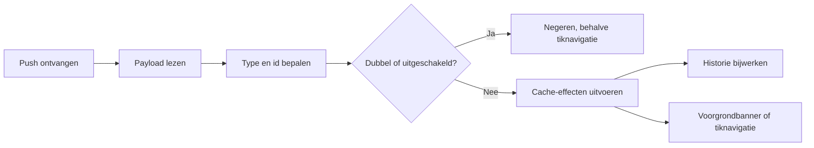

# Pushmeldingen

> Gecontroleerd op: `c1506088` (2026-10-07)
> Bronnen: `src/domeinen/notifications/`, `src/bootstrap/notification-actions.ts`, `src/bootstrap/container.ts`, `src/bootstrap/native.ts`, `index.js`, `app.config.ts`, `src/app/(app)/notifications.tsx`
> Zie ook: [ADR 0017](../decisions/0017-push-notificaties.md), [toestemmingen](toestemmingen.md), [flows](../functioneel/flows.md), [API-contract](../functioneel/api-contract.md), [bekende fouten](../functioneel/bekende-fouten-oude-app.md)

## Waarvoor

Pushmeldingen houden opdrachten, medewerkerstatus en voertuigafgiftes actueel zonder dat de berger
handmatig hoeft te verversen. Daarnaast bewaart de app een lokale berichtgeschiedenis en kan een tik
op een melding het opdrachtenoverzicht openen.

## Hoe het werkt

Bij een sessiestart richt de app het Android-kanaal in (Notifee), **leest** de FCM-toestemming
(zonder dialoog) en registreert het FCM-token alleen als die al is verleend. De OS-dialoog komt uit
de disclosure-wizard of Instellingen → Toestemmingen (`DevicePermissions` / Notifee); daarna start
`pushRuntime` opnieuw. Voorgrond-, achtergrond-, geopende en initiële berichten gaan door dezelfde
parser, ontdubbeling en effectplanner. De FCM-achtergrondhandler staat in `index.js` vóór Expo
Router.

Een bekend type kiest gerichte cache-effecten. Bij een onbekend of ontbrekend type ververst de app
veiligheidshalve alle opdrachten. Een tik opent bewust het opdrachtenoverzicht, niet één specifieke
opdracht. Push is daarmee een verversingssignaal; de serverdata blijft de bron van waarheid.

## Beweringen

| ID       | Bewering                                                                                                                  | Code                                                                     | Test                                                                                                                      |
| -------- | ------------------------------------------------------------------------------------------------------------------------- | ------------------------------------------------------------------------ | ------------------------------------------------------------------------------------------------------------------------- |
| PUSH-01  | Bij verleende toestemming registreert de app het FCM-token als `{ notificationtoken }` op `/api/workers/register`.        | `src/domeinen/notifications/api/push-registration-api.ts`                | `src/domeinen/notifications/api/push-registration-api.test.ts`, `src/domeinen/notifications/service/push-runtime.test.ts` |
| PUSH-02  | Geweigerde toestemming of een ontbrekend token blokkeert de app niet en start geen registratie.                           | `src/domeinen/notifications/service/push-runtime.ts`                     | `src/domeinen/notifications/service/push-runtime.test.ts`                                                                 |
| PUSH-02b | `PushGateway.permission()` leest alleen; de OS-dialoog komt uit disclosure of instellingen via `DevicePermissions`.       | `src/domeinen/notifications/platform/rn/firebase-push-gateway.ts`        | `src/domeinen/notifications/service/push-runtime.test.ts`                                                                 |
| PUSH-03  | Een registratiefout blokkeert de ontvangstlistener niet.                                                                  | `src/domeinen/notifications/service/push-runtime.ts`                     | `src/domeinen/notifications/service/push-runtime.test.ts`                                                                 |
| PUSH-04  | Wanneer FCM het token wijzigt, registreert de app het nieuwe token opnieuw.                                               | `src/domeinen/notifications/service/push-runtime.ts`                     | `src/domeinen/notifications/service/push-runtime.test.ts`                                                                 |
| PUSH-05  | De parser leest payloads op het hoogste niveau, in `body` en in geneste `body.Data`, waarbij de diepste waarde wint.      | `src/domeinen/notifications/domain/parse.ts`                             | `src/domeinen/notifications/domain/parse.test.ts`                                                                         |
| PUSH-06  | Een numeriek notificatietype wordt alleen tekst; zonder bekende tekstmapping blijft het type onbekend.                    | `src/domeinen/notifications/domain/parse.ts`                             | `src/domeinen/notifications/domain/parse.test.ts`                                                                         |
| PUSH-07  | Een onbekend of ontbrekend notificatietype ververst alle opdrachten.                                                      | `src/domeinen/notifications/domain/plan.ts`                              | `src/domeinen/notifications/domain/plan.test.ts`                                                                          |
| PUSH-08  | `NewIncident`, `ChangedIncident`, `AcceptService` en `NewTms` zonder allocation-id verversen alle opdrachten.             | `src/domeinen/notifications/domain/plan.ts`                              | `src/domeinen/notifications/domain/plan.test.ts`                                                                          |
| PUSH-09  | Een vervallen opdracht zonder allocation- of incident-id ververst alle opdrachten.                                        | `src/domeinen/notifications/domain/plan.ts`                              | `src/domeinen/notifications/domain/plan.test.ts`                                                                          |
| PUSH-10  | Als gericht ophalen van een opdracht niets vindt of faalt, probeert de handler alle opdrachten te verversen.              | `src/domeinen/notifications/service/notification-handler.ts`             | `src/domeinen/notifications/service/notification-handler.test.ts`                                                         |
| PUSH-11  | `WorkerStatus` ververst alleen de medewerker en toont geen voorgrondbanner of tiknavigatie.                               | `src/domeinen/notifications/domain/plan.ts`                              | `src/domeinen/notifications/domain/plan.test.ts`, `src/domeinen/notifications/domain/incoming.test.ts`                    |
| PUSH-12  | `StandbyLocationAdvice` wordt volledig genegeerd.                                                                         | `src/domeinen/notifications/domain/plan.ts`                              | `src/domeinen/notifications/domain/plan.test.ts`, `src/domeinen/notifications/domain/incoming.test.ts`                    |
| PUSH-13  | Een normaal voorgrondbericht toont een lokale banner, voert cache-effecten uit en navigeert niet.                         | `src/domeinen/notifications/service/push-runtime.ts`                     | `src/domeinen/notifications/service/push-runtime.test.ts`                                                                 |
| PUSH-14  | Een ontbrekende titel of tekst in een voorgrondbericht krijgt de vertaalde standaardtekst.                                | `src/domeinen/notifications/domain/banner.ts`                            | `src/domeinen/notifications/domain/banner.test.ts`, `src/domeinen/notifications/service/push-runtime.test.ts`             |
| PUSH-15  | Hetzelfde bericht-id wordt maar eenmaal verwerkt; een latere tik mag nog wel het opdrachtenoverzicht openen.              | `src/domeinen/notifications/domain/incoming.ts`                          | `src/domeinen/notifications/domain/incoming.test.ts`, `src/domeinen/notifications/service/push-runtime.test.ts`           |
| PUSH-16  | Een niet-uitgeschakeld bericht met een id wordt ongelezen aan de duurzame historie toegevoegd en dubbelingen tellen niet. | `src/domeinen/notifications/service/notification-history.ts`             | `src/domeinen/notifications/service/notification-history.test.ts`                                                         |
| PUSH-17  | De historie bewaart maximaal honderd berichten en ondersteunt één of alle berichten als gelezen markeren.                 | `src/domeinen/notifications/domain/history.ts`                           | `src/domeinen/notifications/domain/history.test.ts`                                                                       |
| PUSH-18  | Bij uitloggen wordt de notificatiehistorie gewist.                                                                        | `src/bootstrap/container.ts`                                             | `src/bootstrap/container.test.ts`                                                                                         |
| PUSH-19  | De runtime logt niet de ruwe pushpayload met mogelijke persoonsgegevens.                                                  | `src/domeinen/notifications/service/push-runtime.ts`                     | `src/domeinen/notifications/service/push-runtime.test.ts`                                                                 |
| PUSH-20  | Het notificatiescherm groepeert historie op vandaag, gisteren en ouder en kan filteren op tab.                            | `src/domeinen/notifications/screens/notifications-screen.tsx`            | —                                                                                                                         |
| PUSH-21  | De bel toont het aantal ongelezen berichten en kapt aantallen boven 99 af als `99+`.                                      | `src/domeinen/notifications/components/notification-bell-button.tsx`     | `src/domeinen/notifications/domain/history.test.ts`                                                                       |
| PUSH-22  | De native adapter maakt het Android-kanaal (Notifee) en laadt de FCM-achtergrondhandler in het JS-entry vóór Expo Router. | `firebase-push-gateway.ts`, `firebase-background-handler.ts`, `index.js` | —                                                                                                                         |

## Randgevallen en bewuste keuzes

- Ontdubbeling leeft alleen in het geheugen en onthoudt maximaal vijftig ids. Berichten zonder id
  worden altijd verwerkt, maar kunnen niet in de historie worden opgeslagen.
- Een achtergrondbericht dat later als geopende melding terugkomt, wordt niet opnieuw verwerkt maar
  de tik navigeert wel.
- Effecten worden onafhankelijk uitgevoerd: een mislukte medewerkerrefresh maakt een opdracht-effect
  niet onopgelost en stopt volgende effecten niet.
- De historie wordt al vóór de ontdubbelbeslissing aangeboden; de historieservice verwijdert een
  dubbel id zelf.
- De oude app deed niets bij incidentberichten zonder allocation-id en had verspreide
  foutafhandeling. De terugval naar alles verversen staat vast in [bekende fouten 11 tot en met
  13](../functioneel/bekende-fouten-oude-app.md).
- De ruwe payload wordt niet gelogd; zie [bekende fout 19](../functioneel/bekende-fouten-oude-app.md).

## Open vragen

- [Vraag 4](../functioneel/open-vragen.md): numerieke notificatietypes hebben geen bekende mapping;
  zij vallen terug op alles verversen.
- [Vraag 17](../functioneel/open-vragen.md): FCM + Notifee, zoals de oude app.
- [Vraag 21](../functioneel/open-vragen.md): het backendveld blijft `notificationtoken`; de waarde
  is een FCM-token; de backend stuurt via FCM.
