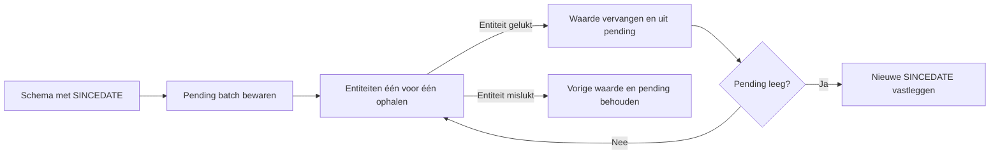

# Referentiedata

> Gecontroleerd op: ba1383c (2026-09-23)
> Bronnen: `src/domeinen/reference-data/`, `src/bootstrap/container.ts`, `src/domeinen/service-form/service/service-form-service.ts`
> Zie ook: [ADR 0013](../decisions/0013-referentiedata-sync.md), [API-contract](../functioneel/api-contract.md), [plan serviceformulier](../functioneel/plan-serviceformulier.md)

## Waarvoor

Referentiedata maakt CRM-keuzelijsten, statusteksten, wagenparkgegevens en formulierdefinities lokaal
beschikbaar. De synchronisatie haalt alleen gewijzigde entiteiten op en kan een gedeeltelijk mislukte
batch later hervatten zonder eerder bruikbare data te verliezen.

## Hoe het werkt

Bij een eerste sync vraagt de app zonder `SINCEDATE` welke entiteiten beschikbaar zijn. Bij latere
syncs stuurt zij de datum van de laatst volledig afgeronde batch. Voor de nieuwe batch wordt eerst
een pendinglijst met een nieuwe datum opgeslagen; daarna haalt de app iedere entiteit afzonderlijk op.

Een volgende `sync()` hervat eerst een bestaande pending batch en vraagt dan niet opnieuw om het
schema. Consumenten lezen de ondoorzichtige rijen per entiteit en valideren zelf de vorm die zij nodig
hebben. Formulierdefinities worden op inhoud gezocht, zodat een gewijzigde entiteitnaam geen app-update
vereist.

## Beweringen

| ID     | Bewering                                                                                                                 | Code                                                            | Test                                                                 |
| ------ | ------------------------------------------------------------------------------------------------------------------------ | --------------------------------------------------------------- | -------------------------------------------------------------------- |
| REF-01 | Zowel Nederlands als Engels synchroniseert referentiedata met backendtaalcode 1043.                                      | `src/domeinen/reference-data/domain/language-code.ts`           | `src/domeinen/reference-data/domain/language-code.test.ts`           |
| REF-02 | De eerste schemasync heeft geen `SINCEDATE`-header; een latere sync stuurt de laatst gecommitteerde ISO-datum.           | `src/domeinen/reference-data/api/reference-data-api.ts`         | `src/domeinen/reference-data/api/reference-data-api.test.ts`         |
| REF-03 | Schema- en entiteitsantwoorden worden als respectievelijk een lijst strings en een lijst onbekende rijen gevalideerd.    | `src/domeinen/reference-data/api/schemas.ts`                    | `src/domeinen/reference-data/api/reference-data-api.test.ts`         |
| REF-04 | Als het schema geen gewijzigde entiteiten teruggeeft, blijft de bestaande syncdatum ongewijzigd.                         | `src/domeinen/reference-data/service/reference-data-service.ts` | `src/domeinen/reference-data/service/reference-data-service.test.ts` |
| REF-05 | Voor het ophalen van entiteiten wordt een pending batch met de nieuwe datum en alle entiteitnamen opgeslagen.            | `src/domeinen/reference-data/service/reference-data-service.ts` | `src/domeinen/reference-data/service/reference-data-service.test.ts` |
| REF-06 | Een geslaagde entiteit vervangt direct haar lokale waarde en wordt eenmaal in de lijst met bekende entiteiten opgenomen. | `src/domeinen/reference-data/service/reference-data-service.ts` | `src/domeinen/reference-data/service/reference-data-service.test.ts` |
| REF-07 | Een mislukte entiteit behoudt haar laatst gesynchroniseerde waarde en blijft pending voor een volgende poging.           | `src/domeinen/reference-data/service/reference-data-service.ts` | `src/domeinen/reference-data/service/reference-data-service.test.ts` |
| REF-08 | Een bestaande pending batch wordt zonder een nieuw schema-request hervat.                                                | `src/domeinen/reference-data/service/reference-data-service.ts` | `src/domeinen/reference-data/service/reference-data-service.test.ts` |
| REF-09 | De nieuwe syncdatum wordt pas gecommitteerd wanneer alle entiteiten uit de batch zijn gesynchroniseerd.                  | `src/domeinen/reference-data/service/reference-data-service.ts` | `src/domeinen/reference-data/service/reference-data-service.test.ts` |
| REF-10 | Een entiteit die nooit is gesynchroniseerd of beschadigde JSON bevat, wordt als `null` gelezen.                          | `src/domeinen/reference-data/service/reference-data-service.ts` | —                                                                    |
| REF-11 | Een beschadigde lijst met bekende entiteiten wordt als leeg behandeld.                                                   | `src/domeinen/reference-data/service/reference-data-service.ts` | `src/domeinen/reference-data/service/reference-data-service.test.ts` |
| REF-12 | Reset wist de gecommitteerde datum en pending batch, maar behoudt entiteitswaarden en de lijst met bekende entiteiten.   | `src/domeinen/reference-data/service/reference-data-service.ts` | `src/domeinen/reference-data/service/reference-data-service.test.ts` |
| REF-13 | Een nieuwe of herstelde sessie start de synchronisatie op de achtergrond.                                                | `src/bootstrap/container.ts`                                    | `src/bootstrap/container.test.ts`                                    |
| REF-14 | Uitloggen wist alleen een pending batch; de syncdatum blijft, zodat de volgende sessie alleen wijzigingen vraagt.        | `src/bootstrap/container.ts`                                    | `src/bootstrap/container.test.ts`                                    |
| REF-15 | Formulierdefinities worden in alle bekende entiteiten op `dataDefinition` en `servicecode` gezocht.                      | `src/domeinen/service-form/service/service-form-service.ts`     | `src/domeinen/service-form/service/service-form-service.test.ts`     |
| REF-16 | `abortPending` wist alleen de pending batch en behoudt de gecommitteerde syncdatum en entiteitswaarden.                  | `src/domeinen/reference-data/service/reference-data-service.ts` | `src/domeinen/reference-data/service/reference-data-service.test.ts` |
| REF-17 | Een handmatige refresh haalt één entiteit opnieuw op, zonder schema of syncdatum te wijzigen.                            | `src/domeinen/reference-data/service/reference-data-service.ts` | `src/domeinen/reference-data/service/reference-data-service.test.ts` |

## Randgevallen en bewuste keuzes

- De sync is per entiteit duurzaam, niet als één transactie over de hele batch. Daardoor zijn
  geslaagde entiteiten meteen bruikbaar terwijl mislukte entiteiten hun vorige waarde houden.
- De syncdatum beschrijft alleen een volledig afgeronde batch. Zij schuift nooit door zolang één
  entiteit nog pending is.
- Reset verwijdert bewust niet alle entiteitsdata: referentiedata geldt niet als geheim en blijft als
  laatste bruikbare waarde beschikbaar totdat de volgende volledige sync haar vervangt. Reset is
  alleen voor een bewuste volledige hersync (bijv. ontbrekende formulierdefinitie), niet voor
  uitloggen.
- Uitloggen breekt een pending batch af zodat die niet in een volgende sessie wordt hervat, maar
  laat de syncdatum staan: de volgende login vraagt alleen wat sindsdien is gewijzigd.
- Een installatie met een oude syncdatum maar zonder lijst met bekende entiteiten doet eenmaal een
  volledige schemasync.
- Er is geen apart synchronisatiescherm. Sessiestart triggert de sync op de achtergrond en fouten
  worden gelogd.

## Open vragen

- [Vraag 25](../functioneel/open-vragen.md): er is geen vaste sync-entiteit voor
  formulierdefinities; zoeken op inhoud is de vastgelegde keuze.
