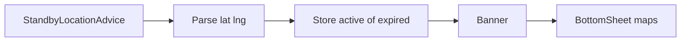

# Standby-locatieadvies

> Gecontroleerd op: (slice 20)
> Bronnen: `src/domeinen/standby-location/`, `src/domeinen/notifications/domain/plan.ts`, `src/domeinen/notifications/domain/parse.ts`, `src/bootstrap/container.ts`
> Zie ook: [ADR 0030](../decisions/0030-standby-locatieadvies.md), [pushmeldingen](pushmeldingen.md), [open vraag 13](../functioneel/open-vragen.md)

## Waarvoor

De centrale stuurt een standby-locatie via push. De berger ziet een banner op de opdrachtenlijst
en kan naar die locatie navigeren. Het advies verdwijnt bij aankomst, een opdracht, einde dienst
of uitloggen.

## Hoe het werkt

## Beweringen

| ID      | Bewering                                                                                                      | Code                                                   | Test                               |
| ------- | ------------------------------------------------------------------------------------------------------------- | ------------------------------------------------------ | ---------------------------------- |
| STBY-01 | `StandbyLocationAdvice` heeft display mode `default` en plant `apply-standby-advice` bij geldige coördinaten. | `notifications/domain/types.ts`, `plan.ts`             | `plan.test.ts`, `parse.test.ts`    |
| STBY-02 | Zonder geldige lat/lng ontstaan geen standby-effecten.                                                        | `standby-location/domain/parse.ts`, `plan.ts`          | `parse.test.ts`, `plan.test.ts`    |
| STBY-03 | Allocation-pushes en onbekend type planten `expire-standby-advice`; dissolve niet.                            | `notifications/domain/plan.ts`                         | `plan.test.ts`                     |
| STBY-04 | Apply met blocking items zet status `expired`; zonder blocking `active`.                                      | `standby-location/service/standby-location-service.ts` | `standby-location-service.test.ts` |
| STBY-05 | Binnen 500 m bij focus wist de app het advies.                                                                | `standby-location/domain/arrival.ts`                   | `arrival.test.ts`                  |
| STBY-06 | Uitloggen wist `standbyLocation.pending`.                                                                     | `bootstrap/container.ts`                               | `container.test.ts`                |
| STBY-07 | Banner toont adres en opent Apple/Google/Waze.                                                                | `standby-location/components/`                         | —                                  |

## Open vragen

- Geen open productvraag meer voor aanzetten; zie open vraag 13 (besloten: aan).
