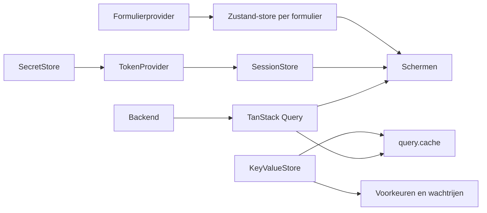

# Stores

> Gecontroleerd op: `ba1383c` (2026-09-23)
> Bronnen: `src/shared/query/`, `src/domeinen/auth/store/`, `src/domeinen/service-form/store/`, `src/shared/platform/ports.ts`, `src/bootstrap/container.ts`
> Zie ook: [ADR 0005](../decisions/0005-state.md), [ADR 0006](../decisions/0006-opslag.md), [architectuur](../architecture.md#uitgangspunten)

## Waarvoor

De app houdt servergegevens, tijdelijke schermstatus, sessies en duurzame voorkeuren gescheiden.
Daardoor heeft elk soort gegevens één eigenaar en kan een volgende gebruiker geen gegevens van de
vorige sessie zien.

## Hoe het werkt

Servergegevens lopen via TanStack Query. Zustand bevat alleen clientstatus: de afgeleide
sessiestatus en een geïsoleerde invulsessie per geopend serviceformulier.

## Beweringen

| ID       | Bewering                                                                                                                          | Code                                                                                                                  | Test                                                                |
| -------- | --------------------------------------------------------------------------------------------------------------------------------- | --------------------------------------------------------------------------------------------------------------------- | ------------------------------------------------------------------- |
| STORE-01 | Een nieuwe Query-client beschouwt querydata na 30 seconden als verouderd en bewaart ongebruikte data maximaal 24 uur in geheugen. | `src/shared/query/create-query-client.ts`                                                                             | `src/shared/query/create-query-client.test.ts`                      |
| STORE-02 | Query's met een tijdelijk probleem krijgen maximaal drie pogingen; niet-retrybare fouten krijgen geen nieuwe poging.              | `src/shared/query/create-query-client.ts`                                                                             | `src/shared/query/create-query-client.test.ts`                      |
| STORE-03 | Mutaties worden niet automatisch herhaald, zodat een bevestigde actie niet ongemerkt twee keer wordt verstuurd.                   | `src/shared/query/create-query-client.ts`                                                                             | `src/shared/query/create-query-client.test.ts`                      |
| STORE-04 | Alleen geslaagde queries worden duurzaam bewaard en na een herstart teruggezet.                                                   | `src/shared/query/query-cache-store.ts`                                                                               | `src/shared/query/query-cache-store.test.ts`                        |
| STORE-05 | Een onleesbare duurzame querycache wordt genegeerd en verwijderd.                                                                 | `src/shared/query/query-cache-store.ts`                                                                               | `src/shared/query/query-cache-store.test.ts`                        |
| STORE-06 | De sessiestore start met status `unknown` en volgt daarna de herstel-, inlog- en uitloggebeurtenissen van de TokenProvider.       | `src/domeinen/auth/store/session-store.ts`                                                                            | `src/domeinen/auth/store/session-store.test.ts`                     |
| STORE-07 | De sessiestore bevat alleen status, gebruikerstype en uitlogreden en bewaart nooit tokens.                                        | `src/domeinen/auth/store/session-store.ts`                                                                            | `src/domeinen/auth/store/session-store.test.ts`                     |
| STORE-08 | Elk geopend serviceformulier krijgt een geïsoleerde Zustand-store, zodat twee formulieren elkaars invoer niet delen.              | `src/domeinen/service-form/store/create-service-form-store.ts`                                                        | `src/domeinen/service-form/store/create-service-form-store.test.ts` |
| STORE-09 | Een formulierprovider maakt zijn store eenmaal bij aankoppelen en gebruikt een nieuw exemplaar na opnieuw aankoppelen.            | `src/domeinen/service-form/store/service-form-store-provider.tsx`                                                     | —                                                                   |
| STORE-10 | Handmatig uitloggen wist zowel de Query-client in geheugen als de duurzaam bewaarde querycache.                                   | `src/bootstrap/container.ts`, `src/shared/query/query-cache-store.ts`                                                 | `src/bootstrap/container.test.ts` (uitloggen)                       |
| STORE-11 | Gewone duurzame gegevens lopen via `KeyValueStore`; sessiegeheimen lopen via de afzonderlijke `SecretStore`.                      | `src/shared/platform/ports.ts`, `src/shared/platform/rn/key-value-store.ts`, `src/shared/platform/rn/secure-store.ts` | —                                                                   |

## Randgevallen en bewuste keuzes

- Servergegevens worden niet in Zustand gedupliceerd. Lijst- en detailquery's mogen daardoor naast
  elkaar bestaan zonder één samengevoegde globale store. Zie [ADR 0005](../decisions/0005-state.md).
- Formulierconcepten zijn duurzame gegevens in `KeyValueStore`; de actieve invulsessie blijft een
  afzonderlijke Zustand-store per formulier.
- Beschadigde querycachedata blokkeert de app niet en wordt verwijderd.

## Open vragen

- [Open vraag 12](../functioneel/open-vragen.md): welke stores en sleutels moet uitloggen wissen? De
  huidige app wist gebruikersgebonden data, maar bewaart de taal als apparaatvoorkeur.
- De levensduur van de formulierprovider en de native opslagadapters hebben geen component- of
  adaptertest.
