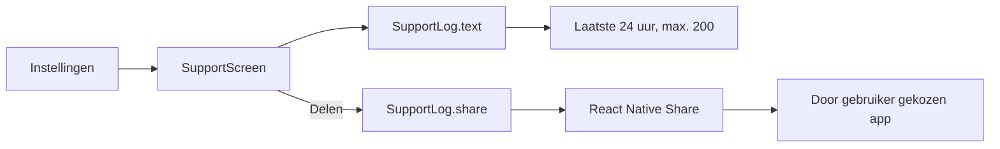

# Support

> Gecontroleerd op: `ba1383c` (2026-09-23)
> Bronnen: `src/domeinen/support/`, `src/shared/logging/`, `src/domeinen/settings/screens/settings-screen.tsx`, `src/bootstrap/container.ts`, `src/bootstrap/native.ts`
> Zie ook: [ADR 0010](../decisions/0010-logging-en-monitoring.md), [ADR 0022](../decisions/0022-offline-en-support.md), [logging en privacy](logging-en-privacy.md), [flows](../functioneel/flows.md#8-offline-en-support-werkt-deels)

## Waarvoor

De berger kan recente technische gebeurtenissen bekijken en via het systeem met support delen. De
export gebruikt de al geredigeerde lokale logbuffer en bevat geen vast e-mailadres of automatische
upload.

## Hoe het werkt

Instellingen navigeert naar `SupportScreen`. Via `SupportProvider` krijgt het scherm een
`SupportLog`: `text()` formatteert de huidige buffer en `share()` maakt opnieuw een export en geeft
die aan de React Native-sharesheet.

De export heeft de kop `Van Eijck Berger — supportlog`, zet de nieuwste regels bovenaan en gebruikt
dezelfde formatter als de gedeelde logger. Het scherm toont een lege-status als alleen de kop
overblijft.

## Beweringen

| ID     | Bewering                                                                                                                                      | Code                                                                                                            | Test                                                                                                                 |
| ------ | --------------------------------------------------------------------------------------------------------------------------------------------- | --------------------------------------------------------------------------------------------------------------- | -------------------------------------------------------------------------------------------------------------------- |
| SUP-01 | Als een supportlog wordt gemaakt, bevat die alleen entries uit de laatste 24 uur.                                                             | `src/domeinen/support/domain/export.ts`                                                                         | `src/domeinen/support/domain/export.test.ts`                                                                         |
| SUP-02 | Als een supportlog wordt gemaakt, bevat die maximaal 200 entries, nieuwste eerst, onder de vaste supportkop.                                  | `src/domeinen/support/domain/export.ts`, `src/shared/logging/logger.ts`                                         | `src/domeinen/support/domain/export.test.ts`, `src/shared/logging/logger.test.ts`                                    |
| SUP-03 | Als het supportscherm opent, maakt het één tekstsnapshot voor de zichtbare logweergave.                                                       | `src/domeinen/support/screens/support-screen.tsx`                                                               | —                                                                                                                    |
| SUP-04 | Als er geen logregels in het tijdvenster staan, toont het scherm de vertaalde lege-status in plaats van alleen de supportkop.                 | `src/domeinen/support/screens/support-screen.tsx`                                                               | —                                                                                                                    |
| SUP-05 | Als de berger op delen tikt, genereert de container een actuele supportexport en geeft die als tekst aan de systeemsharesheet.                | `src/bootstrap/container.ts`, `src/domeinen/support/platform/rn/rn-log-share.ts`                                | —                                                                                                                    |
| SUP-06 | Als delen mislukt, stopt de laadstatus en toont het supportscherm een algemene foutmelding.                                                   | `src/domeinen/support/screens/support-screen.tsx`                                                               | —                                                                                                                    |
| SUP-07 | Als logdata via support wordt gedeeld, is de data al door de redactielaag gegaan voordat zij in de loggerbuffer kwam.                         | `src/shared/logging/logger.ts`, `src/domeinen/support/domain/export.ts`                                         | `src/shared/logging/logger.test.ts`, `src/domeinen/support/domain/export.test.ts`, `src/bootstrap/container.test.ts` |
| SUP-08 | Als de berger support opent vanuit instellingen, navigeert de app naar de dunne supportroute en levert bootstrap de `SupportLog` via context. | `src/domeinen/settings/screens/settings-screen.tsx`, `src/app/(app)/support.tsx`, `src/bootstrap/providers.tsx` | —                                                                                                                    |

## Randgevallen en bewuste keuzes

- De zichtbare tekst is een snapshot van het moment waarop het scherm opende. `share()` maakt op het
  moment van delen een nieuwe tekst; nieuwere logregels kunnen daardoor wel in de gedeelde tekst
  staan maar nog niet op het scherm.
- Support voert niet opnieuw `redact` uit. De privacygrens ligt bij `Logger.write`, vóór opslag en
  vóór iedere sink.
- De sharesheet ontvangt alleen `message: text`. Er is geen bestand, ontvanger, onderwerp,
  apparaatmetadata of automatisch supportadres.
- Annuleren van de systeemsharesheet is geen fout; alleen een verworpen `Share.share()`-promise
  toont de algemene foutmelding.
- De logbuffer leeft in geheugen en is na een app-herstart leeg.
- De oude support- en debugpaden konden persoonsgegevens bevatten. De nieuwe export deelt alleen
  geredigeerde entries; de pushpayloadregressie staat bij
  [bekende fouten, rij 19](../functioneel/bekende-fouten-oude-app.md).

## Open vragen

- [Open vraag 15](../functioneel/open-vragen.md): centrale crash- en foutmonitoring is nog niet
  gekozen. De supportpagina deelt voorlopig alleen de lokale buffer op initiatief van de berger.
