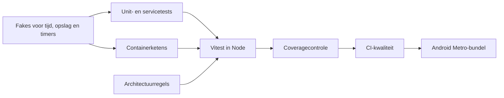

# Testen

> Gecontroleerd op: `ba1383c` (2026-09-23)
> Bronnen: `src/test/`, `src/bootstrap/container.test.ts`, `src/architecture.test.ts`, `vitest.config.mts`, `package.json`, `.github/workflows/ci.yml`
> Zie ook: [ADR 0003](../decisions/0003-vitest-in-node.md), [conventies](../conventions.md#9-testen), [architectuur](../architecture.md#testen)

## Waarvoor

De testopzet controleert domeingedrag snel in Node en bewaakt tegelijk de architectuurgrenzen. Een
containertest verbindt echte applicatieonderdelen met bestuurbare vervangers voor apparaat en
backend.

## Hoe het werkt

Tests sturen tijd, opslag, wachttijden en asynchrone volgorde zelf. Scherm- en end-to-endtests hebben
nog geen afzonderlijke runner.

## Beweringen

| ID      | Bewering                                                                                                                                                    | Code                                | Test                                                                                             |
| ------- | ----------------------------------------------------------------------------------------------------------------------------------------------------------- | ----------------------------------- | ------------------------------------------------------------------------------------------------ |
| TEST-01 | `pnpm run ci` controleert achtereenvolgens opmaak, lint, types en tests met coverage.                                                                       | `package.json`                      | —                                                                                                |
| TEST-02 | Vitest draait `src/**/*.test.ts` in een Node-omgeving en herstelt mocks na elke test.                                                                       | `vitest.config.mts`                 | —                                                                                                |
| TEST-03 | Coverage faalt onder 90% voor regels, statements of functies en onder 85% voor branches.                                                                    | `vitest.config.mts`                 | —                                                                                                |
| TEST-04 | Coverage telt productiecode in `domain`, `api`, `service` en `shared`, maar niet de React Native-adapters, UI, tests, indexbestanden of domeinstores.       | `vitest.config.mts`                 | —                                                                                                |
| TEST-05 | Tests kunnen klok en gewone of beveiligde opslag volledig in geheugen besturen.                                                                             | `src/test/fakes.ts`                 | `src/domeinen/auth/service/token-provider.test.ts`, `src/shared/query/query-cache-store.test.ts` |
| TEST-06 | Tests kunnen wachttijden registreren zonder werkelijk te wachten.                                                                                           | `src/test/fakes.ts`                 | `src/domeinen/auth/service/token-provider.test.ts`                                               |
| TEST-07 | Tests kunnen timers afzonderlijk activeren en annulering controleren.                                                                                       | `src/test/fakes.ts`                 | `src/domeinen/auth/service/session-lifecycle.test.ts`                                            |
| TEST-08 | Tests kunnen met een uitgestelde promise de volgorde van concurrerende acties bepalen.                                                                      | `src/test/fakes.ts`                 | `src/domeinen/auth/service/token-provider.test.ts`                                               |
| TEST-09 | De containertest controleert complete ketens voor sessies, API, querycache, push, foto's, outbox en serviceformulieren met een nep-apparaat en nep-backend. | `src/bootstrap/container.test.ts`   | `src/bootstrap/container.test.ts`                                                                |
| TEST-10 | De architectuurtest houdt `domain`, `api` en `service` vrij van React, React Native en Expo.                                                                | `src/architecture.test.ts`          | `src/architecture.test.ts`                                                                       |
| TEST-11 | De architectuurtest staat domeinoverschrijdende imports alleen via de publieke ingang toe en weigert afhankelijkheidscycli.                                 | `src/architecture.test.ts`          | `src/architecture.test.ts`                                                                       |
| TEST-12 | De architectuurtest weigert TypeScript-enums en console-uitvoer buiten de toegestane apparaatadapters.                                                      | `src/architecture.test.ts`          | `src/architecture.test.ts`                                                                       |
| TEST-13 | In CI start de Android Metro-bundel pas nadat format, lint, typecheck en coveragetests zijn geslaagd.                                                       | `.github/workflows/ci.yml`          | —                                                                                                |
| TEST-14 | Schermen, componenten en volledige gebruikersflows hebben nog geen geautomatiseerde component- of end-to-endrunner.                                         | `vitest.config.mts`, `package.json` | —                                                                                                |

## Randgevallen en bewuste keuzes

- Storetests draaien wel mee via `src/**/*.test.ts`, maar storeproductiecode telt niet mee voor de
  ingestelde coveragedrempels.
- Native adapters en UI zijn van coverage uitgesloten. Hun gedrag wordt alleen indirect via poorten
  getest, tenzij een handmatige toestelcontrole of Metro-bundel fouten vindt.
- Bekende fouten krijgen een gerichte regressietest. De nog ongeteste schermregressie 35 staat in
  [bekende fouten](../functioneel/bekende-fouten-oude-app.md).
- De architectuurtest leest bronbestanden en bevat daarom eerst een controle dat de scan niet leeg
  is.

## Open vragen

- Er staat geen productvraag over de teststrategie in
  [open vragen](../functioneel/open-vragen.md).
- Componenttests met React Native Testing Library en end-to-endtests met Maestro zijn nog gepland;
  er is nog geen runner of testpad voor.
