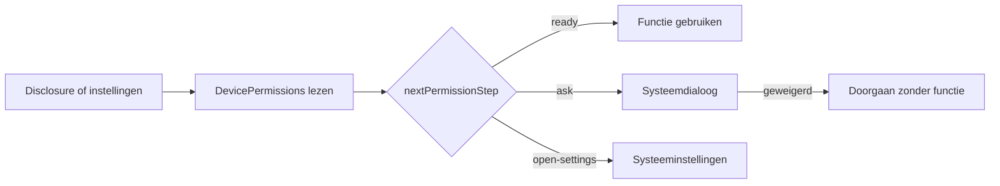

# Toestemmingen

> Gecontroleerd op: `c1506088` (2026-10-07)
> Bronnen: `src/domeinen/settings/`, `src/domeinen/location/`, `src/domeinen/photos/components/photo-camera.tsx`, `src/domeinen/notifications/`, `src/bootstrap/native.ts`, `src/domeinen/onboarding/screens/onboarding-gate-screen.tsx`
> Zie ook: [ADR 0016](../decisions/0016-diensten-en-locatie.md), [ADR 0017](../decisions/0017-push-notificaties.md), [ADR 0020](../decisions/0020-fotos.md), [ADR 0021](../decisions/0021-instellingen-en-toestemmingen.md), [flows](../functioneel/flows.md#7-instellingen-werkt)

## Waarvoor

De app gebruikt voorgrondlocatie voor de 500-metercontrole en fotolocatie, meldingen voor nieuwe
opdrachten en de camera voor dienstfoto's. Een weigering blokkeert de app niet volledig: de berger
krijgt waar mogelijk een bevestiging of kan de toestemming later via de systeeminstellingen
herstellen.

## Hoe het werkt

Na inloggen stuurt de onboarding-gate naar `/permission-disclosure` zolang
`nextDisclosureStep` nog een stap heeft. De wizard loopt meldingen → locatie → camera. “Toestaan”
vraagt via `DevicePermissions`; “Later” markeert de stap gezien zonder te vragen. Al verleende
toestemmingen worden overgeslagen. Voortgang staat in `settings.permissionDisclosure.seen` en wordt
bij uitloggen gewist (open vraag 12), zodat de wizard na de volgende login opnieuw verschijnt.

`PermissionsScreen` (via Instellingen → Toestemmingen) leest via `useDevicePermissions` de
OS-status van locatie, meldingen en camera opnieuw zodra het scherm focus krijgt. De pure functie
`nextPermissionStep` bepaalt daarna of niets nodig is, de systeemdialoog nog gevraagd kan worden,
of alleen de systeeminstellingen overblijven.

De concrete ingangen verschillen per functie:

| Functie    | Scherm, hook of service                                                         | Platformflow                                                                                                                                                                    |
| ---------- | ------------------------------------------------------------------------------- | ------------------------------------------------------------------------------------------------------------------------------------------------------------------------------- |
| Disclosure | `PermissionDisclosureScreen` na inloggen                                        | Vraagt via `createExpoDevicePermissions`; markeert gezien in `settings.permissionDisclosure.seen`.                                                                              |
| Locatie    | `LocationStatusButton` en `ServiceActionsService` gebruiken `LocationReader`    | `createExpoLocationReader` vraagt alleen voorgrondlocatie zolang de status nog `undetermined` is (vangnet na “Later”) en leest daarna een eenmalige hoge-nauwkeurigheidpositie. |
| Camera     | `PhotosScreen` gebruikt `useCameraPermissions` wanneer de berger een foto maakt | Opnieuw vragen zolang dat mag; anders `Linking.openSettings()`.                                                                                                                 |
| Push       | `PushRuntime.start()` na aangemelde start of na disclosure-accept               | `createFirebasePushGateway.permission()` leest alleen; de dialoog komt uit `DevicePermissions` (Notifee). Token alleen bij toestemming.                                         |
| Herstel    | `PermissionsScreen` toont alle drie statussen                                   | `createExpoDevicePermissions` leest, vraagt en opent de systeeminstellingen via één poort.                                                                                      |

## Beweringen

| ID      | Bewering                                                                                                                                                | Code                                                                                                                                | Test                                                                                                        |
| ------- | ------------------------------------------------------------------------------------------------------------------------------------------------------- | ----------------------------------------------------------------------------------------------------------------------------------- | ----------------------------------------------------------------------------------------------------------- |
| PERM-01 | Als een toestemming al is verleend, biedt de app geen nieuwe toestemmingsactie aan.                                                                     | `src/domeinen/settings/domain/permission-step.ts`                                                                                   | `src/domeinen/settings/domain/permission-step.test.ts`                                                      |
| PERM-02 | Als de systeemdialoog nog kan verschijnen, biedt de app aan de toestemming te vragen.                                                                   | `src/domeinen/settings/domain/permission-step.ts`                                                                                   | `src/domeinen/settings/domain/permission-step.test.ts`                                                      |
| PERM-03 | Als de systeemdialoog niet meer kan verschijnen, verwijst de app naar de systeeminstellingen.                                                           | `src/domeinen/settings/domain/permission-step.ts`                                                                                   | `src/domeinen/settings/domain/permission-step.test.ts`                                                      |
| PERM-04 | Als het toestemmingenscherm focus krijgt, leest het achtereenvolgens de actuele status van locatie, meldingen en camera.                                | `src/domeinen/settings/screens/permissions-screen.tsx`                                                                              | —                                                                                                           |
| PERM-05 | Als voorgrondlocatie nog niet is gevraagd, vraagt de locatielezer die toestemming; bij weigering, een fout of geen fix levert hij geen geldige positie. | `src/domeinen/location/platform/rn/expo-location-reader.ts`                                                                         | —                                                                                                           |
| PERM-06 | Als bij het accepteren van een dienst geen huidige positie beschikbaar is, vraagt de app of de berger toch wil doorgaan.                                | `src/domeinen/location/domain/proximity.ts`, `src/domeinen/allocations/hooks/use-accept-service.ts`                                 | `src/domeinen/location/domain/proximity.test.ts`                                                            |
| PERM-07 | Als locatie is toegestaan maar geen fix beschikbaar is, blijft de GPS-knop groen; zonder toestemming is hij rood.                                       | `src/domeinen/location/domain/gps-status.ts`                                                                                        | `src/domeinen/location/domain/gps-status.test.ts`                                                           |
| PERM-08 | Als de camera nog gevraagd mag worden, vraagt het fotoscherm toestemming bij het maken van een foto; anders opent het de systeeminstellingen.           | `src/domeinen/photos/components/photo-camera.tsx`                                                                                   | —                                                                                                           |
| PERM-09 | Als pushtoestemming wordt geweigerd, start de app verder en registreert hij geen pushtoken.                                                             | `src/domeinen/notifications/service/push-runtime.ts`                                                                                | `src/domeinen/notifications/service/push-runtime.test.ts`                                                   |
| PERM-10 | Als push is toegestaan maar geen bruikbaar token beschikbaar is, slaat de app backendregistratie over.                                                  | `src/domeinen/notifications/domain/registration.ts`                                                                                 | `src/domeinen/notifications/domain/registration.test.ts`                                                    |
| PERM-11 | Na inloggen toont de gate de disclosure-wizard zolang er nog een niet-gezien en niet-verleend soort is (meldingen → locatie → camera).                  | `src/domeinen/settings/domain/permission-disclosure.ts`, `src/domeinen/onboarding/screens/onboarding-gate-screen.tsx`               | `src/domeinen/settings/domain/permission-disclosure.test.ts`                                                |
| PERM-12 | “Later” of “Toestaan” markeert de stap gezien onder `settings.permissionDisclosure.seen`; uitloggen wist die voortgang.                                 | `src/domeinen/settings/service/permission-disclosure-preference.ts`, `src/bootstrap/container.ts`                                   | `src/domeinen/settings/service/permission-disclosure-preference.test.ts`, `src/bootstrap/container.test.ts` |
| PERM-13 | `PushGateway.permission()` vraagt geen OS-dialoog; na accept van meldingen in de disclosure start `pushRuntime` opnieuw voor tokenregistratie.          | `src/domeinen/notifications/platform/rn/firebase-push-gateway.ts`, `src/domeinen/settings/screens/permission-disclosure-screen.tsx` | `src/domeinen/notifications/service/push-runtime.test.ts`                                                   |

## Randgevallen en bewuste keuzes

- De app vraagt alleen voorgrondlocatie; er is geen continue tracking of achtergrondlocatie. De
  GPS-tegel kan na “Later” bij eerste focus van het opdrachtenoverzicht alsnog de systeemdialoog
  tonen via `LocationReader.getCurrent()`.
- Disclosure en instellingen delen `DevicePermissions`. Het fotoscherm gebruikt nog de
  Expo-camerahook; push leest Firebase-status maar vraagt via Notifee/`DevicePermissions`.
- Een geweigerde locatie wordt voor de 500-metercontrole hetzelfde behandeld als een ontbrekende
  GPS-fix. De drie bevestigingsredenen blijven daardoor: geen huidige positie, geen doelpositie en
  500 meter of verder weg.
- De systeemteksten voor permissies in `app.config.ts` zijn Nederlands en vallen buiten de in-app
  i18n-resources.
- Push is nog niet met echte EAS-credentials, een fysiek toestel en een backendbericht bewezen; zie
  [ADR 0017](../decisions/0017-push-notificaties.md#gevolgen).

## Open vragen

- [Open vraag 14](../functioneel/open-vragen.md): live positie naar
  `POST /api/incidents/{id}/registerlocation` is niet gebouwd.
- [Open vraag 21](../functioneel/open-vragen.md): de backend moet het Expo-pushtoken via de
  Expo-pushdienst gebruiken.
- [Open vraag 31](../functioneel/open-vragen.md): disclosure-wizard na inloggen is besloten.
