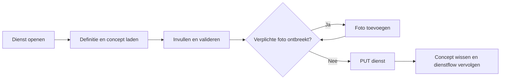
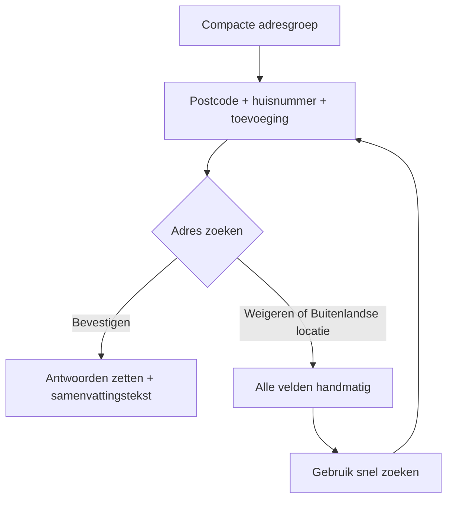
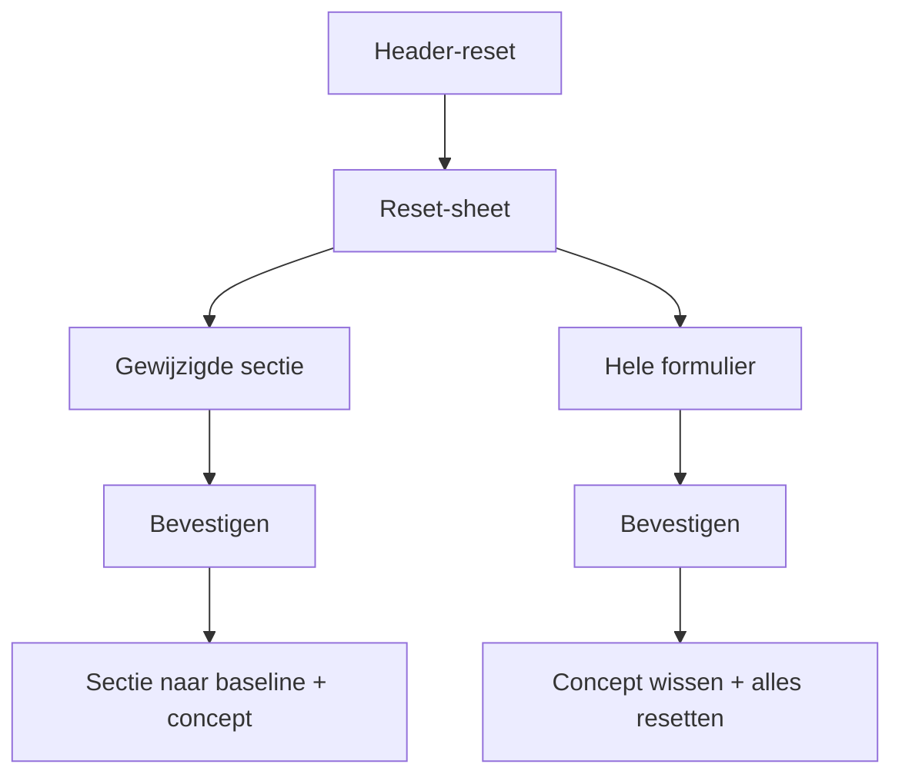

# Verwerkingsformulier

> Gecontroleerd op: `c0127855` (2026-10-16; finishmodus)
> Bronnen: `src/domeinen/service-form/`, `src/domeinen/signatures/`, `src/shared/ui/bottom-sheet.tsx`, `src/shared/platform/rn/expo-multipart-upload-files.ts`, `src/bootstrap/container.ts`, `src/bootstrap/native.ts`, `src/bootstrap/providers.tsx`, `src/app/(app)/allocations/[id]/services/[serviceId]/form.tsx`
> Zie ook: [ADR 0023](../decisions/0023-serviceform.md), [ADR 0024](../decisions/0024-feedback-en-dialogen.md), [ADR 0026](../decisions/0026-adresgroepen-in-serviceform.md), [ADR 0027](../decisions/0027-kentekengroepen-in-serviceform.md), [flows](../functioneel/flows.md), [plan serviceformulier](../functioneel/plan-serviceformulier.md), [spec snellere adressen](../specs/speed-up-address-locations-in-form.md)

## Waarvoor

Het verwerkingsformulier laat de berger de gegevens van een actieve dienst aanvullen en controleren.
Het formulier komt uit gesynchroniseerde CRM-definities, past zich aan de fase en taal aan en bewaart
gewijzigde invoer als concept wanneer de berger het scherm verlaat.

## Hoe het werkt

De route zoekt eerst de opdracht en dienst. Daarna zoekt de service op inhoud naar een passende
`dataDefinition` in de gesynchroniseerde referentiedata. In een ontwikkelbuild (`__DEV__`) en in de
internal-build ([ADR 0029](../decisions/0029-experimentdefinities-in-internal-build.md)) komen die
definities uit `docs/diensten/experiment` en blijft de lokale sync ongelezen voor het formulierschema;
keuzelijsten komen wel uit de referentiedata. Het schema bepaalt de fase, secties,
zichtbaarheid, veldsoorten, keuzelijsten en validatie; bestaande CRM-waarden en een eventueel lokaal
concept vullen het formulier. Tijdens het scrollen blijft de kop van de huidige sectie bovenaan
staan, tot de volgende sectiekop die plek inneemt. Alleen zichtbare, bewerkbare en ingevulde waarden komen in de
verzendpayload.

Een ongeldige verzending toont alle veldfouten en springt naar het eerste ongeldige veld. Een
verzendfout houdt het formulier open en biedt opnieuw proberen; formulierverzending gaat bewust niet
via de outbox. Preview toont dezelfde gegevens alleen-lezen en heeft geen concept- of verzendactie.

Een adresanker met volledige versie-1-metadata groepeert de bestaande losse CRM-velden. Een
`address_group` in de definitie maakt een compacte adresgroep: standaard alleen postcode, huisnummer
en toevoeging, met knop **Adres zoeken**. Straat en plaats zijn optioneel in de metadata (bijvoorbeeld
een taxi-route). Gekoppelde straat, plaats en land blijven als invoervelden verborgen. Na bevestigen
van het gevonden adres worden die antwoorden wél gezet (inclusief land `NL` wanneer het landveld
gekoppeld is) en toont de app een leesbare adresregel. Via **Buitenlandse locatie** wisselt de
berger naar alle gekoppelde velden zonder postcode-lookup; **Gebruik snel zoeken** keert terug naar
de compacte lookup en wist de afgeleide adresvelden. Zonder `address_group` blijft de oudere
adresgroep-UI: postcode-lookup, Places-zoeken of handmatige detailvelden volgens de flags. Een
onbekende versie of incomplete mapping blijft als losse velden werken. Een selectveld met
`autoform.quickPicks` toont de eerste N opties als chips (dichtstbijzijnde eerst bij
afstandssortering) plus **Meer opties…** voor de gewone keuzelijst.

Een `license_plate_group` op het aangetroffen-kentekenveld bundelt gemeld/aangetroffen kenteken,
land, RDW-tekst en CRM-merk/type tot één compacte kaart. Met een bekend gemeld kenteken bevestigt
de berger met **Dit klopt** of kiest **Ander kenteken**. Een Nederlands patroon start de RDW-lookup;
na bevestiging toont de app één samenvattingsregel en vult CRM-land/merk/type én de RDW-tekstvelden
(merk, type, kleur) in de antwoorden. Handmatige merk/type verschijnen alleen bij een mislukte
match, "Niet correct?" of een buitenlands kenteken. Past het ingetikte kenteken niet (meer) bij een
NL-sidecode (buitenlands, leger, …), vindt RDW niets, of kiest de berger buitenlands, dan toont de
app een neutrale kentekenplaat (zelfde vorm, blauwe strook zonder vlag, geen geel) en worden land,
merk en type runtime-verplicht; type blijft afhankelijk van het gekozen merk. Zonder
`license_plate_group` blijft de vaste kentekengroep als vangnet. Zie
[ADR 0027](../decisions/0027-kentekengroepen-in-serviceform.md).

`Volgende` volgt de werkelijk gemeten schermvolgorde en activeert het direct volgende zichtbare
bewerkbare veld.

De header-reset (↻) opent een bottom sheet met alleen zichtbare secties die ten opzichte van de
CRM-beginwaarden gewijzigd zijn, plus onderaan **Hele formulier opnieuw**. Na keuze volgt een
bevestiging. Een sectiereset herstelt die velden (en legt afhankelijke velden buiten de sectie leeg),
werkt het concept bij of wist het als er niets meer vuil is. Hele-formulier-reset wist het concept
en herstelt alle antwoorden. Compacte adres- en kentekengroepen remounten na een reset zodat hun
lokale UI-state niet blijft hangen. De sheet past zich aan de inhoud (max. half scherm), blijft
onder de top-notch en houdt onderaan ruimte voor de home indicator.

## Beweringen

| ID      | Bewering                                                                                                                                                                                                                                                                                               | Code                                                                                                                                                                                                                                                                                                                          | Test                                                                                                                                                                                          |
| ------- | ------------------------------------------------------------------------------------------------------------------------------------------------------------------------------------------------------------------------------------------------------------------------------------------------------ | ----------------------------------------------------------------------------------------------------------------------------------------------------------------------------------------------------------------------------------------------------------------------------------------------------------------------------- | --------------------------------------------------------------------------------------------------------------------------------------------------------------------------------------------- |
| FORM-01 | Een formulierdefinitie wordt op `servicecode` in alle gesynchroniseerde entiteiten gezocht, niet onder een vaste entiteitnaam.                                                                                                                                                                         | `src/domeinen/service-form/service/service-form-service.ts`                                                                                                                                                                                                                                                                   | `src/domeinen/service-form/service/service-form-service.test.ts`                                                                                                                              |
| FORM-02 | Zonder gebundelde catalogus wist opnieuw proberen de syncvoortgang, synchroniseert alles en zoekt daarna opnieuw.                                                                                                                                                                                      | `src/domeinen/service-form/service/service-form-service.ts`                                                                                                                                                                                                                                                                   | `src/domeinen/service-form/service/service-form-service.test.ts`                                                                                                                              |
| FORM-03 | Status `HULPVERLENING_AKKOORD` kiest fase 2; iedere andere status kiest fase 1.                                                                                                                                                                                                                        | `src/domeinen/service-form/domain/form-context.ts`                                                                                                                                                                                                                                                                            | `src/domeinen/service-form/domain/form-context.test.ts`                                                                                                                                       |
| FORM-04 | Engelse formulieren gebruiken labelcode 1044 en alle andere talen labelcode 1043.                                                                                                                                                                                                                      | `src/domeinen/service-form/domain/form-context.ts`                                                                                                                                                                                                                                                                            | `src/domeinen/service-form/domain/form-context.test.ts`                                                                                                                                       |
| FORM-05 | Het scherm onderscheidt laden, opdracht of dienst niet gevonden, definitie ontbreekt, leesfout en gereed.                                                                                                                                                                                              | `src/domeinen/service-form/domain/load-state.ts`                                                                                                                                                                                                                                                                              | `src/domeinen/service-form/domain/load-state.test.ts`                                                                                                                                         |
| FORM-06 | Een definitie kiest de gevraagde fase en taal met een deterministische terugval als die variant ontbreekt.                                                                                                                                                                                             | `src/domeinen/service-form/domain/schema.ts`                                                                                                                                                                                                                                                                                  | `src/domeinen/service-form/domain/schema.test.ts`                                                                                                                                             |
| FORM-07 | Een beschadigd veld wordt overgeslagen en als diagnostiek vastgelegd in plaats van het hele formulier te blokkeren.                                                                                                                                                                                    | `src/domeinen/service-form/domain/schema.ts`                                                                                                                                                                                                                                                                                  | `src/domeinen/service-form/domain/schema.test.ts`                                                                                                                                             |
| FORM-08 | Een onbekend veldtype krijgt een zichtbare niet-ondersteundtoestand in plaats van een gegokte invoer.                                                                                                                                                                                                  | `src/domeinen/service-form/domain/field-kind.ts`                                                                                                                                                                                                                                                                              | `src/domeinen/service-form/domain/field-kind.test.ts`                                                                                                                                         |
| FORM-09 | Een komma in een decimaalveld wordt als punt opgeslagen.                                                                                                                                                                                                                                               | `src/domeinen/service-form/domain/field-kind.ts`                                                                                                                                                                                                                                                                              | `src/domeinen/service-form/domain/field-kind.test.ts`                                                                                                                                         |
| FORM-10 | Een afhankelijk veld is alleen zichtbaar als zijn voorwaarde én de volledige keten van bovenliggende voorwaarden klopt.                                                                                                                                                                                | `src/domeinen/service-form/domain/conditions.ts`                                                                                                                                                                                                                                                                              | `src/domeinen/service-form/domain/conditions.test.ts`                                                                                                                                         |
| FORM-11 | Alleen zichtbare velden worden gevalideerd; alleen-lezen velden worden niet verplicht gesteld.                                                                                                                                                                                                         | `src/domeinen/service-form/domain/validation.ts`                                                                                                                                                                                                                                                                              | `src/domeinen/service-form/domain/validation.test.ts`                                                                                                                                         |
| FORM-12 | Na een mislukte validatie opent het scherm zo nodig de sectie en scrollt het naar het eerste ongeldige veld.                                                                                                                                                                                           | `src/domeinen/service-form/screens/service-form-screen.tsx`                                                                                                                                                                                                                                                                   | —                                                                                                                                                                                             |
| FORM-13 | Depotkeuzes worden op afstand gesorteerd wanneer het schema daarom vraagt en een bruikbare locatie beschikbaar is.                                                                                                                                                                                     | `src/domeinen/service-form/domain/select-options.ts`                                                                                                                                                                                                                                                                          | `src/domeinen/service-form/domain/select-options.test.ts`                                                                                                                                     |
| FORM-14 | Voertuigtypen blijven leeg totdat een merk is gekozen en worden daarna op dat merk gefilterd.                                                                                                                                                                                                          | `src/domeinen/service-form/domain/select-options.ts`                                                                                                                                                                                                                                                                          | `src/domeinen/service-form/domain/select-options.test.ts`                                                                                                                                     |
| FORM-15 | Een gewijzigd formulier wordt bij verlaten per opdracht en dienst als concept bewaard en bij heropenen hersteld.                                                                                                                                                                                       | `src/domeinen/service-form/screens/service-form-screen.tsx`                                                                                                                                                                                                                                                                   | —                                                                                                                                                                                             |
| FORM-16 | Hele-formulier-reset wist het concept van de geopende opdracht en dienst en herstelt alle antwoorden naar de CRM-beginwaarden.                                                                                                                                                                         | `src/domeinen/service-form/screens/service-form-screen.tsx`, `src/domeinen/service-form/store/create-service-form-store.ts`, `src/domeinen/service-form/service/draft-storage.ts`                                                                                                                                             | `src/domeinen/service-form/store/create-service-form-store.test.ts`, `src/domeinen/service-form/service/draft-storage.test.ts`                                                                |
| FORM-17 | Preview laadt geen concept, staat geen wijzigingen toe en toont geen verzendactie.                                                                                                                                                                                                                     | `src/domeinen/service-form/screens/service-form-screen.tsx`                                                                                                                                                                                                                                                                   | —                                                                                                                                                                                             |
| FORM-18 | Verzenden vereist alle verplichte posities als bevestigde lokale of CRM-foto; iedere lokale dienstfoto, ook een extra foto, moet `sent` zijn. `draft`, `queued` en `failed` blokkeren verzending.                                                                                                      | `src/domeinen/service-form/screens/service-form-screen.tsx`, `src/domeinen/service-form/domain/photos-confirm.ts`                                                                                                                                                                                                             | `src/domeinen/service-form/domain/photos-confirm.test.ts`                                                                                                                                     |
| FORM-19 | De verzendpayload sluit verborgen, alleen-lezen, lege en handtekeningvelden uit.                                                                                                                                                                                                                       | `src/domeinen/service-form/domain/submission.ts`                                                                                                                                                                                                                                                                              | `src/domeinen/service-form/domain/submission.test.ts`                                                                                                                                         |
| FORM-20 | Fase 1 verzendt status `HULPVERLENING_AKKOORD` en fase 2 status `HULPVERLENING_AFGEROND`.                                                                                                                                                                                                              | `src/domeinen/service-form/domain/submission.ts`                                                                                                                                                                                                                                                                              | `src/domeinen/service-form/domain/submission.test.ts`                                                                                                                                         |
| FORM-21 | Het formulier wordt met `PUT /api/services/{id}` verstuurd.                                                                                                                                                                                                                                            | `src/domeinen/service-form/api/service-form-api.ts`                                                                                                                                                                                                                                                                           | `src/domeinen/service-form/api/service-form-api.test.ts`                                                                                                                                      |
| FORM-22 | Als de dienststatus inmiddels geen formulierverzending meer toestaat, wordt niets verstuurd en verlaat het scherm de flow.                                                                                                                                                                             | `src/domeinen/service-form/service/service-form-service.ts`                                                                                                                                                                                                                                                                   | `src/domeinen/service-form/service/service-form-service.test.ts`                                                                                                                              |
| FORM-23 | Een tijdelijke verzendfout houdt het formulier open en biedt een retryactie zonder de mutatie in de outbox te zetten.                                                                                                                                                                                  | `src/domeinen/service-form/screens/service-form-screen.tsx`                                                                                                                                                                                                                                                                   | —                                                                                                                                                                                             |
| FORM-24 | Na een geslaagde verzending wordt het concept gewist en gaat dezelfde verwerkings-exitflow verder.                                                                                                                                                                                                     | `src/domeinen/service-form/screens/service-form-screen.tsx`                                                                                                                                                                                                                                                                   | —                                                                                                                                                                                             |
| FORM-25 | Bij uitloggen worden alle formulierconcepten gewist.                                                                                                                                                                                                                                                   | `src/bootstrap/container.ts`                                                                                                                                                                                                                                                                                                  | `src/domeinen/service-form/service/draft-storage.test.ts`, `src/bootstrap/container.test.ts`                                                                                                  |
| FORM-26 | Alleen een complete versie-1-adresmapping groepeert de losse velden; onbekende of incomplete metadata laat ze los staan.                                                                                                                                                                               | `src/domeinen/service-form/domain/address-entry.ts`                                                                                                                                                                                                                                                                           | `src/domeinen/service-form/domain/address-entry.test.ts`                                                                                                                                      |
| FORM-27 | Postcode-lookup accepteert de geformatteerde en legacy JSON-stringresponse en levert hetzelfde gestructureerde adres op.                                                                                                                                                                               | `src/domeinen/service-form/domain/postal-address-lookup.ts`, `src/bootstrap/postal-address-lookup.ts`                                                                                                                                                                                                                         | `src/domeinen/service-form/domain/postal-address-lookup.test.ts`, `src/bootstrap/postal-address-lookup.test.ts`                                                                               |
| FORM-28 | Een wijziging aan postcode, huisnummer of toevoeging wist alleen de afgeleide adresvelden en laat andere antwoorden staan.                                                                                                                                                                             | `src/domeinen/service-form/domain/address-entry.ts`                                                                                                                                                                                                                                                                           | `src/domeinen/service-form/domain/address-entry.test.ts`                                                                                                                                      |
| FORM-29 | Bij een niet-compacte adresgroep worden verborgen detailvelden na een lookupfout alleen zichtbaar als de definitie handmatige invoer toestaat.                                                                                                                                                         | `src/domeinen/service-form/domain/address-entry.ts`                                                                                                                                                                                                                                                                           | `src/domeinen/service-form/domain/address-entry.test.ts`                                                                                                                                      |
| FORM-30 | `Volgende` kiest het direct volgende zichtbare bewerkbare veld in schermvolgorde, ongeacht verplicht of ingevuld.                                                                                                                                                                                      | `src/domeinen/service-form/domain/selectors.ts`, `src/domeinen/service-form/screens/service-form-screen.tsx`                                                                                                                                                                                                                  | `src/domeinen/service-form/domain/selectors.test.ts`                                                                                                                                          |
| FORM-31 | Een ingevulde handtekening wordt voor de service-update naar `POST /api/signatures` verstuurd; zonder handtekening slaat het formulier deze stap over.                                                                                                                                                 | `src/domeinen/service-form/screens/service-form-screen.tsx`, `src/domeinen/signatures/api/signatures-api.ts`                                                                                                                                                                                                                  | —                                                                                                                                                                                             |
| FORM-32 | De handtekeningupload gebruikt multipart met `incidentId`, `serviceId`, `fileExtension`, `name`, `email`, `phase`, `signatureType` en een JPEG-bestand in veld `file`.                                                                                                                                 | `src/domeinen/signatures/api/signatures-api.ts`                                                                                                                                                                                                                                                                               | `src/domeinen/signatures/api/signatures-api.test.ts`, `src/bootstrap/container.test.ts`                                                                                                       |
| FORM-33 | De app decodeert de JPEG-base64 naar bytes, schrijft die als tijdelijk Expo-bestand in de cache en voegt dat `File`-object rechtstreeks aan de multipartbody toe.                                                                                                                                      | `src/domeinen/signatures/domain/image-bytes.ts`, `src/shared/platform/rn/expo-multipart-upload-files.ts`                                                                                                                                                                                                                      | `src/domeinen/signatures/api/signatures-api.test.ts`                                                                                                                                          |
| FORM-34 | De tijdelijke JPEG blijft beschikbaar totdat de upload klaar is, ook wanneer de HTTP-client een token na een 401 ververst, en wordt daarna altijd opgeruimd.                                                                                                                                           | `src/domeinen/signatures/api/signatures-api.ts`, `src/shared/api/http-client.ts`                                                                                                                                                                                                                                              | `src/domeinen/signatures/api/signatures-api.test.ts`, `src/bootstrap/container.test.ts`                                                                                                       |
| FORM-35 | Een HTTP 409 bij de handtekeningupload geldt als geslaagd, zodat een veilige herhaling na een verloren response niet de formulierflow blokkeert.                                                                                                                                                       | `src/domeinen/signatures/api/signatures-api.ts`                                                                                                                                                                                                                                                                               | `src/domeinen/signatures/api/signatures-api.test.ts`                                                                                                                                          |
| FORM-36 | De native container injecteert Expo Fetch in de centrale HTTP-client; handtekeningen gebruiken daarmee dezelfde token-, time-out- en foutafhandeling als overige API-aanroepen.                                                                                                                        | `src/bootstrap/native.ts`, `src/bootstrap/container.ts`, `src/shared/api/http-client.ts`                                                                                                                                                                                                                                      | `src/bootstrap/container.test.ts`, `src/shared/api/http-client.test.ts`                                                                                                                       |
| FORM-37 | Een `address_group` in de definitie maakt een compacte adresgroep; zonder die metadata blijft de niet-compacte adresgroep-UI.                                                                                                                                                                          | `src/domeinen/service-form/domain/address-entry.ts`                                                                                                                                                                                                                                                                           | `src/domeinen/service-form/domain/address-entry.test.ts`                                                                                                                                      |
| FORM-38 | In een compacte adresgroep blijven straat, plaats en land als invoervelden verborgen totdat de berger buitenlandse of handmatige invoer opent.                                                                                                                                                         | `src/domeinen/service-form/domain/address-entry.ts`, `src/domeinen/service-form/components/service-form-address-group.tsx`                                                                                                                                                                                                    | `src/domeinen/service-form/domain/address-entry.test.ts`                                                                                                                                      |
| FORM-39 | Compacte postcode-lookup start pas na de knop Adres zoeken; een geslaagde bevestiging zet de adresantwoorden en toont een samenvattingstekst onder die knop.                                                                                                                                           | `src/domeinen/service-form/domain/address-entry.ts`, `src/domeinen/service-form/components/service-form-address-group.tsx`                                                                                                                                                                                                    | `src/domeinen/service-form/domain/address-entry.test.ts`                                                                                                                                      |
| FORM-40 | Een postcode-lookupresultaat draagt landcode `NL`; bij toepassen wordt die naar het landveld gemapt via `dn_country` en in de samenvattingstekst opgenomen.                                                                                                                                            | `src/domeinen/service-form/domain/postal-address-lookup.ts`, `src/domeinen/service-form/domain/address-place-selection.ts`                                                                                                                                                                                                    | `src/domeinen/service-form/domain/postal-address-lookup.test.ts`, `src/domeinen/service-form/domain/address-place-selection.test.ts`                                                          |
| FORM-41 | De link Buitenlandse locatie toont alle adresvelden onder elkaar en schakelt de postcode-lookup uit.                                                                                                                                                                                                   | `src/domeinen/service-form/domain/address-entry.ts`, `src/domeinen/service-form/components/service-form-address-group.tsx`                                                                                                                                                                                                    | `src/domeinen/service-form/domain/address-entry.test.ts`                                                                                                                                      |
| FORM-42 | De link Gebruik snel zoeken verlaat de handmatige modus, wist afgeleide adresantwoorden en toont opnieuw de compacte lookup.                                                                                                                                                                           | `src/domeinen/service-form/domain/address-entry.ts`, `src/domeinen/service-form/components/service-form-address-group.tsx`                                                                                                                                                                                                    | `src/domeinen/service-form/domain/address-entry.test.ts`                                                                                                                                      |
| FORM-43 | Een compacte adresgroep kan een leesbare adresregel opbouwen uit de gevulde componenten (straat, huisnummer, postcode, plaats, land).                                                                                                                                                                  | `src/domeinen/service-form/domain/address-entry.ts`                                                                                                                                                                                                                                                                           | `src/domeinen/service-form/domain/address-entry.test.ts`                                                                                                                                      |
| FORM-44 | In een ontwikkelbuild en de internal-build komen formulierdefinities uit `docs/diensten/experiment`. In een ontwikkelbuild lezen twee tikken op de voortgangscirkel die map opnieuw via de Metro-devserver, zonder de referentiedata te wissen of te synchroniseren. Keuzelijsten blijven uit de sync. | `src/bootstrap/container.ts`, `src/bootstrap/dev/experiment-service-definitions.ts`, `src/bootstrap/dev/load-experiment-service-definitions.ts`, `src/domeinen/service-form/service/service-form-service.ts`, `src/domeinen/service-form/components/service-form-header.tsx`                                                  | `src/bootstrap/dev/experiment-service-definitions.test.ts`, `src/bootstrap/dev/load-experiment-service-definitions.test.ts`, `src/domeinen/service-form/service/service-form-service.test.ts` |
| FORM-45 | De sectiekop (voortgangscirkel, titel en chevron) blijft bovenaan de scroll staan zolang die sectie in beeld is, tot de volgende sectiekop die plek inneemt.                                                                                                                                           | `src/domeinen/service-form/screens/service-form-screen.tsx`, `src/domeinen/service-form/components/service-form-section.tsx`                                                                                                                                                                                                  | `src/domeinen/service-form/domain/section-scroll.test.ts`                                                                                                                                     |
| FORM-46 | Een `license_plate_group` in de definitie maakt een compacte kentekengroep; zonder die metadata blijft de vaste kentekengroep als vangnet.                                                                                                                                                             | `src/domeinen/service-form/domain/license-plate-entry.ts`, `src/domeinen/service-form/screens/service-form-screen.tsx`                                                                                                                                                                                                        | `src/domeinen/service-form/domain/license-plate-entry.test.ts`                                                                                                                                |
| FORM-47 | Bij een bekend gemeld kenteken bevestigt de berger met Dit klopt (neemt over) of Ander kenteken (leeg invoerveld); het aangetroffen kenteken is leidend voor RDW.                                                                                                                                      | `src/domeinen/service-form/domain/license-plate-entry.ts`, `src/domeinen/service-form/components/service-form-license-plate-group.tsx`                                                                                                                                                                                        | `src/domeinen/service-form/domain/license-plate-entry.test.ts`                                                                                                                                |
| FORM-48 | Een geldig NL-kenteken start de RDW-lookup; bij een eenduidige match toont de app een samenvatting en vult land, CRM-merk/type én RDW-tekstvelden (merk/type/kleur) in de antwoorden; handmatige merk/type verschijnen alleen bij een gat, mislukte lookup of Niet correct.                            | `src/domeinen/service-form/domain/license-plate-entry.ts`, `src/domeinen/service-form/domain/rdw-autofill.ts`, `src/domeinen/service-form/components/service-form-license-plate-group.tsx`                                                                                                                                    | `src/domeinen/service-form/domain/license-plate-entry.test.ts`, `src/domeinen/service-form/domain/rdw-autofill.test.ts`                                                                       |
| FORM-49 | Een `address_group` met alleen postcode en huisnummer is geldig; de samenvatting valt terug op die twee rollen en schrijft geen straat of plaats weg.                                                                                                                                                  | `src/domeinen/service-form/domain/address-entry.ts`                                                                                                                                                                                                                                                                           | `src/domeinen/service-form/domain/address-entry.test.ts`                                                                                                                                      |
| FORM-50 | Een selectveld met `autoform.quickPicks: N` toont de eerste N opties als chips (na de bestaande sortering) plus Meer opties…; zonder `quickPicks` blijft de gewone keuzelijst.                                                                                                                         | `src/domeinen/service-form/domain/select-options.ts`, `src/domeinen/service-form/domain/schema.ts`, `src/domeinen/service-form/components/service-field-renderer.tsx`                                                                                                                                                         | `src/domeinen/service-form/domain/select-options.test.ts`, `src/bootstrap/container.test.ts`                                                                                                  |
| FORM-51 | Zodra een kenteken geen NL-sidecode kan zijn (buitenlands, leger, …), bij mislukte RDW-lookup, of in buitenlandmodus: neutrale kentekenplaat (blauwe strook zonder vlag, geen geel); land, merk en type runtime-verplicht — ook als type in de definitie optioneel is.                                 | `src/domeinen/service-form/domain/license-plate-entry.ts`, `src/domeinen/allocation-unit/domain/license-plate.ts`, `src/domeinen/service-form/hooks/use-rdw-vehicle-registration.ts`, `src/domeinen/service-form/components/service-form-license-plate-group.tsx`, `src/domeinen/allocation-unit/components/number-plate.tsx` | `src/domeinen/service-form/domain/license-plate-entry.test.ts`, `src/domeinen/allocation-unit/domain/license-plate.test.ts`, `src/domeinen/allocation-unit/components/number-plate.test.ts`   |
| FORM-52 | De header-reset toont een sheet met alleen gewijzigde zichtbare secties plus Hele formulier opnieuw; een sectiereset herstelt die velden naar de CRM-baseline (met legen van afhankelijke velden buiten de sectie) en werkt het concept bij of wist het als er niets meer vuil is.                     | `src/domeinen/service-form/domain/section-reset.ts`, `src/domeinen/service-form/store/create-service-form-store.ts`, `src/domeinen/service-form/components/service-form-reset-sheet.tsx`, `src/domeinen/service-form/screens/service-form-screen.tsx`                                                                         | `src/domeinen/service-form/domain/section-reset.test.ts`, `src/domeinen/service-form/store/create-service-form-store.test.ts`                                                                 |
| FORM-53 | De reset-sheet past zich aan de inhoud (hooguit half scherm), blijft onder de top-notch, houdt onderaan ruimte voor de home indicator en scrollt bij overflow; met open toetsenbord blijft de sheet compact (alleen omhoog geschoven).                                                                 | `src/domeinen/service-form/components/service-form-reset-sheet.tsx`, `src/shared/ui/bottom-sheet.tsx`, `src/shared/ui/sheet-keyboard.ts`                                                                                                                                                                                      | `src/shared/ui/sheet-keyboard.test.ts`                                                                                                                                                        |

| FORM-54 | De finishmodus toont Start en Afleveren read-only; Start gebruikt de volledige fase-1-snapshot wanneer die bestaat en anders actuele dienstwaarden, Afleveren gebruikt altijd actuele dienstwaarden. | `src/domeinen/service-form/screens/service-form-screen.tsx`, `src/domeinen/service-form/domain/values.ts` | `src/domeinen/service-form/screens/service-form-screen.test.ts`, `src/domeinen/service-form/domain/values.test.ts` |
| FORM-55 | Een geslaagde fase-1-submit bewaart antwoorden alleen als de definitie ook fase 2 bevat; Finish verwijdert de snapshot voordat de bestaande exitflow wordt uitgevoerd. | `src/domeinen/service-form/screens/service-form-screen.tsx`, `src/domeinen/service-form/service/draft-storage.ts` | `src/domeinen/service-form/screens/service-form-screen.test.ts`, `src/domeinen/service-form/service/draft-storage.test.ts` |

## Randgevallen en bewuste keuzes

- Verborgen antwoorden blijven lokaal in de formuliersessie staan, maar tellen niet mee voor
  voortgang, validatie of verzending.
- Een datumveld is alleen informatief: zonder CRM-waarde kan een verplicht datumveld verzending
  blokkeren; de app verzint geen datumkiezer. Zie vraag 27 hieronder.
- Handtekeningen worden apart opgebouwd; handtekeningvelden komen niet als gewone antwoorden in de
  servicepayload.
- De dienstdefinitie bepaalt de verplichte posities van de huidige fase. In fase 2 vereist daarnaast
  iedere werkelijk gemaakte fase-1-foto een afzonderlijke tegenfoto, inclusief extra's en gelijke
  posities. CRM-foto's worden naast lokale foto's opgehaald en occurrence-voor-occurrence
  samengevoegd; een netwerkfout zonder cache blokkeert verzenden.
- De oude optie 'toch versturen' bestaat niet meer. Zie
  [bekende fout 39](../functioneel/bekende-fouten-oude-app.md).
- Anders dan de oude pilot toont verzenden alle fouten en springt het naar de eerste fout. Zie
  [bekende fout 35](../functioneel/bekende-fouten-oude-app.md).
- Bestaande apps blijven adresgroepen als dezelfde losse CRM-velden verwerken; de nieuwe metadata
  verandert veldnamen en veldtypen niet. Zie [ADR 0026](../decisions/0026-adresgroepen-in-serviceform.md).
- Bestaande apps blijven kentekengroepen als dezelfde losse CRM-velden verwerken; zie
  [ADR 0027](../decisions/0027-kentekengroepen-in-serviceform.md).
- Bij een compacte groep vult een geslaagde lookup de antwoorden voor verzending, maar toont de app
  straat/plaats/land niet opnieuw als invoervelden; de berger leest het resultaat in de
  samenvattingstekst. Wijzigen gebeurt via Buitenlandse locatie of door postcode/huisnummer aan te
  passen (dat wist de afgeleide velden).
- Weigeren van het bevestigingsdialoog bij een compacte lookup opent dezelfde handmatige
  buitenlandmodus als de link Buitenlandse locatie.
- Lokale reset in een compacte adres- of kentekengroep blijft beschikbaar naast de header-reset.
- In een ontwikkelbuild toont een dev-knop op compacte groepen de geschreven CRM-antwoorden; die
  hoort niet bij productiegedrag.
- Experimentdefinitie `Berging_Test.json` is verwijderd; de experimentcatalogus leest de overige
  bestanden in `docs/diensten/experiment`.

## Open vragen

- [Vraag 25](../functioneel/open-vragen.md): er is bewust geen vaste client-sync-entiteit voor
  formulierdefinities; de app zoekt op `dataDefinition` en `servicecode`.
- [Vraag 26](../functioneel/open-vragen.md): het formulier gebruikt `PUT /api/services/{id}`.
- [Vraag 27](../functioneel/open-vragen.md): datumvelden zijn alleen-lezen; een verplicht leeg
  datumveld blokkeert daardoor verzending.
- [Vraag 28](../functioneel/open-vragen.md): decimalen worden met een punt opgeslagen; of de backend
  alle waarden zo accepteert blijft een backendvraag.
- [Vraag 37](../functioneel/open-vragen.md)–[42](../functioneel/open-vragen.md): metadata voor
  kenteken-/adres-/persoonsgroepen, depotvelden en samengevoegde afleverblokken (zie ook
  [spec snellere adressen](../specs/speed-up-address-locations-in-form.md)).
