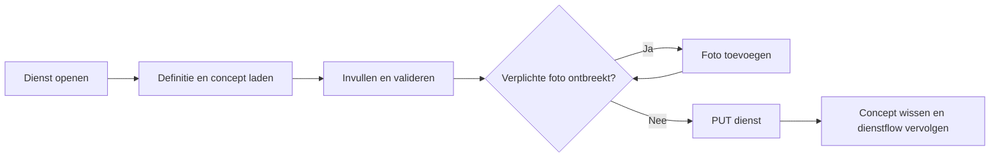

# Verwerkingsformulier

> Gecontroleerd op: `c0687077` (2026-10-07)
> Bronnen: `src/domeinen/service-form/`, `src/domeinen/signatures/`, `src/shared/platform/rn/expo-multipart-upload-files.ts`, `src/bootstrap/container.ts`, `src/bootstrap/native.ts`, `src/bootstrap/providers.tsx`, `src/app/(app)/allocations/[id]/services/[serviceId]/form.tsx`
> Zie ook: [ADR 0023](../decisions/0023-serviceform.md), [ADR 0024](../decisions/0024-feedback-en-dialogen.md), [ADR 0026](../decisions/0026-adresgroepen-in-serviceform.md), [flows](../functioneel/flows.md), [plan serviceformulier](../functioneel/plan-serviceformulier.md)

## Waarvoor

Het verwerkingsformulier laat de berger de gegevens van een actieve dienst aanvullen en controleren.
Het formulier komt uit gesynchroniseerde CRM-definities, past zich aan de fase en taal aan en bewaart
gewijzigde invoer als concept wanneer de berger het scherm verlaat.

## Hoe het werkt

De route zoekt eerst de opdracht en dienst. Daarna zoekt de service op inhoud naar een passende
`dataDefinition` in de gesynchroniseerde referentiedata. Het schema bepaalt de fase, secties,
zichtbaarheid, veldsoorten, keuzelijsten en validatie; bestaande CRM-waarden en een eventueel lokaal
concept vullen het formulier. Alleen zichtbare, bewerkbare en ingevulde waarden komen in de
verzendpayload.

Een ongeldige verzending toont alle veldfouten en springt naar het eerste ongeldige veld. Een
verzendfout houdt het formulier open en biedt opnieuw proberen; formulierverzending gaat bewust niet
via de outbox. Preview toont dezelfde gegevens alleen-lezen en heeft geen concept- of verzendactie.

Een adresanker met volledige versie-1-metadata groepeert de bestaande losse CRM-velden. De app kan
postcode en huisnummer opzoeken, een adres via Places kiezen of de losse velden handmatig tonen. Een
onbekende versie of incomplete mapping blijft als losse velden werken. `Volgende` volgt de werkelijk
gemeten schermvolgorde en activeert het direct volgende zichtbare bewerkbare veld.

## Beweringen

| ID      | Bewering                                                                                                                                                                                          | Code                                                                                                              | Test                                                                                                            |
| ------- | ------------------------------------------------------------------------------------------------------------------------------------------------------------------------------------------------- | ----------------------------------------------------------------------------------------------------------------- | --------------------------------------------------------------------------------------------------------------- |
| FORM-01 | Een formulierdefinitie wordt op `servicecode` in alle gesynchroniseerde entiteiten gezocht, niet onder een vaste entiteitnaam.                                                                    | `src/domeinen/service-form/service/service-form-service.ts`                                                       | `src/domeinen/service-form/service/service-form-service.test.ts`                                                |
| FORM-02 | Als een definitie ontbreekt, wist opnieuw proberen de syncvoortgang, synchroniseert alles en zoekt daarna opnieuw.                                                                                | `src/domeinen/service-form/service/service-form-service.ts`                                                       | `src/domeinen/service-form/service/service-form-service.test.ts`                                                |
| FORM-03 | Status `HULPVERLENING_AKKOORD` kiest fase 2; iedere andere status kiest fase 1.                                                                                                                   | `src/domeinen/service-form/domain/form-context.ts`                                                                | `src/domeinen/service-form/domain/form-context.test.ts`                                                         |
| FORM-04 | Engelse formulieren gebruiken labelcode 1044 en alle andere talen labelcode 1043.                                                                                                                 | `src/domeinen/service-form/domain/form-context.ts`                                                                | `src/domeinen/service-form/domain/form-context.test.ts`                                                         |
| FORM-05 | Het scherm onderscheidt laden, opdracht of dienst niet gevonden, definitie ontbreekt, leesfout en gereed.                                                                                         | `src/domeinen/service-form/domain/load-state.ts`                                                                  | `src/domeinen/service-form/domain/load-state.test.ts`                                                           |
| FORM-06 | Een definitie kiest de gevraagde fase en taal met een deterministische terugval als die variant ontbreekt.                                                                                        | `src/domeinen/service-form/domain/schema.ts`                                                                      | `src/domeinen/service-form/domain/schema.test.ts`                                                               |
| FORM-07 | Een beschadigd veld wordt overgeslagen en als diagnostiek vastgelegd in plaats van het hele formulier te blokkeren.                                                                               | `src/domeinen/service-form/domain/schema.ts`                                                                      | `src/domeinen/service-form/domain/schema.test.ts`                                                               |
| FORM-08 | Een onbekend veldtype krijgt een zichtbare niet-ondersteundtoestand in plaats van een gegokte invoer.                                                                                             | `src/domeinen/service-form/domain/field-kind.ts`                                                                  | `src/domeinen/service-form/domain/field-kind.test.ts`                                                           |
| FORM-09 | Een komma in een decimaalveld wordt als punt opgeslagen.                                                                                                                                          | `src/domeinen/service-form/domain/field-kind.ts`                                                                  | `src/domeinen/service-form/domain/field-kind.test.ts`                                                           |
| FORM-10 | Een afhankelijk veld is alleen zichtbaar als zijn voorwaarde én de volledige keten van bovenliggende voorwaarden klopt.                                                                           | `src/domeinen/service-form/domain/conditions.ts`                                                                  | `src/domeinen/service-form/domain/conditions.test.ts`                                                           |
| FORM-11 | Alleen zichtbare velden worden gevalideerd; alleen-lezen velden worden niet verplicht gesteld.                                                                                                    | `src/domeinen/service-form/domain/validation.ts`                                                                  | `src/domeinen/service-form/domain/validation.test.ts`                                                           |
| FORM-12 | Na een mislukte validatie opent het scherm zo nodig de sectie en scrollt het naar het eerste ongeldige veld.                                                                                      | `src/domeinen/service-form/screens/service-form-screen.tsx`                                                       | —                                                                                                               |
| FORM-13 | Depotkeuzes worden op afstand gesorteerd wanneer het schema daarom vraagt en een bruikbare locatie beschikbaar is.                                                                                | `src/domeinen/service-form/domain/select-options.ts`                                                              | `src/domeinen/service-form/domain/select-options.test.ts`                                                       |
| FORM-14 | Voertuigtypen blijven leeg totdat een merk is gekozen en worden daarna op dat merk gefilterd.                                                                                                     | `src/domeinen/service-form/domain/select-options.ts`                                                              | `src/domeinen/service-form/domain/select-options.test.ts`                                                       |
| FORM-15 | Een gewijzigd formulier wordt bij verlaten per opdracht en dienst als concept bewaard en bij heropenen hersteld.                                                                                  | `src/domeinen/service-form/screens/service-form-screen.tsx`                                                       | —                                                                                                               |
| FORM-16 | Reset wist alleen het concept van de geopende opdracht en dienst en herstelt de CRM-beginwaarden.                                                                                                 | `src/domeinen/service-form/service/draft-storage.ts`                                                              | `src/domeinen/service-form/service/draft-storage.test.ts`                                                       |
| FORM-17 | Preview laadt geen concept, staat geen wijzigingen toe en toont geen verzendactie.                                                                                                                | `src/domeinen/service-form/screens/service-form-screen.tsx`                                                       | —                                                                                                               |
| FORM-18 | Verzenden vereist alle verplichte posities als bevestigde lokale of CRM-foto; iedere lokale dienstfoto, ook een extra foto, moet `sent` zijn. `draft`, `queued` en `failed` blokkeren verzending. | `src/domeinen/service-form/screens/service-form-screen.tsx`, `src/domeinen/service-form/domain/photos-confirm.ts` | `src/domeinen/service-form/domain/photos-confirm.test.ts`                                                       |
| FORM-19 | De verzendpayload sluit verborgen, alleen-lezen, lege en handtekeningvelden uit.                                                                                                                  | `src/domeinen/service-form/domain/submission.ts`                                                                  | `src/domeinen/service-form/domain/submission.test.ts`                                                           |
| FORM-20 | Fase 1 verzendt status `HULPVERLENING_AKKOORD` en fase 2 status `HULPVERLENING_AFGEROND`.                                                                                                         | `src/domeinen/service-form/domain/submission.ts`                                                                  | `src/domeinen/service-form/domain/submission.test.ts`                                                           |
| FORM-21 | Het formulier wordt met `PUT /api/services/{id}` verstuurd.                                                                                                                                       | `src/domeinen/service-form/api/service-form-api.ts`                                                               | `src/domeinen/service-form/api/service-form-api.test.ts`                                                        |
| FORM-22 | Als de dienststatus inmiddels geen formulierverzending meer toestaat, wordt niets verstuurd en verlaat het scherm de flow.                                                                        | `src/domeinen/service-form/service/service-form-service.ts`                                                       | `src/domeinen/service-form/service/service-form-service.test.ts`                                                |
| FORM-23 | Een tijdelijke verzendfout houdt het formulier open en biedt een retryactie zonder de mutatie in de outbox te zetten.                                                                             | `src/domeinen/service-form/screens/service-form-screen.tsx`                                                       | —                                                                                                               |
| FORM-24 | Na een geslaagde verzending wordt het concept gewist en gaat dezelfde verwerkings-exitflow verder.                                                                                                | `src/domeinen/service-form/screens/service-form-screen.tsx`                                                       | —                                                                                                               |
| FORM-25 | Bij uitloggen worden alle formulierconcepten gewist.                                                                                                                                              | `src/bootstrap/container.ts`                                                                                      | `src/domeinen/service-form/service/draft-storage.test.ts`, `src/bootstrap/container.test.ts`                    |
| FORM-26 | Alleen een complete versie-1-adresmapping groepeert de losse velden; onbekende of incomplete metadata laat ze los staan.                                                                          | `src/domeinen/service-form/domain/address-entry.ts`                                                               | `src/domeinen/service-form/domain/address-entry.test.ts`                                                        |
| FORM-27 | Postcode-lookup accepteert de geformatteerde en legacy JSON-stringresponse en levert hetzelfde gestructureerde adres op.                                                                          | `src/domeinen/service-form/domain/postal-address-lookup.ts`, `src/bootstrap/postal-address-lookup.ts`             | `src/domeinen/service-form/domain/postal-address-lookup.test.ts`, `src/bootstrap/postal-address-lookup.test.ts` |
| FORM-28 | Een wijziging aan postcode, huisnummer of toevoeging wist alleen de afgeleide adresvelden en laat andere antwoorden staan.                                                                        | `src/domeinen/service-form/domain/address-entry.ts`                                                               | `src/domeinen/service-form/domain/address-entry.test.ts`                                                        |
| FORM-29 | Verborgen detailvelden worden na een lookupfout alleen zichtbaar als de definitie handmatige invoer toestaat.                                                                                     | `src/domeinen/service-form/domain/address-entry.ts`                                                               | `src/domeinen/service-form/domain/address-entry.test.ts`                                                        |
| FORM-30 | `Volgende` kiest het direct volgende zichtbare bewerkbare veld in schermvolgorde, ongeacht verplicht of ingevuld.                                                                                 | `src/domeinen/service-form/domain/selectors.ts`, `src/domeinen/service-form/screens/service-form-screen.tsx`      | `src/domeinen/service-form/domain/selectors.test.ts`                                                            |
| FORM-31 | Een ingevulde handtekening wordt voor de service-update naar `POST /api/signatures` verstuurd; zonder handtekening slaat het formulier deze stap over.                                            | `src/domeinen/service-form/screens/service-form-screen.tsx`, `src/domeinen/signatures/api/signatures-api.ts`      | —                                                                                                               |
| FORM-32 | De handtekeningupload gebruikt multipart met `incidentId`, `serviceId`, `fileExtension`, `name`, `email`, `phase`, `signatureType` en een JPEG-bestand in veld `file`.                            | `src/domeinen/signatures/api/signatures-api.ts`                                                                   | `src/domeinen/signatures/api/signatures-api.test.ts`, `src/bootstrap/container.test.ts`                         |
| FORM-33 | De app decodeert de JPEG-base64 naar bytes, schrijft die als tijdelijk Expo-bestand in de cache en voegt dat `File`-object rechtstreeks aan de multipartbody toe.                                 | `src/domeinen/signatures/domain/image-bytes.ts`, `src/shared/platform/rn/expo-multipart-upload-files.ts`          | `src/domeinen/signatures/api/signatures-api.test.ts`                                                            |
| FORM-34 | De tijdelijke JPEG blijft beschikbaar totdat de upload klaar is, ook wanneer de HTTP-client een token na een 401 ververst, en wordt daarna altijd opgeruimd.                                      | `src/domeinen/signatures/api/signatures-api.ts`, `src/shared/api/http-client.ts`                                  | `src/domeinen/signatures/api/signatures-api.test.ts`, `src/bootstrap/container.test.ts`                         |
| FORM-35 | Een HTTP 409 bij de handtekeningupload geldt als geslaagd, zodat een veilige herhaling na een verloren response niet de formulierflow blokkeert.                                                  | `src/domeinen/signatures/api/signatures-api.ts`                                                                   | `src/domeinen/signatures/api/signatures-api.test.ts`                                                            |
| FORM-36 | De native container injecteert Expo Fetch in de centrale HTTP-client; handtekeningen gebruiken daarmee dezelfde token-, time-out- en foutafhandeling als overige API-aanroepen.                   | `src/bootstrap/native.ts`, `src/bootstrap/container.ts`, `src/shared/api/http-client.ts`                          | `src/bootstrap/container.test.ts`, `src/shared/api/http-client.test.ts`                                         |

## Randgevallen en bewuste keuzes

- Verborgen antwoorden blijven lokaal in de formuliersessie staan, maar tellen niet mee voor
  voortgang, validatie of verzending.
- Een datumveld is alleen informatief: zonder CRM-waarde kan een verplicht datumveld verzending
  blokkeren; de app verzint geen datumkiezer. Zie vraag 27 hieronder.
- Handtekeningen worden apart opgebouwd; handtekeningvelden komen niet als gewone antwoorden in de
  servicepayload.
- De dienstdefinitie bepaalt de verplichte posities van de huidige fase. In fase 2 vereist daarnaast
  iedere werkelijk gemaakte fase-1-foto een afzonderlijke tegenfoto, inclusief extra's en gelijke
  posities. CRM-foto's worden naast lokale foto's opgehaald en occurrence-voor-occurrence
  samengevoegd; een netwerkfout zonder cache blokkeert verzenden.
- De oude optie 'toch versturen' bestaat niet meer. Zie
  [bekende fout 39](../functioneel/bekende-fouten-oude-app.md).
- Anders dan de oude pilot toont verzenden alle fouten en springt het naar de eerste fout. Zie
  [bekende fout 35](../functioneel/bekende-fouten-oude-app.md).
- Bestaande apps blijven adresgroepen als dezelfde losse CRM-velden verwerken; de nieuwe metadata
  verandert veldnamen en veldtypen niet. Zie [ADR 0026](../decisions/0026-adresgroepen-in-serviceform.md).

## Open vragen

- [Vraag 25](../functioneel/open-vragen.md): er is bewust geen vaste client-sync-entiteit voor
  formulierdefinities; de app zoekt op `dataDefinition` en `servicecode`.
- [Vraag 26](../functioneel/open-vragen.md): het formulier gebruikt `PUT /api/services/{id}`.
- [Vraag 27](../functioneel/open-vragen.md): datumvelden zijn alleen-lezen; een verplicht leeg
  datumveld blokkeert daardoor verzending.
- [Vraag 28](../functioneel/open-vragen.md): decimalen worden met een punt opgeslagen; of de backend
  alle waarden zo accepteert blijft een backendvraag.
